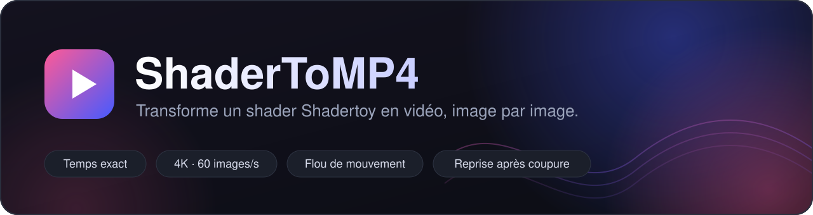
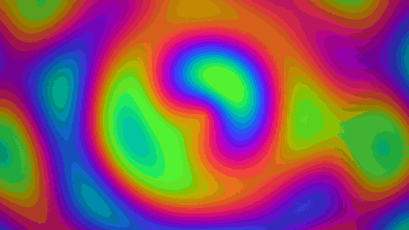
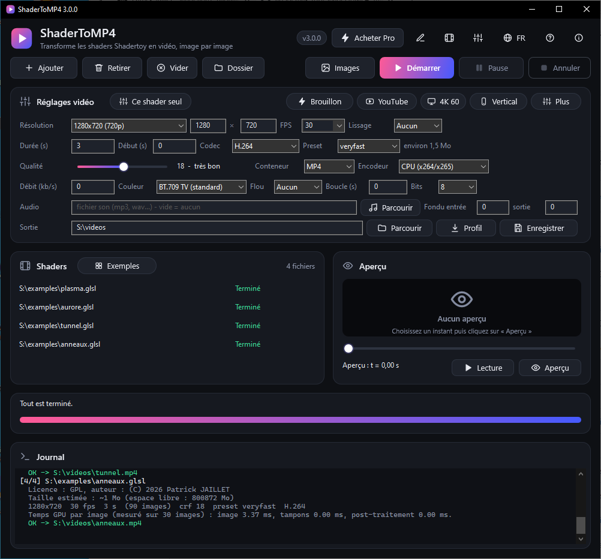
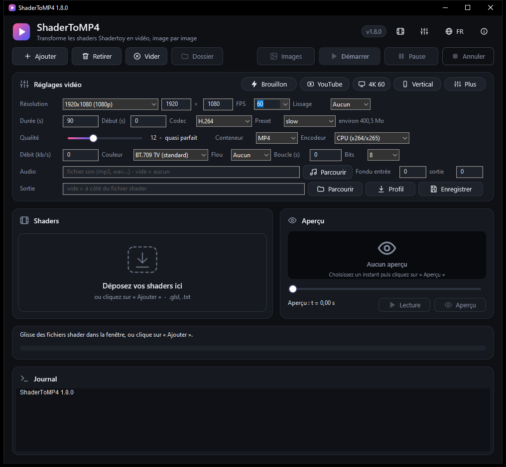
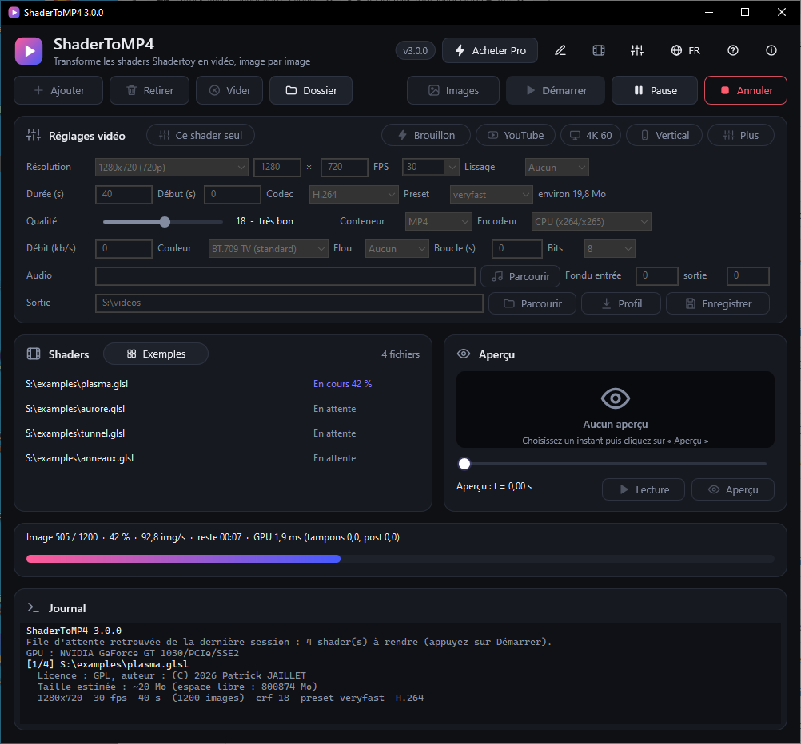
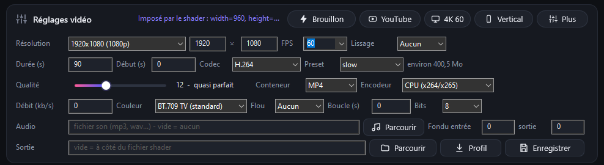
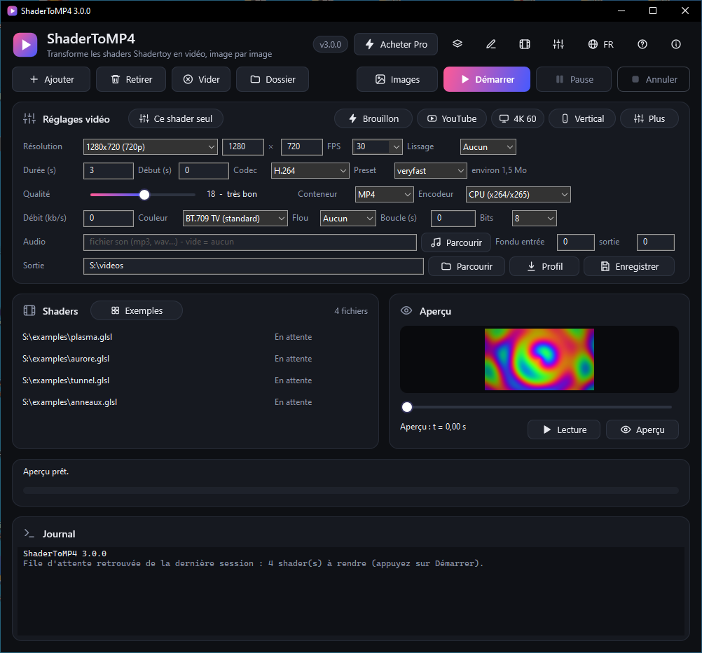
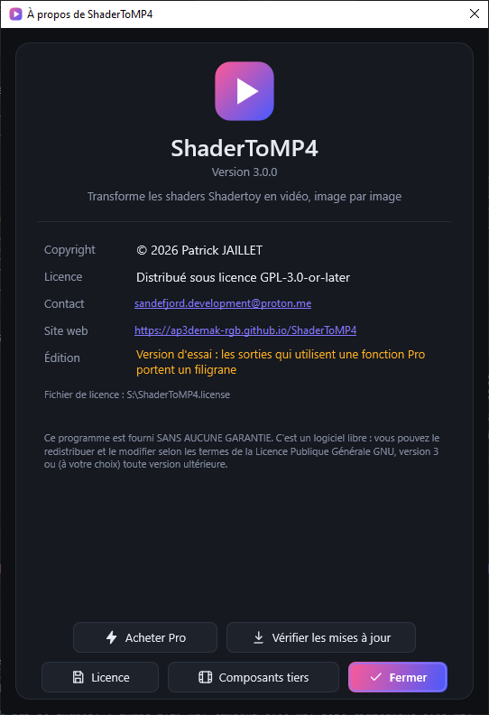
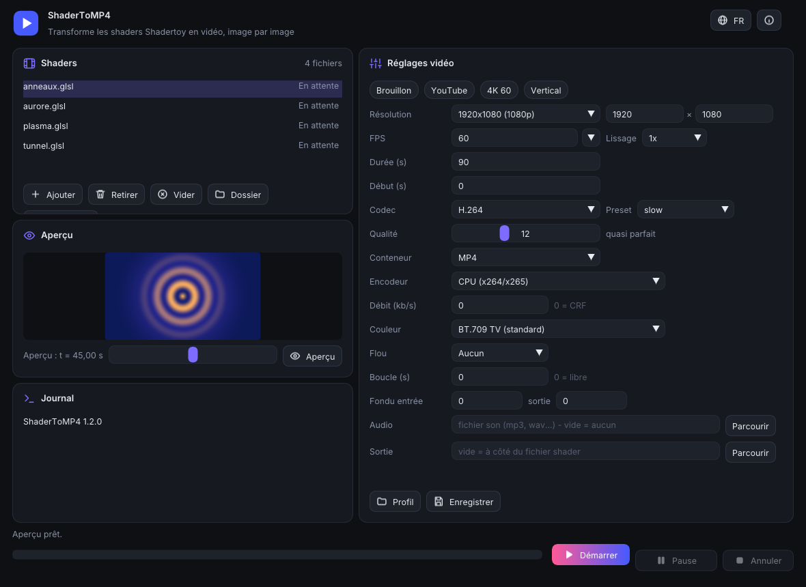
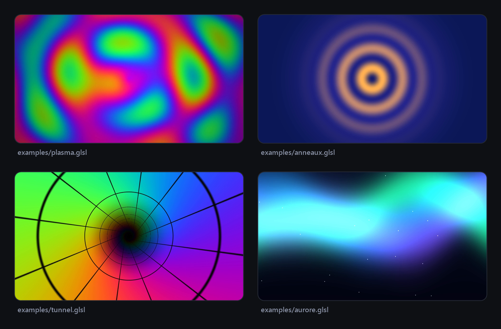

<!-- SPDX-License-Identifier: GPL-3.0-or-later - Copyright (C) 2026 Patrick JAILLET -->

<p align="center">
  
</p>

<p align="center"><a href="README.md">English</a> · <b>Français</b></p>

<p align="center">
  <a href="https://github.com/ap3demak-rgb/ShaderToMP4/releases/latest"></a>
  &nbsp;
  <a href="https://ap3demak-rgb.github.io/ShaderToMP4"></a>
</p>

<p align="center">
  
  
  
  
  
  <a href="LICENSE"></a>
</p>

<p align="center">
  
</p>

**ShaderToMP4** convertit un shader [Shadertoy](https://www.shadertoy.com) (onglet *Image*) en vidéo, **image par image**, avec un temps exact (`iTime = image / fps`). Pas de capture d'écran, donc pas de saccades, pas de perte, quelle que soit la puissance de ta carte graphique : un shader qui tourne à 5 images par seconde en direct donne une vidéo parfaitement fluide.

Un seul programme portable pour **Windows, Linux et macOS**, **sans installeur**, avec une interface sombre moderne en français et en anglais.

---

## Pourquoi ShaderToMP4 ?

| | |
|---|---|
| **Temps exact** | Chaque image est rendue au temps `n / fps`, puis envoyée directement à ffmpeg par un tube : aucun fichier intermédiaire. |
| **Qualité maximale** | Jusqu'à 16384 pixels de large, supersampling ×4, flou de mouvement (×4, ×8, ×16), conversion de couleur BT.709 correcte, sortie 10 bits, x264 / x265 sans perte si vous le voulez. |
| **Nombreux formats** | MP4, MOV, MKV, WebM (H.264, H.265, VP9, AV1), ProRes et DNxHR pour le montage, GIF et WebP animés, séquences d'images PNG / TIFF / EXR. |
| **Fonctions Shadertoy** | Textures (`iChannel`), shaders à passes multiples (Buffer A–D, Common), souris et date fixes, GLSL de style WebGL 2, et rapport de compatibilité avant chaque rendu. |
| **Rapide** | Rendu et encodage en parallèle, lecture GPU asynchrone, encodage matériel (NVENC, AMF, QuickSync, VAAPI, VideoToolbox) en option. |
| **Fiable** | Les longs rendus se font par parties : si quelque chose plante, tu reprends exactement où tu t'étais arrêté. |
| **Pratique** | Aperçu intégré, préréglages (YouTube, 4K, vertical 9:16), audio avec fondus, boucle parfaite, file d'attente de plusieurs shaders, pause et annulation. |
| **Portable** | Rien à installer, quel que soit le système. Réglages, langues et `ffmpeg` restent dans le dossier de l'application. |

## L'interface

<p align="center">
  
</p>

<table>
  <tr>
    <td width="50%"></td>
    <td width="50%"></td>
  </tr>
  <tr>
    <td align="center"><sub><b>Glisse tes shaders</b> dans la zone de dépôt, ou clique sur « Ajouter ».</sub></td>
    <td align="center"><sub><b>Rendu en cours</b> : vitesse, temps restant, pause et annulation. La progression s'affiche aussi dans la barre des tâches.</sub></td>
  </tr>
</table>

<p align="center">
  <br>
  <sub>Tous les réglages vidéo au même endroit, avec des <b>préréglages en un clic</b> (Brouillon, YouTube, 4K 60, Vertical) et une info-bulle sur chaque champ.</sub>
</p>

<p align="center">
  <br>
  <sub>La file d'attente avec le statut de chaque shader, et un <b>aperçu</b> à l'instant de ton choix, sans lancer ffmpeg.</sub>
</p>

<p align="center">
  <br>
  <sub>La fenêtre « À propos » (<code>F1</code>) : version, copyright, licence, contact et site web. Le bouton globe change la langue instantanément.</sub>
</p>

### Sous Linux et macOS

Windows garde son interface native Direct2D. Linux et macOS utilisent une seconde interface au même aspect (cartes sombres, accent en dégradé, mêmes icônes SVG), fondée sur GLFW et Dear ImGui et dessinée en OpenGL ; les deux interfaces partagent le même moteur de rendu, les mêmes réglages et les mêmes traductions.

<p align="center">
  <br>
  <sub>L'interface Linux / macOS (capture produite par l'intégration continue sous Linux).</sub>
</p>

## Exemples

Le dossier [`examples`](examples) contient quatre shaders prêts à convertir : plasma, anneaux, tunnel et aurore.

<p align="center">
  
</p>

## Démarrage rapide

1. **Télécharge** l'archive portable de ton système depuis la page [Releases](https://github.com/ap3demak-rgb/ShaderToMP4/releases/latest) et décompresse-la où tu veux (ou [compile le projet](#compiler)).

   | Système | Archive | Lancer |
   |---|---|---|
   | Windows 10 / 11, 64 bits | `ShaderToMP4-<version>-win64.zip` | `ShaderToMP4.exe` |
   | Linux x86-64 | `ShaderToMP4-<version>-linux-x86_64.tar.gz` | `./ShaderToMP4` |
   | Linux ARM64 | `ShaderToMP4-<version>-linux-aarch64.tar.gz` | `./ShaderToMP4` |
   | macOS 10.13+, Apple Silicon et Intel | `ShaderToMP4-<version>-macos-universal.zip` | `ShaderToMP4.app` |

2. Si `ffmpeg` est absent, le programme propose de le télécharger (Windows : environ 80 Mo depuis [gyan.dev](https://www.gyan.dev/ffmpeg/builds/) ; Linux : un build statique de [BtbN](https://github.com/BtbN/FFmpeg-Builds) ; vérifié par SHA-256) et l'installe à côté de lui. Sous macOS, installe-le avec Homebrew (`brew install ffmpeg`) ou place le binaire `ffmpeg` à côté du `.app` : aucune source ne publie d'empreinte SHA-256 vérifiable pour macOS, il n'y a donc pas de téléchargement automatique.
3. **Glisse** un ou plusieurs fichiers shader (`.glsl` ou `.txt`) dans la fenêtre, ou clique sur **Ajouter**.
4. Règle la vidéo (ou choisis un préréglage) puis clique sur **Démarrer**.
5. La vidéo est créée à côté du shader, ou dans le dossier choisi dans **Sortie**.

> Les fichiers passés en ligne de commande (ou glissés sur l'exécutable sous Windows) sont ajoutés et rendus tout de suite.

**Prérequis** : une carte graphique (ou un pilote) compatible OpenGL 3.3, et
- **Windows** : Windows 10 (version 1703 ou plus récente) ou Windows 11.
- **Linux** : un bureau X11 ou Wayland (XWayland), glibc 2.35 ou plus récente, le pilote OpenGL de ta carte graphique (Mesa convient), et `curl` ainsi que `tar` avec `xz` pour le téléchargement automatique de ffmpeg. Sur un portable à deux GPU, mets `gpu=high` dans `config.ini` (ou `--gpu=high` avec `--render`) pour utiliser le GPU dédié, `gpu=low` pour l'intégré (le programme fixe les variables PRIME de Mesa et du pilote NVIDIA avant d'ouvrir OpenGL ; relance-le après un changement ; `--diagnostic` montre le GPU utilisé).
- **macOS** : 10.13 ou plus récent. L'archive est signée « ad hoc », non notariée : au premier lancement, clic droit sur `ShaderToMP4.app` puis *Ouvrir* (ou `xattr -dr com.apple.quarantine ShaderToMP4.app`). Les réglages sont écrits dans le dossier qui contient le `.app` : garde-le dans un dossier où tu peux écrire (pas `/Applications`).

## Fonctions

<details>
<summary><b>Les boutons et les raccourcis</b></summary>

| Bouton | Raccourci | Rôle |
|---|---|---|
| **Ajouter** | `Ctrl+O` | Ajouter des shaders à la file |
| **Démarrer** | `F5` | Rend tous les fichiers de la liste qui ne sont pas déjà terminés |
| **Pause** / **Reprendre** | `F6` | Suspend le rendu (le temps de pause n'est pas compté dans la vitesse) |
| **Annuler** | `Échap` | Arrête le rendu ; les parties déjà terminées sont conservées |
| **Image PNG** | | Rend une seule image, au temps « Début », et l'ouvre |
| **Aperçu** et curseur | `Ctrl+P` | Affiche une image du shader à un instant choisi, sans ffmpeg |
| **Lecture** / **Arrêt** | | Joue le shader en temps réel à la taille de l'aperçu (640 px au plus), en boucle sur la plage, saut par le curseur ; l'aperçu se recharge tout seul quand le shader ou un de ses fichiers de passes change sur le disque |
| **Retirer** | `Suppr` (dans la liste) | Retire les shaders sélectionnés |
| **Dossier** | | Ouvre l'explorateur sur la vidéo du shader sélectionné |
| **Profil / Enregistrer** | | Charge ou enregistre tous les réglages dans un fichier `.ini` |
| **À propos** | `F1` | Version, copyright, licence, contact, site web |
| **EN / FR** | | Change la langue de l'interface |

`Tab` passe d'un réglage au suivant. Tous les textes de l'interface ont un contraste d'au moins 4,5:1 avec leur fond (WCAG AA), contrôlé automatiquement pour les deux interfaces.

**File d'attente conservée entre deux sessions** : les shaders pas encore rendus (en attente, en échec, annulés ou interrompus) sont notés dans `queue.txt` à côté du programme et remis dans la liste à la prochaine ouverture sans fichier (le journal l'indique ; appuyez sur Démarrer). Les shaders terminés sont oubliés, tout comme un fichier qui n'existe plus.

</details>

<details>
<summary><b>Tous les réglages</b> (fenêtre, <code>config.ini</code> ou commentaires du shader)</summary>

Les réglages sont enregistrés dans `config.ini` à côté du `.exe`, et peuvent être imposés **par shader** avec un commentaire (prioritaire sur la fenêtre ; le journal le signale, et la carte des réglages affiche « Imposé par le shader : … » quand un tel shader est sélectionné) :

```glsl
// fps=30
// duration=20
// width=3840
// height=2160
void mainImage(out vec4 fragColor, in vec2 fragCoord) { ... }
```

| Réglage (fenêtre) | Clé | Valeurs |
|---|---|---|
| Résolution | `width`, `height` | 16 à 16384 (arrondi au nombre pair) |
| FPS | `fps` | 1 à 240 |
| Durée, Début | `duration`, `start` | secondes (`90`) ou `mm:ss` dans la fenêtre |
| Codec | `codec` | `h264`, `h265`, `vp9`, `av1`, `prores_*`, `dnxhr_*` (voir « Formats de sortie ») |
| Preset | `preset` | `ultrafast` ... `veryslow` |
| Qualité (CRF) | `crf` | 0 (sans perte), 12 (quasi parfait), 18 (très bon) |
| Débit | `bitrate` | kb/s ; 0 = qualité constante (CRF) |
| Conteneur | `container` | `mp4`, `mov`, `mkv`, `webm`, `gif`, `webp`, `png`, `tiff`, `exr` (WebM : VP9/AV1 seulement ; MOV : pas VP9/AV1 ; MP4 : pas ProRes/DNxHR) |
| Bits | `depth` | 8 ou 10 bits par canal (10 : H.265, AV1, VP9, ProRes, PNG/TIFF) |
| Encodeur | `encoder` | `cpu`, `auto`, `nvenc`, `amf`, `qsv` (repli sur le CPU si indisponible) |
| Lissage | `ss` | 1 à 4 : rendu à N× la taille puis réduction (supersampling) |
| Couleur | `color` | `bt709`, `bt709full` (pleine plage), `srgb`, `bt601` |
| Flou | `blur`, `shutter` | 1, 4, 8, 16 sous-images par image ; obturateur (0,5 = 180°) |
| Boucle (s) | `loop` | période du shader : la durée devient un multiple entier, la dernière image précède exactement la première |
| Audio | `audio` | fichier son, calé sur le temps « Début », complété par du silence s'il est plus court |
| Fondu entrée / sortie | `fadein`, `fadeout` | secondes, image et son |
| Sortie | `outdir` | dossier de sortie (vide = à côté du shader) |
| (commentaires du shader) | `iChannel0`…`iChannel3`, `mouse`, `date` | textures, souris et date fixes (voir « Compatibilité Shadertoy ») |
| (commentaires du shader, `--variant=`) | `variant` | rendus supplémentaires du même shader, une ligne par variante : `// variant=720p:width=1280\|height=720\|crf=23`. Le rendu de base passe d'abord, puis chaque variante avec ses réglages ; son nom s'ajoute au nom du fichier (`shader_720p.mp4`) sauf si la variante fixe `name` |
| (config.ini seulement) | `name`, `exists` | modèle du nom de sortie et conduite si le fichier existe (voir « Formats de sortie ») |
| (config.ini seulement) | `gpu` | carte graphique sur un PC à deux GPU, Linux seulement : `default`, `high` (la dédiée) ou `low` (l'intégrée). Windows demande déjà le GPU puissant ; macOS choisit seul |
| (config.ini seulement) | `endaction` | après un lot réussi : `none` (défaut), `folder` (montrer le dernier fichier dans le gestionnaire de fichiers) ou `sleep` (mise en veille après 15 s ; fermer le programme l'annule). À la fin d'un lot le bouton de la barre des tâches / du Dock clignote toujours |
| (config.ini seulement) | `chunk` | rendu par parties de N secondes (30 par défaut, 0 = jamais) |
| (config.ini seulement) | `metadata` | 1 = écrire titre (nom du shader) et commentaire (taille, cadence, version) dans le fichier, 0 = aucun (1 par défaut) |
| (config.ini seulement) | `pbo` | profondeur de la file de lecture GPU (2 à 8, 3 par défaut) |

</details>

<details>
<summary><b>Formats de sortie, 10 bits, noms de fichiers et préréglages</b></summary>

| Format | `codec` | `container` | Remarques |
|---|---|---|---|
| H.264, H.265 | `h264`, `h265` | `mp4`, `mov`, `mkv` | encodeurs matériels : NVENC, AMF, QuickSync, VAAPI, VideoToolbox |
| VP9, AV1 | `vp9`, `av1` | `webm`, `mp4`, `mkv` | VP9 sur le CPU (libvpx-vp9) ; AV1 avec SVT-AV1 (libaom en secours), et essayé d'abord sur NVENC / AMF / QuickSync / VAAPI quand un encodeur est choisi (repli sur le CPU) ; le son WebM est en Opus |
| ProRes | `prores_proxy`, `prores_lt`, `prores_422`, `prores_hq`, `prores_4444` | `mov`, `mkv` | format de montage : 10 bits 4:2:2 (4:4:4 pour le 4444), très gros fichiers, CRF et débit ignorés |
| DNxHR | `dnxhr_sq`, `dnxhr_hq`, `dnxhr_hqx`, `dnxhr_444` | `mov`, `mkv` | format de montage, au moins 256×120 |
| GIF animé | (ignoré) | `gif` | palette optimisée sur toute l'animation, pas de son ; 15 à 25 images/s conseillé et une limite de taille protège la mémoire |
| WebP animé | (ignoré) | `webp` | qualité tirée du curseur CRF, pas de son |
| Séquence d'images | (ignoré) | `png`, `tiff`, `exr` | dossier `<nom>_frames/` contenant `<nom>_000000.png`… ; RVB pleine plage, sans conversion YUV ; PNG / TIFF en 16 bits avec 10 bits ; EXR en demi-flottant |

- **Bits** (`depth`, 8 ou 10) : à 10, le shader est rendu en 16 bits par canal et encodé en H.265 Main10, AV1, VP9 profil 2, ProRes / DNxHR (toujours 10 bits) ou PNG / TIFF 16 bits, ce qui supprime les bandes des dégradés doux. Les encodeurs matériels sont en 8 bits seulement : le CPU est alors utilisé (le journal l'indique).
- Un codec ou un conteneur que le ffmpeg installé ne sait pas produire est marqué « absent de ce ffmpeg » dans les listes ; installez une version complète de ffmpeg (le téléchargement automatique en est une). Une combinaison impossible (WebM avec H.264, MOV avec VP9, MP4 avec ProRes) est refusée avec une explication avant le début du rendu.
- **Taille estimée** : affichée sous les réglages (approximative, elle dépend du shader), avec un avertissement si le disque de destination est trop petit.
- **Nom du fichier** (config.ini ou commentaire du shader) : `name` est un modèle, `{shader}` par défaut ; `{w}`, `{h}`, `{fps}`, `{date}` et `{codec}` sont remplacés (`// name={shader}_{w}x{h}`). `exists` décide ce qui se passe si le résultat existe déjà : `overwrite` (par défaut), `number` (`nom-2`, `nom-3`…) ou `skip`.
- **Préréglages** : les pastilles (Brouillon, YouTube, 4K 60, Vertical) et le menu « Plus » (X 720p30, GIF léger, ProRes pour le montage, WebM VP9) ne changent que la taille, la cadence, le codec, le conteneur et la qualité. Vos propres préréglages sont des fichiers `.ini` dans un dossier `presets` à côté du programme : ils apparaissent dans le menu « Plus » (même format qu'un profil enregistré avec « Enregistrer »).

</details>

<details>
<summary><b>Compatibilité Shadertoy</b> (textures, souris, date)</summary>

Seul l'onglet **Image** est rendu. Ce qui fonctionne :

| Fonction | État |
|---|---|
| `mainImage`, `iResolution`, `iTime`, `iTimeDelta`, `iFrame`, `iFrameRate`, `iSampleRate` (44100) | pris en charge, exacts à chaque image |
| `iChannel0` à `iChannel3` en textures 2D | pris en charge : `// iChannel0=image.png` (chemin relatif au shader ; PNG, JPG, HDR, EXR… tout ce que ffmpeg décode), `noise` ou `grid` (générés, identiques à chaque exécution) |
| options des textures | `// iChannel0.filter=nearest\|linear\|mipmap` (mipmap par défaut), `.wrap=clamp\|repeat` (repeat par défaut), `.vflip=0\|1` (1 par défaut, comme Shadertoy) |
| `iChannelResolution`, `iChannelTime` | pris en charge (le temps vaut 0 : pas de canal animé) |
| `iMouse` | valeur fixe : `// mouse=0.5,0.5` (fractions de la taille, origine en bas à gauche), `// mouse=0.5,0.5,down` pour un bouton enfoncé ; sinon 0 |
| `iDate` | date réelle par défaut ; `// date=2026-03-14T15:09:26` la fixe pour un rendu reproductible |
| Buffer A–D, Common | pris en charge sous forme de fichiers à côté du shader : `nom.bufferA.glsl` … `nom.bufferD.glsl` et `nom.common.glsl` (n'ajoutez que `nom.glsl` à la liste). Chaque passe lit ses entrées par ses propres commentaires `// iChannel0=bufferA` (`bufferA` à `bufferD`, images, `noise`, `grid`). Ordre : A, B, C, D, puis Image ; un tampon lu après sa passe dans la même image donne l'image courante, lu avant (ou par lui-même) il donne la précédente, comme sur Shadertoy. Les tampons sont en flottant 32 bits, démarrent à zéro, sont rendus une fois par image (sans flou de mouvement), avec filtrage linéaire et bords étirés par défaut |
| Historique des tampons | un rendu qui démarre plus loin (reprise des parties, aperçu à un instant donné) rejoue d'abord les images précédentes sans les encoder ; le journal l'indique. L'aperçu rejoue 600 images au plus |
| GLSL écrit pour WebGL 2 | accepté : les lignes `#version` et `#extension` sont ignorées, les `precision`, `texture2D`, `texture2DLod` ainsi que `texelFetch`, `textureLod`, `dFdx`… fonctionnent (le programme compile en GLSL 3.30 core). Une erreur de compilation nomme la passe (`[Buffer A]`) et garde les numéros de ligne de son fichier |
| Erreurs de compilation | affichées « fichier:ligne: message » (comme un compilateur, le fichier étant le shader ou la passe) ; **double-cliquez** la ligne du journal pour ouvrir le fichier à cette ligne (Notepad++, Sublime Text ou VS Code s'ils sont installés, sinon l'application par défaut) |
| Rapport de compatibilité | avant chaque rendu le journal liste ce qui est ignoré ou figé : `mainVR`, `mainSound`, cubemaps, textures 3D, `iMouse` ou `iDate` lus sans valeur fixe, `iChannelTime` |
| Passe Sound | fichier `nom.sound.glsl` avec `vec2 mainSound(int samp, float time)`, rendue par le GPU (512×512 échantillons stéréo par bloc, 44,1 kHz, Common disponible) dans un fichier WAV temporaire qui devient la piste audio de la vidéo, à partir de l'instant `start` ; le réglage `audio`, s'il est renseigné, la remplace. Sorties vidéo seulement (GIF, WebP et séquences n'ont pas de son) ; le fichier temporaire est supprimé à la fin |
| Cubemap A | fichier `nom.cubemapA.glsl` avec `mainCubemap(out vec4 fragColor, in vec2 fragCoord, in vec3 rayOri, in vec3 rayDir)`, rendu sur les six faces (512×512) à chaque image ; lisible avec `// iChannel0=cubeA` |
| Import Shadertoy | glissez, ajoutez ou `--render` le fichier `.json` exporté depuis la page du shader (bouton Export) : passes, Common et commentaires `iChannel` sont écrits dans le dossier `shadertoy/` à côté du programme, puis rendus. Hors ligne, sans compte ni clé d'API. Les médias propres à Shadertoy (textures, cubemaps, volumes) sont remplacés par des équivalents générés (signalé dans le journal) ; passes son, webcam et clavier non pris en charge. Le shader garde la licence de son auteur |
| canaux cubemap, texture 3D, audio, vidéo | pris en charge : `// iChannel0=cube:sky` (ciel généré), `cube:nom_%d.png` (six faces carrées 0 à 5 = +X −X +Y −Y +Z −Z) ou `cube:croix.png` (croix 4×3) ; `volume:noise` (généré) ou `volume:image.png@N` (N tranches côte à côte) ; `audio` (la bande son du réglage `audio`) ou `audio:fichier.mp3` donne la texture 512×2 de Shadertoy (ligne 0 spectre, ligne 1 forme d'onde, calculées au temps exact de chaque image, sans le lissage entre images de l'analyseur web) ; `video:fichier.mp4` joue une vidéo (en boucle, décodée par ffmpeg à la cadence du rendu, réduite à 1280×720 au plus, `.vflip` comme pour les images). Les déclarations `samplerCube` / `sampler3D` du shader sont reconnues automatiquement |
| canaux webcam, micro et clavier | non pris en charge (le rendu n'est pas interactif) |
| lignes `// iChannel` inutiles si le shader ne lit pas le canal | un canal lu sans texture reste noir et le journal le signale |

</details>

<details>
<summary><b>Reprise après interruption</b></summary>

Les vidéos plus longues que `chunk` secondes sont rendues par parties, dans un dossier `<nom>.parts` à côté de la vidéo. Si le rendu est annulé, plante ou échoue, les parties terminées restent : relance le même rendu **avec les mêmes réglages** et il reprend où il s'était arrêté, puis assemble les parties (copie des flux, sans réencodage). Si le shader ou un réglage a changé, les anciennes parties sont jetées.

</details>

<details>
<summary><b>Ligne de commande</b></summary>

| Commande | Effet |
|---|---|
| `ShaderToMP4 a.glsl b.glsl` | Ajoute les fichiers et lance le rendu |
| `ShaderToMP4 --render [options] a.glsl b.glsl` | Rendre sans fenêtre, identique sous Windows, Linux et macOS (voir plus bas) |
| `ShaderToMP4 --diagnostic` | Affiche système, carte graphique, OpenGL, ffmpeg et encodeurs trouvés (sans chemin ni donnée personnelle) : à coller dans un rapport de bug |
| `ShaderToMP4 --benchmark [--seconds=N] [--quick] [--json]` | Mesure les images par seconde en 720p, 1080p et 4K avec l'encodeur CPU, et avec le matériel s'il existe |
| `ShaderToMP4 --selftest [--update] [--quiet]` | Auto-test (voir plus bas) |
| `ShaderToMP4 --get-ffmpeg [--quiet]` | Télécharge et installe `ffmpeg` sans ouvrir la fenêtre (Windows et Linux) |
| `ShaderToMP4 --version` | Affiche la version, le copyright et la licence |
| `ShaderToMP4 --help` | Affiche les options |

**Rendu sans fenêtre** (`--render`) : les options sont les clés du tableau des réglages écrites `--clé=valeur` (`--width=1280 --height=720 --fps=30 --duration=10 --codec=h265 --container=mp4 --crf=18 --outdir=sortie`), appliquées après `config.ini` et après `--profile=fichier.ini` ; les commentaires `// clé=valeur` d'un shader restent prioritaires, comme dans la fenêtre. `--png` rend une seule image au temps de départ. `--watch=dossier` laisse le programme actif et rend chaque `.glsl` / `.txt` qui apparaît dans le dossier (une fois que sa taille ne change plus ; les fichiers de passes comme `nom.bufferA.glsl` ne sont pas des shaders à part ; arrêt par `Ctrl+C`, ou `--watch-count=N` pour s'arrêter après N rendus). La surveillance n'est jamais active par défaut. `--progress=json` écrit un objet JSON par ligne sur la sortie standard : `start`, `progress` (`frame`, `frames`, `percent`, `fps`, `eta`), `log`, `done` (avec le fichier `output`), `error`, puis `end` (`ok`, `failed`) ; `--progress=text` écrit une ligne tous les 10 %. Codes de sortie : `0` tout est rendu, `1` un rendu a échoué, `2` ligne de commande invalide, `3` pas d'OpenGL 3.3, `4` ffmpeg introuvable. Sous Windows le programme est une application à fenêtre : utilisez `start /wait` dans `cmd`, ou `Start-Process -Wait -NoNewWindow` dans PowerShell, pour l'attendre et lire le code de sortie.

```
ShaderToMP4 --render --progress=json --container=webm --codec=vp9 --width=1280 --height=720 --outdir=sortie shader.glsl
```

</details>

<details>
<summary><b>Langues</b></summary>

Tous les textes de l'interface viennent de `lang/en.json` et `lang/fr.json`, embarqués dans l'exécutable, et des autres fichiers du dossier `lang` livré à côté : allemand (`de`), espagnol (`es`), italien (`it`) et portugais (`pt`). Ces quatre traductions sont récentes et n'ont pas été relues par des locuteurs natifs : les corrections sont bienvenues. La langue suit le système par défaut (quand un fichier existe pour elle), se change avec le bouton globe et est mémorisée dans `window.ini`. Pour ajouter ou corriger une langue sans recompiler, place un fichier `lang/<code>.json` à côté de l'exécutable (les clés qui y manquent retombent sur l'anglais) ; le bouton globe passe alors en revue toutes les langues disponibles.

</details>

## Questions fréquentes

**Quels shaders Shadertoy sont supportés ?**
Ceux qui n'utilisent que l'onglet *Image* et les entrées `iResolution`, `iTime`, `iTimeDelta`, `iFrame`, `iFrameRate`, `iDate`. Copie le code dans un fichier `.glsl` : la fonction `mainImage` suffit.

**Et les textures, les buffers, le son ou la souris ?**
Pas encore : `iChannel0` à `iChannel3` (textures, buffers, multipasse), `iMouse` (fixe à 0) et le son Shadertoy ne sont pas supportés. Un shader qui les utilise s'affiche avec un avertissement et un rendu noir pour ces entrées.

**Pourquoi pas une simple capture d'écran ?**
Une capture dépend de la vitesse de ton PC : si le shader est lourd, la vidéo saccade. Ici chaque image est rendue au temps exact, aussi lentement que nécessaire.

**Mon rendu est long, que faire ?**
Essaie l'encodeur matériel (`Encodeur : Auto`), un preset plus rapide, ou le préréglage *Brouillon* pour tester. Le journal indique si le goulot est le GPU ou l'encodeur.

**Où est `ffmpeg` ?**
Sous Windows et Linux, il est téléchargé à la demande à côté du programme. Tu peux aussi le placer toi-même dans le même dossier, ou le garder dans ton `PATH` (sous macOS, les dossiers Homebrew sont aussi parcourus).

**Quels encodeurs matériels sont pris en charge ?**

| Système | Encodeurs (réglage `Encodeur`) |
|---|---|
| Windows | NVENC (NVIDIA), AMF (AMD), QuickSync (Intel) |
| Linux | NVENC, VAAPI (AMD / Intel), QuickSync |
| macOS | VideoToolbox |

`Auto` les essaie dans cet ordre par un encodage de test de 0,2 s et retombe sur le CPU si aucun ne fonctionne.

**Est-ce que ça installe quelque chose ou écrit ailleurs sur mon PC ?**
Non. Le programme est portable : réglages (`config.ini`, `window.ini`), langues et `ffmpeg` vivent dans son propre dossier. Le programme lui-même n'écrit ni dans le registre, ni dans ton profil utilisateur, ni dans un dossier système (les pilotes graphiques peuvent garder leurs propres caches).

## Compiler

### Windows

Avec les Build Tools de Visual Studio (le chemin de `vcvars64.bat` est écrit dans `scripts\build.bat`, à adapter si besoin) :

```
.\scripts\build.bat
```

Cela compile les ressources (manifeste, icône, icônes SVG, fichiers de langue, informations de version) puis tous les fichiers de `src` vers `bin\ShaderToMP4.exe`, lié statiquement (aucun runtime à installer), et copie les fichiers de licence et `lang/` à côté. CMake fonctionne aussi (`cmake -S . -B build-cmake` puis `cmake --build build-cmake --config Release`), et `scripts\package-windows.ps1` fabrique le zip portable.

### Linux et macOS

Il faut CMake 3.20+, un compilateur C++17 et, sous Linux, les paquets de développement X11 / Wayland (sous Debian et Ubuntu : `sudo apt install cmake ninja-build xorg-dev libgl1-mesa-dev libxkbcommon-dev libwayland-dev wayland-protocols`).

```
./scripts/build.sh          # configure, télécharge GLFW, Dear ImGui et NanoSVG (versions figées) et compile bin/ShaderToMP4
./scripts/test.sh           # auto-test
./scripts/package-linux.sh x86_64      # ou aarch64 : dist/ShaderToMP4-<version>-linux-<arch>.tar.gz
./scripts/package-macos.sh             # dist/ShaderToMP4-<version>-macos-universal.zip (compiler avec -DCMAKE_OSX_ARCHITECTURES="arm64;x86_64")
```

La première configuration demande une connexion internet pour récupérer les trois bibliothèques.

<details>
<summary>MinGW-w64 (non testé)</summary>

Le rendu SVG de Direct2D demande des en-têtes MinGW récents.

```
g++ -std=c++17 -O2 -finput-charset=UTF-8 -municode -mwindows -static -I src -o bin/ShaderToMP4.exe src/main.cpp src/core/*.cpp src/gui/*.cpp -lopengl32 -lgdi32 -luser32 -lcomctl32 -lcomdlg32 -lshell32 -ladvapi32 -lwininet -ld2d1 -ld3d11 -ldxgi -ldwrite -lshlwapi -luxtheme -ldwmapi -lole32
```

</details>

### Organisation du projet

```
src/        code source : core/ (moteur de rendu, sans interface), platform/ (seul code qui appelle le système : windows/, posix/),
            gui/ (interface Windows, Direct2D), ui_imgui/ (interface Linux et macOS, GLFW + Dear ImGui), main.cpp, main_posix.cpp
assets/     polices embarquées dans l'interface Linux / macOS (Inter)
cmake/      embarquement des ressources pour les compilations CMake
lang/       textes de l'interface : en.json, fr.json
res/        manifeste (DPI, thème), icône, informations de version, icônes SVG (icons/)
scripts/    build.bat / build.sh (compiler), test.bat / test.sh (auto-test), package-*.{ps1,sh} (archives portables), check-repo.ps1 (contrôle du dépôt)
tests/      shaders de référence et leurs images .ref
examples/   shaders d'exemple
docs/       bannière, captures d'écran, site web
bin/        dossier de travail : l'exécutable (généré), ffmpeg, config.ini
```

### Auto-test et contrôle du dépôt

`scripts\test.bat` (`./scripts/test.sh` sous Linux et macOS) rend les shaders du dossier `tests` en 64×64 (à t = 1 s) et les compare à leurs images de référence `.ref` (écart moyen toléré : 2/255). Le rapport est dans `tests\report.txt` et le code de sortie vaut 0 si tout passe. Les références dépendent du GPU et du pilote : après un changement volontaire du rendu ou de matériel, régénère-les avec `scripts\test.bat --update`.

`scripts\check-repo.ps1` contrôle le dépôt avant chaque commit : en-têtes de licence, fichiers de langue concordants, aucun texte d'interface écrit en dur, documentation bilingue, règles de portabilité.

### Publier une version

1. Mettez le nouveau numéro dans `src/app_info.h` (`APP_VER_MAJOR`, `APP_VER_MINOR`, `APP_VER_PATCH`, `APP_VER_STR`).
2. Dans `CHANGELOG.md` et `CHANGELOG.fr.md`, renommez la section « Non publié » avec la version (`## 1.4.0 — date`).
3. Validez, puis `git tag v1.4.0 && git push --tags`. L'intégration continue fabrique les quatre archives, écrit `SHA256SUMS.txt` et publie la version avec la section du journal des modifications ; elle refuse une étiquette différente de `APP_VER_STR` ou un journal sans section pour cette version.

### Limites connues

- L'interface Windows s'adapte au DPI de l'écran. Sa mise en page a été vérifiée à 100 %, 125 %, 150 % et 200 % avec `--dpi=120|144|192` (option de test qui force l'échelle ; le comportement d'une fenêtre déplacée entre deux vrais écrans d'échelles différentes n'a pas été testé). Lecteurs d'écran : les champs, les listes déroulantes et les curseurs portent leur libellé comme nom pour l'automatisation de l'interface de Windows (UI Automation, vérifié avec un client UI Automation) ; Narrator et NVDA eux-mêmes n'ont pas été essayés.
- Les encodeurs matériels AMD et Intel (AMF, QuickSync, VAAPI), et l'AV1 matériel, n'ont pas été testés sur du matériel réel.
- macOS : le programme est compilé et empaqueté par l'intégration continue, mais les machines macOS hébergées n'ont pas de GPU : la fenêtre n'a donc pas été lancée sur un vrai Mac. Signale tout problème.
- Linux et macOS : les boîtes de dialogue de fichiers sont intégrées au programme (pas de boîte système), et la progression du rendu s'affiche dans le Dock de macOS (écrite d'après la documentation du système et compilée par l'intégration continue, mais jamais exécutée sur un vrai Mac) ; sous Linux il n'y a pas de progression sur le bouton de la barre des tâches (l'API des lanceurs passe par D-Bus, une bibliothèque que le programme ne livre pas), la fenêtre demande seulement l'attention à la fin d'un lot.

## Informations sur le projet

- **Copyright** © 2026 Patrick JAILLET
- **Licence** : distribué sous licence GPL-3.0-or-later, voir [LICENSE](LICENSE) et [COPYING](COPYING). Composants tiers : [THIRD_PARTY_NOTICES.fr.md](THIRD_PARTY_NOTICES.fr.md). `ffmpeg` est un programme séparé, non inclus dans ce dépôt : il est téléchargé à la demande depuis [gyan.dev](https://www.gyan.dev/ffmpeg/builds/) (Windows) ou [BtbN](https://github.com/BtbN/FFmpeg-Builds) (Linux) et reste soumis à sa propre licence.
- **Contact** : [sandefjord.development@proton.me](mailto:sandefjord.development@proton.me)
- **Site web** : <https://ap3demak-rgb.github.io/ShaderToMP4>
