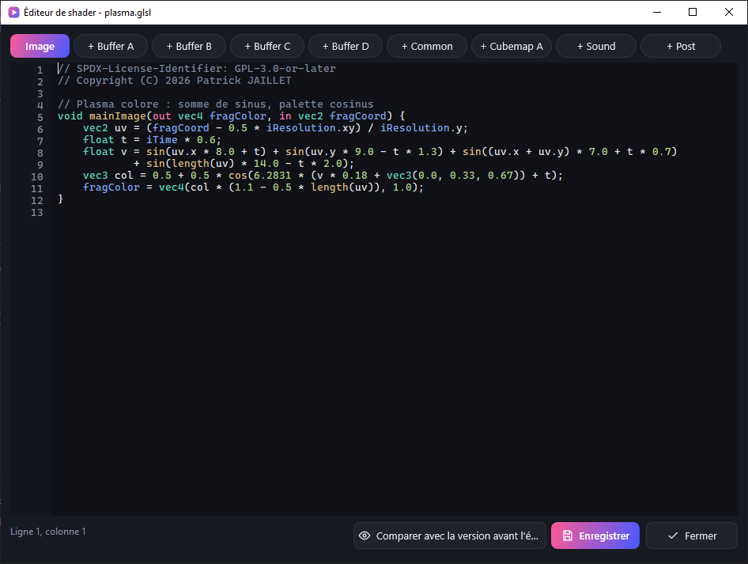
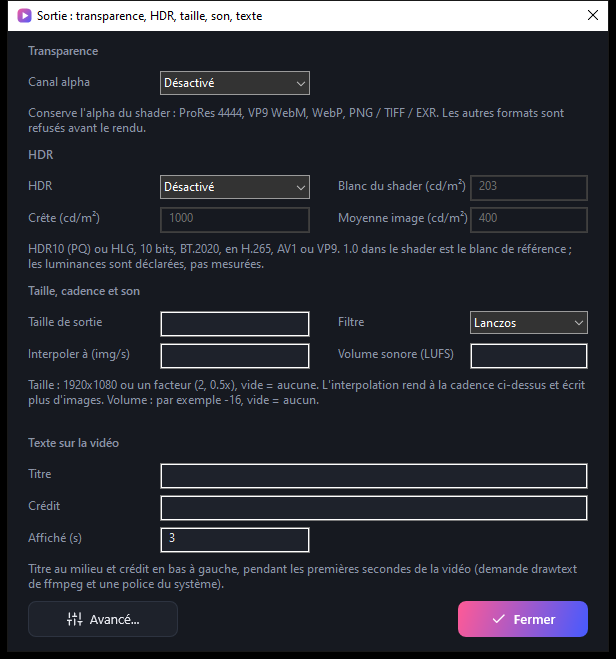

<!-- SPDX-License-Identifier: GPL-3.0-or-later - Copyright (C) 2026 Patrick JAILLET -->

<p align="center">
  
</p>

<p align="center"><a href="README.md">English</a> · <b>Français</b></p>

<p align="center">
  <a href="https://github.com/ap3demak-rgb/ShaderToMP4/releases/latest"></a>
  &nbsp;
  <a href="https://ap3demak-rgb.github.io/ShaderToMP4"></a>
</p>

<p align="center">
  
  
  
  
  
  <a href="LICENSE"></a>
</p>

<p align="center">
  
</p>

**ShaderToMP4** convertit un shader [Shadertoy](https://www.shadertoy.com) (onglet *Image*, avec ses passes Buffer A–D, Common, Cubemap A et Sound) en vidéo, **image par image**, avec un temps exact (`iTime = image / fps`). Pas de capture d'écran, donc pas de saccades, pas de perte, quelle que soit la puissance de ta carte graphique : un shader qui tourne à 5 images par seconde en direct donne une vidéo parfaitement fluide.

Un seul programme portable pour **Windows, Linux et macOS** (rien à installer ; un **installeur** facultatif pour Windows), avec une interface sombre moderne en français et en anglais.

---

## Pourquoi ShaderToMP4 ?

| | |
|---|---|
| **Temps exact** | Chaque image est rendue au temps `n / fps`, puis envoyée directement à ffmpeg par un tube : aucun fichier intermédiaire. |
| **Qualité maximale** | Jusqu'à 16384 pixels de large, supersampling ×4, flou de mouvement (×4, ×8, ×16), conversion de couleur BT.709 correcte, sortie 10 bits, x264 / x265 sans perte si vous le voulez. |
| **Nombreux formats** | MP4, MOV, MKV, WebM (H.264, H.265, VP9, AV1), ProRes et DNxHR pour le montage, GIF et WebP animés, séquences d'images PNG / TIFF / EXR. |
| **Fonctions Shadertoy** | Textures, cubemaps, textures 3D, canaux audio et vidéo (`iChannel`), shaders à passes multiples (Buffer A–D, Common), souris et date fixes, GLSL de style WebGL 2, et rapport de compatibilité avant chaque rendu. |
| **Rapide** | Rendu et encodage en parallèle, lecture GPU asynchrone, encodage matériel (NVENC, AMF, QuickSync, VAAPI, VideoToolbox) en option. |
| **Fiable** | Les longs rendus se font par parties : si quelque chose plante, tu reprends exactement où tu t'étais arrêté. |
| **Pratique** | Aperçu intégré, préréglages (YouTube, 4K, vertical 9:16), audio avec fondus, boucle parfaite, file d'attente de plusieurs shaders, pause et annulation. |
| **Portable** | Rien à installer, quel que soit le système (un installeur Windows facultatif existe). Réglages, langues et `ffmpeg` restent dans le dossier de l'application. |

## L'interface

<p align="center">
  
</p>

<table>
  <tr>
    <td width="50%"></td>
    <td width="50%"></td>
  </tr>
  <tr>
    <td align="center"><sub><b>Glisse tes shaders</b> dans la zone de dépôt, ou clique sur « Ajouter ».</sub></td>
    <td align="center"><sub><b>Rendu en cours</b> : vitesse, temps restant, pause et annulation. La progression s'affiche aussi dans la barre des tâches.</sub></td>
  </tr>
</table>

<p align="center">
  <br>
  <sub>Tous les réglages vidéo au même endroit, avec des <b>préréglages en un clic</b> (Brouillon, YouTube, 4K 60, Vertical) et une info-bulle sur chaque champ.</sub>
</p>

<p align="center">
  <br>
  <sub>La file d'attente avec le statut de chaque shader, et un <b>aperçu</b> à l'instant de ton choix, sans lancer ffmpeg.</sub>
</p>

<p align="center">
  <br>
  <sub>La fenêtre « À propos » (<code>F1</code>) : version, copyright, licence, contact et site web. Le bouton globe change la langue instantanément.</sub>
</p>

### Sous Linux et macOS

Windows garde son interface native Direct2D. Linux et macOS utilisent une seconde interface au même aspect (cartes sombres, accent en dégradé, mêmes icônes SVG), fondée sur GLFW et Dear ImGui et dessinée en OpenGL ; les deux interfaces partagent le même moteur de rendu, les mêmes réglages et les mêmes traductions.

<p align="center">
  <br>
  <sub>L'interface Linux / macOS (capture produite par l'intégration continue sous Linux).</sub>
</p>

## Exemples

Le dossier [`examples`](examples) contient quatre shaders prêts à convertir : plasma, anneaux, tunnel et aurore.

<p align="center">
  
</p>

## Démarrage rapide

1. **Télécharge** l'archive portable de ton système depuis la page [Releases](https://github.com/ap3demak-rgb/ShaderToMP4/releases/latest) et décompresse-la où tu veux (ou [compile le projet](#compiler)).

   | Système | Archive | Lancer |
   |---|---|---|
   | Windows 10 / 11, 64 bits | `ShaderToMP4-<version>-win64.zip` | `ShaderToMP4.exe` |
   | Linux x86-64 | `ShaderToMP4-<version>-linux-x86_64.tar.gz` | `./ShaderToMP4` |
   | Linux ARM64 | `ShaderToMP4-<version>-linux-aarch64.tar.gz` | `./ShaderToMP4` |
   | macOS 10.13+, Apple Silicon et Intel | `ShaderToMP4-<version>-macos-universal.zip` | `ShaderToMP4.app` |

   **Installeur Windows (facultatif).** `ShaderToMP4-<version>-win64-setup.exe` fait comme l'archive, avec des raccourcis du menu Démarrer et du bureau, une entrée dans *Applications et fonctionnalités* pour désinstaller, et `ffmpeg.exe` déjà dedans (version 9.0.2, build GPL, rien à télécharger). Il installe pour votre compte seulement, sans droits d'administrateur, par défaut dans `%LOCALAPPDATA%\Programs\ShaderToMP4` (Program Files est refusé : le programme range ses réglages à côté de lui et doit pouvoir y écrire). Il n'écrit que : les fichiers du programme, `HKCU\Software\ShaderToMP4` (dossier et version), l'entrée de désinstallation, le raccourci du menu Démarrer et, si vous les cochez, un raccourci du bureau et « Ouvrir avec » pour `.glsl` et `.montage` (`HKCU\Software\Classes`, vos programmes par défaut ne changent pas). Installer une version plus récente par-dessus garde vos réglages et préréglages ; une version plus ancienne est refusée ; un `ffmpeg.exe` que vous y avez mis vous-même n'est jamais remplacé ni supprimé. La désinstallation garde vos réglages sauf si vous cochez la case (`/DELETE_SETTINGS` en mode silencieux) ; vos shaders et vos vidéos ne sont jamais touchés. En silencieux : `setup.exe /S /D=C:\dossier` (aussi `/LANG=1036`, `/DESKTOP`, `/ASSOC`), `Uninstall.exe /S`. L'installeur **n'est pas signé** : Windows SmartScreen peut avertir d'un éditeur inconnu ; comparez la somme SHA-256 du fichier avec `SHA256SUMS.txt` de la version. Le programme lui-même ne change pas et reste portable : l'archive zip reste la référence. Essayé sur ce PC seulement (Windows 10 : installation silencieuse, mise à jour, refus d'une version plus ancienne, programme en cours, composants facultatifs, désinstallation avec et sans les réglages, aucune trace) ; les autres versions de Windows et les autres comptes n'ont pas été essayés, et les pages de l'installeur n'ont été regardées qu'en anglais et en français.

2. Si `ffmpeg` est absent, le programme propose de le télécharger (Windows : environ 80 Mo depuis [gyan.dev](https://www.gyan.dev/ffmpeg/builds/) ; Linux : un build statique de [BtbN](https://github.com/BtbN/FFmpeg-Builds) ; vérifié par SHA-256) et l'installe à côté de lui. Sous macOS, installe-le avec Homebrew (`brew install ffmpeg`) ou place le binaire `ffmpeg` à côté du `.app` : aucune source ne publie d'empreinte SHA-256 vérifiable pour macOS, il n'y a donc pas de téléchargement automatique.
3. **Glisse** un ou plusieurs fichiers shader (`.glsl` ou `.txt`) dans la fenêtre, ou clique sur **Ajouter**.
4. Règle la vidéo (ou choisis un préréglage) puis clique sur **Démarrer**.
5. La vidéo est créée à côté du shader, ou dans le dossier choisi dans **Sortie**.

> Les fichiers passés en ligne de commande (ou glissés sur l'exécutable sous Windows) sont ajoutés et rendus tout de suite.

**Prérequis** : une carte graphique (ou un pilote) compatible OpenGL 3.3, et
- **Windows** : Windows 10 (version 1703 ou plus récente) ou Windows 11.
- **Linux** : un bureau X11 ou Wayland (XWayland), glibc 2.35 ou plus récente, le pilote OpenGL de ta carte graphique (Mesa convient), et `curl` ainsi que `tar` avec `xz` pour le téléchargement automatique de ffmpeg. Sur un portable à deux GPU, mets `gpu=high` dans `config.ini` (ou `--gpu=high` avec `--render`) pour utiliser le GPU dédié, `gpu=low` pour l'intégré (le programme fixe les variables PRIME de Mesa et du pilote NVIDIA avant d'ouvrir OpenGL ; relance-le après un changement ; `--diagnostic` montre le GPU utilisé).
- **macOS** : 10.13 ou plus récent. L'archive est signée « ad hoc », non notariée : au premier lancement, clic droit sur `ShaderToMP4.app` puis *Ouvrir* (ou `xattr -dr com.apple.quarantine ShaderToMP4.app`). Les réglages sont écrits dans le dossier qui contient le `.app` : garde-le dans un dossier où tu peux écrire (pas `/Applications`).

## Fonctions

<details>
<summary><b>Les boutons et les raccourcis</b></summary>

| Bouton | Raccourci | Rôle |
|---|---|---|
| **Ajouter** | `Ctrl+O` | Ajouter des shaders à la file |
| **Démarrer** | `F5` | Rend tous les fichiers de la liste qui ne sont pas déjà terminés |
| **Pause** / **Reprendre** | `F6` | Suspend le rendu (le temps de pause n'est pas compté dans la vitesse) |
| **Annuler** | `Échap` | Arrête le rendu ; les parties déjà terminées sont conservées |
| **Images** | | Menu : une image PNG au temps « Début », une vignette de couverture (milieu de la plage) ou une planche-contact (3×2 à 6×5) ; le fichier est ouvert |
| **Modifier** (icône crayon de l'en-tête ; le bouton **Modifier** sous la liste sous Linux et macOS) | `Ctrl+E` | Ouvre l'éditeur du shader sélectionné et de ses passes (voir « Éditeur et passes ») |
| **Ce shader seul** | | Les champs de la carte des réglages valent pour le seul shader sélectionné (voir « Ordre de la file, réglages d'un shader, médias déposés ») |
| **Aperçu** et curseur | `Ctrl+P` | Affiche une image du shader à un instant choisi, sans ffmpeg |
| **Lecture** / **Arrêt** | | Joue le shader en temps réel à la taille de l'aperçu (640 px au plus), en boucle sur la plage, saut par le curseur ; l'aperçu se recharge tout seul quand le shader ou un de ses fichiers de passes change sur le disque |
| **Retirer** | `Suppr` (dans la liste) | Retire les shaders sélectionnés |
| **Dossier** | | Ouvre l'explorateur sur la vidéo du shader sélectionné |
| **Profil / Enregistrer** | | Charge ou enregistre tous les réglages dans un fichier `.ini` |
| **Paramètres** (icône à curseurs) | | Paramètres du shader et post-traitement (effets, LUT couleur) ; sous Linux et macOS ils sont en bas de la carte des réglages |
| **À propos** | `F1` | Version, copyright, licence, contact, site web |
| **EN / FR** | | Change la langue de l'interface |

`Tab` passe d'un réglage au suivant. Tous les textes de l'interface ont un contraste d'au moins 4,5:1 avec leur fond (WCAG AA), contrôlé automatiquement pour les deux interfaces.

**File d'attente conservée entre deux sessions** : les shaders pas encore rendus (en attente, en échec, annulés ou interrompus) sont notés dans `queue.txt` à côté du programme et remis dans la liste à la prochaine ouverture sans fichier (le journal l'indique ; appuyez sur Démarrer). Les shaders terminés sont oubliés, tout comme un fichier qui n'existe plus.

</details>

<details>
<summary><b>Ordre de la file, réglages d'un shader, médias déposés</b></summary>

**Ordre de la file.** Clic droit sur un shader (sous Windows aussi `Alt+Haut` / `Alt+Bas`) : *Passer en tête de file*, *Monter*, *Descendre*, *Rendre seulement la sélection* (les autres shaders restent tels quels), *Modifier le shader…*, *Remettre en attente* (un shader terminé ou en échec est rendu de nouveau au prochain Démarrer), *Retirer*. L'ordre est conservé dans `queue.txt`. **Lots** : *Lot ▸ Mettre dans le lot 1 à 4* numérote les shaders sélectionnés (`[2]` s'affiche devant leur nom, noté dans `jobs/batches.txt`), et *Rendre le lot N* ne rend que ce groupe, shaders terminés compris.

**Réglages d'un seul shader.** La carte des réglages vaut normalement pour tous les shaders. Le bouton **Ce shader seul** (à côté du titre de la carte) fait valoir les champs pour le seul shader sélectionné : ils sont gardés dans le dossier `jobs/` à côté du programme (un petit `.ini` par shader), le fichier du shader n'est pas touché et les autres shaders gardent les réglages généraux. Cela couvre la carte des réglages **et** la fenêtre Sortie (transparence, HDR, taille, texte, nom du fichier, parties, variantes...), sauf l'action de fin de lot. Un second appui rend les réglages généraux (ceux du shader sont effacés). L'entrée du clic droit *Écrire les réglages dans le shader* les transforme en commentaires `// clé=valeur` en tête du fichier du shader (après une confirmation sous Windows) : c'est la seule façon dont le programme modifie un shader, et seulement à votre demande. Priorité : réglages généraux, puis réglages propres au shader, puis commentaires `// clé=valeur` du shader.

**Réglages imposés par le shader.** Quand le shader sélectionné impose un réglage par un commentaire `// clé=valeur`, le champ montre la valeur du shader, grisée, à la place de celle de la fenêtre (qui reste pour les autres shaders) ; l'estimation de taille suit ce que fera le shader.

**Médias déposés.** Déposez une image, un son ou une vidéo sur la fenêtre : un menu demande le canal, et la ligne `// iChannel0=tex/bois.png` (`audio:fichier.wav` pour un son, `video:clip.mp4` pour une vidéo ; un chemin relatif au shader quand le fichier est à côté) s'écrit dans les commentaires du shader sélectionné. Pour un son le menu propose aussi la bande-son (`// audio=…`). Les fichiers shader déposés sur la fenêtre sont toujours ajoutés à la liste.

**Aperçu.** Pendant la lecture, le temps affiché donne aussi le numéro de l'image et la cadence réelle de l'aperçu (`t = 1,23 s · n° 37 · 58 img/s`) ; le menu Images propose *Image PNG au temps de l'aperçu*.

</details>

<details>
<summary><b>Éditeur et passes</b></summary>

On l'ouvre par l'icône crayon de l'en-tête (Windows), le bouton **Modifier** sous la liste (Linux et macOS), `Ctrl+E` ou le menu du clic droit de la liste.

- **Un onglet par fichier du shader** : Image (le shader lui-même), Buffer A–D, Common, Cubemap A, Sound et Post. Un onglet marqué `+` n'existe pas encore : un clic crée le fichier à côté du shader (`nom.bufferA.glsl`…) avec un code minimal qui compile, et l'ouvre.
- **Windows** : coloration GLSL (commentaires, directives `// clé=valeur`, mots-clés, types, fonctions, uniforms de Shadertoy, nombres, lignes `#`), numéros de ligne, annuler. **Linux et macOS** : les mêmes onglets, numéros de ligne et couleurs (le champ de texte est dessiné transparent et le même texte est redessiné par-dessus, en couleur ; l'éditeur utilise la police intégrée à Dear ImGui, seuls les caractères ASCII s'affichent).
- **`Ctrl+S`** écrit le fichier dans son propre dossier (jamais ailleurs ; il est écrit à côté puis renommé, donc jamais à moitié écrit ; fins de ligne et marque d'ordre des octets conservées) et recharge l'aperçu. Les erreurs du compilateur reviennent dans le journal sous la forme `fichier:ligne: message` et se marquent dans l'éditeur : ligne rouge soulignée, point dans la marge, message sous l'éditeur. Quand l'aperçu en lecture tourne, il se recharge tout seul.
- La fermeture demande si les onglets modifiés doivent être enregistrés. Un rendu lancé entre-temps utilise ce qui est sur le disque.

<p align="center"></p>

</details>

<details>
<summary><b>Tous les réglages</b> (fenêtre, <code>config.ini</code> ou commentaires du shader)</summary>

Les réglages sont enregistrés dans `config.ini` à côté du `.exe`, et peuvent être imposés **par shader** avec un commentaire (prioritaire sur la fenêtre ; le journal le signale, et la carte des réglages affiche « Imposé par le shader : … » quand un tel shader est sélectionné) :

```glsl
// fps=30
// duration=20
// width=3840
// height=2160
void mainImage(out vec4 fragColor, in vec2 fragCoord) { ... }
```

| Réglage (fenêtre) | Clé | Valeurs |
|---|---|---|
| Résolution | `width`, `height` | 16 à 16384 (arrondi au nombre pair) |
| FPS | `fps` | 1 à 240 |
| Durée, Début | `duration`, `start` | secondes (`90`) ou `mm:ss` dans la fenêtre |
| Codec | `codec` | `h264`, `h265`, `vp9`, `av1`, `prores_*`, `dnxhr_*` (voir « Formats de sortie ») |
| Preset | `preset` | `ultrafast` ... `veryslow` |
| Qualité (CRF) | `crf` | 0 (sans perte), 12 (quasi parfait), 18 (très bon) |
| Débit | `bitrate` | kb/s ; 0 = qualité constante (CRF) |
| Conteneur | `container` | `mp4`, `mov`, `mkv`, `webm`, `gif`, `webp`, `png`, `tiff`, `exr` (WebM : VP9/AV1 seulement ; MOV : pas VP9/AV1 ; MP4 : pas ProRes/DNxHR) |
| Bits | `depth` | 8 ou 10 bits par canal (10 : H.265, AV1, VP9, ProRes, PNG/TIFF) |
| Encodeur | `encoder` | `cpu`, `auto`, `nvenc`, `amf`, `qsv` (repli sur le CPU si indisponible) |
| Lissage | `ss` | 1 à 4 : rendu à N× la taille puis réduction (supersampling) |
| Couleur | `color` | `bt709`, `bt709full` (pleine plage), `srgb`, `bt601` |
| Flou | `blur`, `shutter` | 1, 4, 8, 16 sous-images par image ; obturateur (0,5 = 180°) |
| Boucle (s) | `loop` | période du shader : la durée devient un multiple entier, la dernière image précède exactement la première |
| Audio | `audio` | fichier son, calé sur le temps « Début », complété par du silence s'il est plus court |
| Fondu entrée / sortie | `fadein`, `fadeout` | secondes, image et son |
| Sortie | `outdir` | dossier de sortie (vide = à côté du shader) |
| (commentaires du shader) | `iChannel0`…`iChannel3`, `bufferA`…`bufferD` (`.scale`, `.size`), `mouse`, `key`, `date` | textures, souris, clavier et date simulés (voir « Compatibilité Shadertoy ») |
| (commentaires du shader, `--variant=`) | `variant` | rendus supplémentaires du même shader, une ligne par variante : `// variant=720p:width=1280\|height=720\|crf=23`. Le rendu de base passe d'abord, puis chaque variante avec ses réglages ; son nom s'ajoute au nom du fichier (`shader_720p.mp4`) sauf si la variante fixe `name` |
| (config.ini seulement) | `name`, `exists` | modèle du nom de sortie et conduite si le fichier existe (voir « Formats de sortie ») |
| (config.ini seulement) | `gpu` | carte graphique sur un PC à deux GPU, Linux seulement : `default`, `high` (la dédiée) ou `low` (l'intégrée). Windows demande déjà le GPU puissant ; macOS choisit seul |
| (config.ini seulement) | `endaction` | après un lot réussi : `none` (défaut), `folder` (montrer le dernier fichier dans le gestionnaire de fichiers) ou `sleep` (mise en veille après 15 s ; fermer le programme l'annule). À la fin d'un lot le bouton de la barre des tâches / du Dock clignote toujours |
| (config.ini seulement) | `chunk` | rendu par parties de N secondes (30 par défaut, 0 = jamais) |
| (config.ini seulement) | `metadata` | 1 = écrire titre (nom du shader) et commentaire (taille, cadence, version) dans le fichier, 0 = aucun (1 par défaut) |
| (commentaires du shader, config.ini) | `alpha` | `1` conserve le canal alpha du shader (ProRes 4444, VP9 WebM, WebP, PNG / TIFF / EXR) ; voir « Sortie » |
| (commentaires du shader, config.ini) | `hdr`, `hdrpeak`, `hdrfall`, `hdrwhite` | `pq` (HDR10) ou `hlg` ; MaxCLL et MaxFALL déclarés en cd/m² (1000, 400), blanc du shader en cd/m² (203) |
| (commentaires du shader, config.ini) | `scale`, `scalefilter` | taille de sortie (`1920x1080`, `2`, `0.5x`) et son filtre (`lanczos`, `bicubic`, `bilinear`, `area`, `neighbor`) |
| (commentaires du shader, config.ini) | `interp`, `loudnorm` | cadence de sortie par interpolation ; normalisation du son en LUFS (`-16`) |
| (commentaires du shader, config.ini) | `title`, `credit`, `titledur` | texte écrit sur les premières secondes de la vidéo (titre au milieu, crédit en bas à gauche) |
| (commentaires du shader, config.ini) | `post`, `lut` | effets de post-traitement (`post=bloom:0.4,grain,vignette`) et LUT couleur (`lut=etalonnage.cube`) ; voir « Création » |
| (commentaires du shader, `--param=`) | `key nom=…`, `param` | paramètres animés : `// key vitesse=0:1.0 ; 4:3.0`, `--param=vitesse=2.5` ; voir « Création » |
| (commentaires du shader, config.ini) | `vr`, `vripd` | shader `mainVR` en vidéo 360° : `auto` (défaut), `off`, `mono`, `stereo` (haut / bas), `sbs` (côte à côte), `anaglyph` (rouge-cyan), `fulldome` (carré fisheye 180°) ; distance entre les yeux du rendu stéréo (voir « Compatibilité Shadertoy ») |
| (commentaires du shader, config.ini) | `warmup` | images simulées avant la première (0 à 3600, 0 par défaut) : les tampons (Buffer A–D, Cubemap A) sont chauffés, et `iFrame` démarre à N (l'image 0 a `iFrame` = N, `iTime` ne change pas). Utile pour les effets à rétroaction qui mettent du temps à se stabiliser ; `iTime` des images de chauffe vaut `start − N/fps`, il peut donc être négatif |
| (commentaires du shader, config.ini, `--report=`) | `report` | `json` ou `text` : un rapport de rendu est écrit à côté de chaque vidéo (voir « Sortie ») ; `off` par défaut |
| (commentaires du shader, config.ini, `--loopmode=`) | `loopmode`, `loopfade` | boucle sans couture sans toucher au shader : `crossfade` (les `loopfade` premières secondes, 1 par défaut, se mélangent avec le shader une durée plus loin, la dernière image rejoint ainsi la première) ou `pingpong` (le temps monte puis revient) ; `none` par défaut ; voir « Sortie » |
| (commentaires du shader, config.ini, `--timemap=`) | `timemap`, `speed`, `audiofollow` | courbe de temps `vidéo:shader` en secondes, par exemple `0:0;4:1;8:5` (lisse entre les points, sans espace dans un commentaire de shader), et vitesse constante (0.25 = quatre fois plus lent, négative = à l'envers) ; `audiofollow=1` fait suivre une vitesse constante au son |
| (commentaires du shader, config.ini, `--samples=`) | `samples` | image fixe (`--png`) : moyenne de N échantillons indépendants du même instant (1 à 100000, `iFrame` différent pour chacun) ; voir « Sortie » |
| (commentaires du shader, config.ini, `--precheck=`) | `precheck` | `1` : un contrôle qualité rapide (flashs, valeurs invalides) avant chaque rendu vidéo, écrit dans le journal et à côté de la vidéo ; avertit, ne bloque jamais ; `0` par défaut |
| (commentaires du shader, config.ini, `--target=`) | `target` | destination de publication : `youtube-1080p`, `youtube-shorts`, `instagram-reels`, `tiktok`, `square-social`, `x-twitter`, `discord-8mb`, `discord-25mb`, ou la vôtre dans `presets/targets.ini` ; règle taille, cadence, codec, conteneur et poids ; les réglages écrits dans le shader l'emportent ; voir « Sortie » |
| (commentaires du shader, config.ini, `--targetsize=`) | `targetsize` | poids du fichier à atteindre (`8MB`, `25MB`, `800KB`) : le débit est calculé puis corrigé jusqu'à ce que le fichier tienne ; h264, h265, vp9, av1 |
| (commentaires du shader, config.ini, `--crop=`) | `crop` | recadrage après le rendu, centré : `9:16`, `1:1`, ou `L:H:X:Y` ; le shader est rendu en entier |
| config.ini, `--mastercache=` / `--cachemax=` | `mastercache`, `cachemax` | `1` : un maître sans perte gardé dans `cache/`, dont chaque format est tiré sans refaire le rendu ; le cache reste sous `cachemax` Go (10 par défaut) |
| (commentaires du shader, config.ini, `--embed=`) | `embed` | `1` : le shader, ses passes et les réglages sont écrits dans la balise de la vidéo pour que `--reproduce` puisse la refaire ; `0` par défaut |
| (commentaires du shader, config.ini, `--animpreview=`) | `animpreview` | `off` (défaut), `gif` ou `webp` : un aperçu animé de 3 s, 480 px, à côté de la vidéo |
| (commentaires du shader, config.ini, `--bpm=`) | `bpm` | tempo imposé à l'analyse du son, en temps par minute ; `0` ou absent : détecté |
| (config.ini, `--parallel=`) | `parallel` | parties rendues en même temps par autant de contextes OpenGL sur ce PC (1 à 16, `1` par défaut) ; demande le rendu par parties (`chunk`) |
| (config.ini, `--farm=`) | `farm` | dossier partagé d'une ferme de rendu : plusieurs ordinateurs rendent les parties de la même vidéo (vide par défaut) ; demande `chunk` |
| (config.ini, `--farmtimeout=`) | `farmtimeout` | secondes sans signe de vie après lesquelles le verrou d'une partie de la ferme est repris (`120` par défaut) |
| (commentaires du shader, config.ini, `--beatsperbar=`) | `beatsperbar` | temps par mesure (2 à 12, `4` par défaut), pour les mesures et les sections de l'analyse du son |
| (commentaires du shader, config.ini, `--markers=`) | `markers` | `off` (défaut), `chapters` (sections en chapitres de la vidéo), `file` (fichiers de repères) ou `all` : repères tirés du rythme du son de `audio` |
| (config.ini, fichier `.montage`, `--beatsync=`) | `beatsync` | montage : `off` (défaut), `beat`, `bar` ou `section` : chaque coupe tombe sur un temps, une mesure ou un début de section de la musique |
| (commentaires du shader, config.ini, `--autocredit=`) | `autocredit` | `1` : le titre, l'auteur et la licence lus dans l'en-tête du shader sont écrits sur les premières secondes de la vidéo et dans les métadonnées du fichier |
| (commentaires du shader, config.ini, `--stillformat=`) | `stillformat` | `png` (défaut) ou `tiff` pour les images fixes (`--png`, affiches, faces de cubemap) |
| (commentaires du shader, config.ini, `--tile=`) | `tile` | image fixe (`--png`) : côté des tuiles en pixels (64 à 16384) ; `0` (défaut) = automatique : tuiles de 2048 × 512 dès que l'image dépasse 8192 pixels ou la limite du GPU ; voir « Sortie » |
| (commentaires du shader, config.ini, `--printdpi=`) | `printdpi` | image fixe PNG : résolution écrite dans le fichier, en points par pouce (0 = aucune ; `--dpi=` est l'option d'échelle de la fenêtre) |
| (config.ini seulement) | `pbo` | profondeur de la file de lecture GPU (2 à 8, 3 par défaut) |

</details>

<details>
<summary><b>Formats de sortie, 10 bits, noms de fichiers et préréglages</b></summary>

| Format | `codec` | `container` | Remarques |
|---|---|---|---|
| H.264, H.265 | `h264`, `h265` | `mp4`, `mov`, `mkv` | encodeurs matériels : NVENC, AMF, QuickSync, VAAPI, VideoToolbox |
| VP9, AV1 | `vp9`, `av1` | `webm`, `mp4`, `mkv` | VP9 sur le CPU (libvpx-vp9) ; AV1 avec SVT-AV1 (libaom en secours), et essayé d'abord sur NVENC / AMF / QuickSync / VAAPI quand un encodeur est choisi (repli sur le CPU) ; le son WebM est en Opus |
| ProRes | `prores_proxy`, `prores_lt`, `prores_422`, `prores_hq`, `prores_4444` | `mov`, `mkv` | format de montage : 10 bits 4:2:2 (4:4:4 pour le 4444), très gros fichiers, CRF et débit ignorés |
| DNxHR | `dnxhr_sq`, `dnxhr_hq`, `dnxhr_hqx`, `dnxhr_444` | `mov`, `mkv` | format de montage, au moins 256×120 |
| GIF animé | (ignoré) | `gif` | palette optimisée sur toute l'animation, pas de son ; 15 à 25 images/s conseillé et une limite de taille protège la mémoire |
| WebP animé | (ignoré) | `webp` | qualité tirée du curseur CRF, pas de son |
| Séquence d'images | (ignoré) | `png`, `tiff`, `exr` | dossier `<nom>_frames/` contenant `<nom>_000000.png`… ; RVB pleine plage, sans conversion YUV ; PNG / TIFF en 16 bits avec 10 bits ; EXR en demi-flottant |

- **Bits** (`depth`, 8 ou 10) : à 10, le shader est rendu en 16 bits par canal et encodé en H.265 Main10, AV1, VP9 profil 2, ProRes / DNxHR (toujours 10 bits) ou PNG / TIFF 16 bits, ce qui supprime les bandes des dégradés doux. Les encodeurs matériels sont en 8 bits seulement : le CPU est alors utilisé (le journal l'indique).
- Un codec ou un conteneur que le ffmpeg installé ne sait pas produire est marqué « absent de ce ffmpeg » dans les listes ; installez une version complète de ffmpeg (le téléchargement automatique en est une). Une combinaison impossible (WebM avec H.264, MOV avec VP9, MP4 avec ProRes) est refusée avec une explication avant le début du rendu.
- **Taille estimée** : affichée sous les réglages (approximative, elle dépend du shader), avec un avertissement si le disque de destination est trop petit.
- **Nom du fichier** (config.ini ou commentaire du shader) : `name` est un modèle, `{shader}` par défaut ; `{w}`, `{h}`, `{fps}`, `{date}` et `{codec}` sont remplacés (`// name={shader}_{w}x{h}`). `exists` décide ce qui se passe si le résultat existe déjà : `overwrite` (par défaut), `number` (`nom-2`, `nom-3`…) ou `skip`.
- **Préréglages** : les pastilles (Brouillon, YouTube, 4K 60, Vertical) et le menu « Plus » (X 720p30, GIF léger, ProRes pour le montage, WebM VP9) ne changent que la taille, la cadence, le codec, le conteneur et la qualité. Vos propres préréglages sont des fichiers `.ini` dans un dossier `presets` à côté du programme : ils apparaissent dans le menu « Plus » (même format qu'un profil enregistré avec « Enregistrer »).

</details>

<details>
<summary><b>Compatibilité Shadertoy</b> (canaux, passes, son, souris, date)</summary>

L'onglet **Image** et les passes **Buffer A–D**, **Common**, **Cubemap A** et **Sound** sont rendus, et `mainVR` (shaders VR) donne une vidéo 360°. Ce qui fonctionne :

| Fonction | État |
|---|---|
| `mainImage`, `iResolution`, `iTime`, `iTimeDelta`, `iFrame`, `iFrameRate`, `iSampleRate` (44100) | pris en charge, exacts à chaque image |
| `iChannel0` à `iChannel3` en textures 2D | pris en charge : `// iChannel0=image.png` (chemin relatif au shader ; PNG, JPG, HDR, EXR… tout ce que ffmpeg décode), `noise` ou `grid` (générés, identiques à chaque exécution) |
| options des textures | `// iChannel0.filter=nearest\|linear\|mipmap` (mipmap par défaut), `.wrap=clamp\|repeat` (repeat par défaut), `.vflip=0\|1` (1 par défaut, comme Shadertoy) |
| `iChannelResolution`, `iChannelTime` | pris en charge : la résolution de chaque canal (256×3 pour le clavier, 512×2 pour l'audio) ; le temps est le temps du rendu `iTime` pour les canaux audio et vidéo, 0 pour les autres |
| `iMouse` | simulé et déterministe. Fixe : `// mouse=0.5,0.5` (fractions de la taille, origine en bas à gauche), `// mouse=0.5,0.5,down` pour un bouton enfoncé. Animé, par images clés (temps en secondes, `t:x,y[,down]`, séparées par `;`) : `// mouse=0:0.2,0.2 ; 5:0.8,0.6,down ; 8:0.8,0.6`. La position est interpolée linéairement entre deux clés et reste constante avant la première et après la dernière. `iMouse.zw` suit Shadertoy : position du dernier clic, `z` > 0 tant que le bouton est enfoncé, `w` > 0 seulement sur l'image où le clic commence ; le bouton est enfoncé à partir d'une clé `down` jusqu'à la clé suivante sans `down`. Sans réglage, 0 |
| `iDate` | date réelle par défaut ; `// date=2026-03-14T15:09:26` fixe la date de départ pour un rendu reproductible. La date avance avec le temps du rendu (le jour, le mois et l'année changent à minuit) ; `+rate=R` règle les secondes de date par seconde de vidéo : `// date=2026-03-14T15:09:26+rate=60` fait passer une minute par seconde, `+rate=0` la fige (1 par défaut) |
| Buffer A–D, Common | pris en charge sous forme de fichiers à côté du shader : `nom.bufferA.glsl` … `nom.bufferD.glsl` et `nom.common.glsl` (n'ajoutez que `nom.glsl` à la liste). Chaque passe lit ses entrées par ses propres commentaires `// iChannel0=bufferA` (`bufferA` à `bufferD`, images, `noise`, `grid`). Ordre : A, B, C, D, puis Image ; un tampon lu après sa passe dans la même image donne l'image courante, lu avant (ou par lui-même) il donne la précédente, comme sur Shadertoy. Les tampons sont en flottant 32 bits, démarrent à zéro, sont rendus une fois par image (sans flou de mouvement), avec filtrage linéaire et bords étirés par défaut. Un tampon peut avoir sa propre taille, réglée dans le shader principal (ou `config.ini`) : `// bufferA.scale=0.5` (fraction de la taille du rendu, supersampling compris) ou `// bufferA.size=512x512` (pixels, `512` seul pour un carré) ; la passe la voit dans `iResolution`, et les passes qui le lisent (et l'image) dans `iChannelResolution`. La lecture d'un tampon plus petit ou plus grand est bilinéaire, sauf avec `.filter=nearest` |
| Historique des tampons | un rendu qui démarre plus loin (reprise des parties, aperçu à un instant donné) rejoue d'abord les images précédentes sans les encoder ; le journal l'indique. L'aperçu rejoue 600 images au plus |
| GLSL écrit pour WebGL 2 | accepté : les lignes `#version` et `#extension` sont ignorées, les `precision`, `texture2D`, `texture2DLod` ainsi que `texelFetch`, `textureLod`, `dFdx`… fonctionnent (le programme compile en GLSL 3.30 core). Une erreur de compilation nomme la passe (`[Buffer A]`) et garde les numéros de ligne de son fichier |
| Erreurs de compilation | affichées « fichier:ligne: message » (comme un compilateur, le fichier étant le shader ou la passe) ; **double-cliquez** la ligne du journal pour ouvrir le fichier à cette ligne (Notepad++, Sublime Text ou VS Code s'ils sont installés, sinon l'application par défaut) |
| Rapport de compatibilité | avant chaque rendu le journal liste ce qui est ignoré ou figé (et, pour un shader VR, le mode 360° et la taille attendue) : `mainSound` écrit dans le fichier principal, cubemaps ou textures 3D lues sans canal, `iMouse` ou `iDate` lus sans valeur fixe, canal clavier sans touche, `iChannelTime` lu sans canal audio ni vidéo, canal réglé mais jamais lu par son code, et tampon ou passe Cubemap A que ni l'image ni une passe lue ne lit |
| Passe Sound | fichier `nom.sound.glsl` avec `vec2 mainSound(int samp, float time)`, rendue par le GPU (512×512 échantillons stéréo par bloc, 44,1 kHz, Common disponible) dans un fichier WAV temporaire qui devient la piste audio de la vidéo, à partir de l'instant `start` ; le réglage `audio`, s'il est renseigné, la remplace. Sorties vidéo seulement (GIF, WebP et séquences n'ont pas de son) ; le fichier temporaire est supprimé à la fin |
| Cubemap A | fichier `nom.cubemapA.glsl` avec `mainCubemap(out vec4 fragColor, in vec2 fragCoord, in vec3 rayOri, in vec3 rayDir)`, rendu sur les six faces (512×512) à chaque image ; lisible avec `// iChannel0=cubeA` |
| Import Shadertoy | glissez, ajoutez ou `--render` le fichier `.json` exporté depuis la page du shader (bouton Export) : passes, Common et commentaires `iChannel` sont écrits dans le dossier `shadertoy/` à côté du programme, puis rendus. Hors ligne, sans compte ni clé d'API. Les médias propres à Shadertoy (textures, cubemaps, volumes) sont remplacés par des équivalents générés (signalé dans le journal) ; la passe Sound est importée et rendue sous la forme `nom.sound.glsl` ; la webcam n'est pas prise en charge ; une passe `mainVR` est rendue en 360° (voir « mainVR ») ; une entrée clavier devient le canal clavier simulé (réglez les touches avec `// key=`). Le shader garde la licence de son auteur |
| canaux cubemap, texture 3D, audio, vidéo | pris en charge : `// iChannel0=cube:sky` (ciel généré), `cube:nom_%d.png` (six faces carrées 0 à 5 = +X −X +Y −Y +Z −Z) ou `cube:croix.png` (croix 4×3) ; `volume:noise` (généré) ou `volume:image.png@N` (N tranches côte à côte) ou `volume:fichier.bin` (format de volume 3D de Shadertoy : en-tête de 20 octets, puis des valeurs sur 8 bits ou en flottants 32 bits, 1 à 4 canaux, 1024 au plus par côté ; un canal donne le rouge seul, les flottants gardent toute leur précision ; les fichiers de volume de Shadertoy ne sont pas fournis, prenez votre propre `.bin`) ; `audio` (la bande son du réglage `audio`) ou `audio:fichier.mp3` donne la texture 512×2 de Shadertoy (ligne 0 spectre, ligne 1 forme d'onde, calculées au temps exact de chaque image, sans le lissage entre images de l'analyseur web) ; `video:fichier.mp4` joue une vidéo (en boucle, décodée par ffmpeg à la cadence du rendu, réduite à 1280×720 au plus, `.vflip` comme pour les images). Les déclarations `samplerCube` / `sampler3D` du shader sont reconnues automatiquement |
| `mainVR` (shaders VR) | rendu en **vidéo 360° équirectangulaire**. Un shader qui a `mainVR` et pas de `mainImage` est reconnu tout seul ; sinon réglez `// vr=mono` ou `// vr=stereo` (`vr=off` ignore `mainVR`). L'origine et la direction du rayon sont donnés pour chaque pixel par `mainVR(out vec4 fragColor, in vec2 fragCoord, in vec3 fragRayOri, in vec3 fragRayDir)` ; l'avant est le centre de l'image (−Z), le haut est +Y. **Mono** : largeur = 2 × hauteur (par ex. 4096×2048 ou 8192×4096), `fragRayOri` est l'origine. **Stéréo** : haut / bas, œil gauche en haut, largeur = hauteur (par ex. 4096×4096), `iResolution` est la taille d'un œil et l'origine se déplace sur un cercle de diamètre `vripd` (0.064 par défaut, en unités du shader), comme en stéréo omnidirectionnelle. Le journal avertit quand la taille ne convient pas. Dans un fichier MP4 ou MOV, les métadonnées de « vidéo sphérique » (équirectangulaire, haut-bas en stéréo) sont ajoutées après le rendu pour que YouTube et les lecteurs VR la lisent en 360° (`metadata=0` les omet ; les autres conteneurs ne peuvent pas les porter). Seule la passe Image est VR : les tampons et Cubemap A sont des passes normales, et la position et l'orientation de la tête d'un casque ne sont pas simulées |
| canal clavier | simulé et déterministe : `// iChannel0=keyboard` donne la texture 256×3 de Shadertoy (ligne 0 touche enfoncée, ligne 1 touche pressée pendant cette image, ligne 2 bascule ; à lire avec `texelFetch(iChannel0, ivec2(codeTouche, ligne), 0).x`), et les touches sont pressées aux instants donnés par `// key=code:début-fin` (code de touche comme en JavaScript, ou une lettre `a`–`z`, ou `space`, `enter`, `left`, `up`, `right`, `down`, `shift`, `ctrl`, `alt`, `esc`, `tab`, `backspace` ; temps en secondes de `iTime`). Plusieurs touches sur une ligne avec `;`, ou plusieurs lignes `// key=` : `// key=space:2-4.5 ; left:1-3`. Le vrai clavier n'est jamais lu |
| canal webcam | non pris en charge (le rendu n'est pas interactif) |
| lignes `// iChannel` inutiles si le shader ne lit pas le canal | un canal lu sans texture reste noir et le journal le signale |

</details>

<details>
<summary><b>Création : paramètres animés et post-traitement</b></summary>

**Paramètres.** Un commentaire déclare un `uniform` réglable, ajouté à toutes les passes du shader (image, tampons, Cubemap A, post) : `// uniform type nom = défaut [min..max]`.

```glsl
// uniform float vitesse = 1.0 [0..5]
// uniform int   nombre = 3 [1..10]
// uniform bool  halo = true
// uniform vec2  centre = 0.5, 0.5 [0..1]
// uniform color teinte = #ff8800      (un vec3 dans le shader)
// uniform float kick = audio.bass     (suit le son, voir plus bas)
void mainImage(out vec4 fragColor, in vec2 fragCoord) { ... vitesse ... }
```

Types : `float`, `int`, `bool`, `vec2`, `vec3`, `vec4`, `color`. Sans intervalle, le curseur va de 0 au double de la valeur par défaut (au moins 1). Un nom déjà pris (une variable Shadertoy comme `iTime`, un mot du GLSL, un uniform écrit dans le shader, un doublon) arrête le rendu avec un message clair, comme une déclaration ou une valeur invalide.

- **Panneau.** Windows : le bouton à curseurs de l'en-tête ouvre « Paramètres et post-traitement » ; Linux et macOS : la section « Paramètres du shader » en bas de la carte des réglages. Un curseur, une case ou un sélecteur de couleur par paramètre du shader sélectionné. Les valeurs sont enregistrées par shader dans le dossier `params/` à côté du programme (rien n'est écrit ailleurs) et reprises tout de suite par l'aperçu en lecture et par tous les rendus. « Rétablir les paramètres » revient aux valeurs écrites dans le shader. Le curseur de temps de l'aperçu montre un trait fin à chaque temps d'image clé du shader sélectionné.
- **Images clés.** `// key nom=0:1.0 ; 4:3.0 ; 8:1.0` (temps en secondes de `iTime`, puis la valeur ; `x,y` pour un vecteur, `#rrggbb` pour une couleur). La valeur est interpolée entre deux clés et reste constante avant la première et après la dernière. Un mot devant choisit l'interpolation : `smooth`, `linear` (par défaut) ou `constant` (un palier à chaque clé) : `// key teinte=smooth 0:1,0,0 ; 2:0,0,1`. Une valeur seule sans temps (`// key halo=false`) fixe le paramètre. Un paramètre à images clés est animé : son curseur est inactif. La même syntaxe marche en ligne de commande : `--param=vitesse=2.5` ou `--param="vitesse=smooth 0:1 ; 4:3"`. Ordre de priorité : la déclaration, puis les valeurs enregistrées par le panneau, puis `--param`, puis les lignes `// key` du shader.
- **Lié au son.** `// uniform float kick = audio.bass` (aussi `audio.level`, `audio.mid`, `audio.treble`) prend sa valeur dans le fichier du réglage `audio`, à l'instant exact de chaque image, avec la même analyse que le canal `audio` : `level` est le niveau sur les 23 dernières ms (1 = un sinus pleine échelle), `bass` la crête de 0 à 250 Hz, `mid` de 250 Hz à 2 kHz, `treble` de 2 à 10 kHz, tous dans 0..1. Avec `[min..max]` la valeur est ramenée à cet intervalle (`// uniform float kick = audio.bass [1..3]`). Seuls `float` et `int` peuvent suivre le son. Sans fichier son, le paramètre garde sa valeur par défaut et le journal le dit.

**Post-traitement.** Appliqué à l'image rendue **en virgule flottante, avant la conversion en 8 ou 10 bits** : il marche donc avec le supersampling, le flou de mouvement et la sortie 10 bits, et les valeurs au-dessus de 1 (lumières fortes) sont encore là pour le bloom. Ordre : la passe `nom.post.glsl`, puis les effets, puis la LUT, puis le fondu.

- **`nom.post.glsl`** à côté du shader : un `mainImage` qui reçoit l'image rendue dans `iChannel0` et a les mêmes entrées qu'un shader d'image (`iTime`, `iFrame`, `iMouse`, paramètres, `// iChannel1=...`, Common, tampons). Les erreurs sont données en `fichier:ligne`.
- **Effets**, dans la fenêtre (case + curseur) ou `// post=bloom:0.4,grain,vignette` (nom, puis la quantité après deux-points ; sans elle, celle par défaut). Ils sont toujours appliqués dans cet ordre :

  | Effet | Quantité (défaut) | Ce qu'il fait |
  |---|---|---|
  | `sharpen` | 0 à 4 (0.5) | netteté (masque flou) |
  | `chroma` | 0 à 0.2 (0.01) | aberration chromatique, croissante vers les bords |
  | `bloom` | 0 à 4 (0.35) | halo des parties lumineuses (flou à trois échelles) |
  | `contrast` | −1 à 2 (0.15) | contraste autour de 0.5 |
  | `saturation` | −1 à 2 (0.25) | −1 donne du gris |
  | `hue` | −0.5 à 0.5 (0.05) | rotation de la teinte, en tours (1 = 360°) |
  | `vignette` | 0 à 2 (0.4) | coins assombris |
  | `grain` | 0 à 1 (0.06) | grain de pellicule, différent à chaque image, identique à chaque rendu |

- **LUT couleur.** `// lut=etalonnage.cube` (chemin relatif au shader) ou le champ « LUT couleur » : un fichier `.cube`, 1D (`LUT_1D_SIZE` 2 à 256) ou 3D (`LUT_3D_SIZE` 2 à 65), avec `DOMAIN_MIN` / `DOMAIN_MAX`. La table 3D est lue par **interpolation tétraédrique**. Le fichier est vérifié à la lecture : mauvaise taille, mauvais nombre de lignes, mot-clé inconnu ou nombre invalide arrêtent le rendu avec le nom du fichier et la ligne.

La fenêtre montre les effets dans l'aperçu en lecture (relancé un instant après un changement) ; `// post=` et `// lut=` écrits dans un shader priment sur la fenêtre. Les réglages `post` et `lut` peuvent aussi s'écrire dans `config.ini`. Pas fait : les effets dans la fenêtre principale de Windows elle-même (ils sont dans la fenêtre « Paramètres »), plusieurs passes `.post.glsl`, et des tailles propres pour la chaîne de post-traitement (elle travaille à la taille du rendu).

</details>

<details>
<summary><b>Sortie : transparence, HDR, taille, son, texte, montage, planches-contact</b></summary>

Tout ceci s'écrit en commentaires `// clé=valeur` dans le shader, dans `config.ini` ou en ligne de commande (`--clé=valeur`), et se règle dans la fenêtre **Sortie** (l'icône de film dans l'en-tête sous Windows ; une section en bas de la carte des réglages sous Linux et macOS). Les valeurs sont vérifiées quand vous fermez la fenêtre (Windows) ou appuyez sur Démarrer, avec les mêmes règles qu'en ligne de commande.

<p align="center"></p>

**Transparence** (`alpha=1`). Le `fragColor.a` du shader est conservé (alpha droit, pas prémultiplié ; la plupart des shaders Shadertoy y écrivent n'importe quoi ou 0, c'est donc désactivé par défaut). Possible avec **ProRes 4444** (MOV, MKV), **VP9** (WebM, MKV ; alpha 8 bits), **WebP** et les séquences **PNG / TIFF / EXR** ; toute autre combinaison (H.264, H.265, AV1, GIF, ProRes 422...) est refusée avant le rendu avec un message. Le supersampling, le flou de mouvement et le post-traitement gardent l'alpha (le flou accumule des couleurs prémultipliées, les bords restent exacts) ; les fondus agissent sur l'alpha, l'aperçu en lecture et l'image d'aperçu montrent la transparence sur un damier gris. L'estimation de taille compte le canal alpha. Impossible avec le HDR ou l'interpolation d'images.

**HDR** (`hdr=pq` pour le HDR10, `hdr=hlg` pour le HLG). L'image est rendue en virgule flottante et encodée en **BT.2020** avec le transfert PQ ou HLG, 10 bits (réglé automatiquement), avec les étiquettes de couleur correspondantes. Les valeurs du shader sont lues comme du sRGB : **1.0 est le blanc de référence**, `hdrwhite` cd/m² (203 par défaut, BT.2408), et les valeurs au-dessus de 1.0 deviennent des hautes lumières (une lumière écrite `vec3(4.0)` vaut 4 fois le blanc). En HDR10 le flux déclare ses luminances : `hdrpeak` (MaxCLL et volume d'affichage, 1000 cd/m² par défaut) et `hdrfall` (MaxFALL, 400) ; elles sont déclarées, pas mesurées sur vos images. Codecs : **H.265** (x265, avec le SEI HDR10), **AV1** (SVT-AV1 avec les métadonnées statiques quand ce ffmpeg les accepte, sinon les seules étiquettes de couleur ; le journal le dit) et **VP9** (étiquettes de couleur seulement), en MP4, MKV ou WebM. Les encodeurs matériels sont en 8 bits ici : l'encodeur CPU est utilisé et le journal le dit. Il n'y a pas de conversion HDR vers SDR : l'aperçu et les images fixes (`--png`) restent en SDR.

**Taille, cadence et son.**
- `scale=1920x1080` ou `scale=2` / `scale=0.5x` (facteur) : rend à la taille de la fenêtre, écrit à une autre ; `scalefilter=lanczos` (défaut), `bicubic`, `bilinear`, `area` ou `neighbor` (plus proche voisin, pour le pixel art). Les dimensions sont arrondies au nombre pair.
- `interp=60` : rend à `fps` (par ex. 30) et laisse `minterpolate` de ffmpeg écrire 60 images par seconde. Le rendu natif est toujours meilleur (un shader peut rendre exactement les images en plus) ; c'est pour les shaders trop lents. Ça marche en 8 bits, pas avec l'alpha, et entre les parties d'un long rendu la première image de chaque partie n'a pas d'image précédente à interpoler.
- `loudnorm=-16` : normalisation EBU R128 à ce niveau (LUFS), en une passe, pour le fichier `audio` et pour la passe Sound. Un son court donne un résultat moins exact (le filtre mesure sur environ 3 secondes).

**Texte sur la vidéo** (`title=Mon titre`, `credit=Shader de Nom`, `titledur=3`). Le titre est écrit au milieu et le crédit en bas à gauche pendant les `titledur` premières secondes, en fondu à l'entrée et à la sortie, avec le filtre `drawtext` de ffmpeg et une police du système (Segoe UI sous Windows, DejaVu, Liberation ou Noto sous Linux, Helvetica ou Arial sous macOS) ; le rendu s'arrête avec un message si ce ffmpeg n'a pas `drawtext` ou si aucune police n'est trouvée. Le rendu par parties garde le bon minutage. Quand vous importez un `.json` de Shadertoy, le journal donne la ligne à ajouter pour créditer l'auteur.

**Montage** (`nom.montage`). Un fichier texte enchaîne plusieurs shaders en une vidéo :

```
# commentaire
set codec=h265              (réglages de la vidéo finale, comme config.ini)
duration=6                  (durée par défaut d'un clip, secondes)
transition=crossfade 1.0    (transition par défaut : cut | fade | crossfade | wipe, puis sa durée)
intro.glsl 5
plasma.glsl 8 crossfade 1.5
"mon tunnel.glsl" 6 cut
```

Une ligne de clip est un chemin (relatif au `.montage` ; entre guillemets s'il a des espaces), une durée facultative, puis la transition qui amène *dans* ce clip depuis le précédent (ignorée pour le premier) : `cut`, `fade` (par le noir), `crossfade` ou `wipe`, avec sa durée. Ajoutez le fichier à la liste ou en ligne de commande comme un shader. Chaque clip est rendu comme un shader, **par parties reprenables** (un clip déjà rendu avec les mêmes réglages est réutilisé après une interruption), dans un dossier `nom.clips` à côté de la vidéo, en ProRes HQ (ou en H.264 sans perte si ce ffmpeg n'a pas ProRes) ; puis ffmpeg les joint avec les transitions (`xfade`, `acrossfade`) et écrit la vidéo finale avec votre codec. La taille, la cadence, `scale`, `interp`, `title`, `credit`, les fondus et `loudnorm` s'appliquent au montage entier, pas à chaque clip ; le réglage `audio` est une seule bande-son sur tout le montage, sinon le son de chaque clip (une passe Sound) est joint avec du silence pour les clips qui n'en ont pas. Limites : conteneurs vidéo seulement, ni alpha ni HDR, ni aperçu ni image fixe d'un montage, et un commentaire `// audio=` ou `// duration=` dans un clip est remplacé par le montage.

**Page avancée.** Le bouton **Avancé…** de la fenêtre Sortie (Linux et macOS : la fin de sa section) ouvre les réglages qui n'existaient que dans `config.ini` : modèle du nom de fichier (`name`), que faire si le fichier existe (`exists` : écraser, numéroter, ignorer), métadonnées du conteneur (`metadata`), les variantes (`variants` : `720p:width=1280|height=720 ; 360p:width=640|height=360`), l'action de fin de lot (`endaction` : rien, montrer le dossier, veille après 15 s), la durée des parties reprenables (`chunk`), la profondeur de la file de lecture GPU (`pbo`) et l'obturateur du flou de mouvement (`shutter`).

**Rapport de rendu** (`report=json` ou `report=text`, ou `--report=json` en ligne de commande). Après chaque rendu (réussi, en échec ou annulé) un fichier `nom.report.json` (ou `.report.txt`, dans votre langue) est écrit à côté de la vidéo avec le shader, le fichier produit, l'état et l'erreur, la taille et le nombre d'images, la durée de la vidéo, la durée totale du rendu, les images par seconde de la boucle de rendu, le **goulot** (le rendu a attendu l'encodeur plus de 30 % du temps : l'encodeur ; sinon le GPU, avec le pourcentage), la taille du fichier, le codec / conteneur / encodeur, et les avertissements affichés par le journal. Les montages et les images seules n'ont pas de rapport.

**Contrôle qualité, comparaison et estimation.** *Contrôle qualité* (**Images ▸ Contrôler le shader**, `--check[=flash,nan,flicker,alias,portability]`, ou `precheck=1` avant chaque rendu vidéo) : de petites images sont rendues sur toute la durée (à la cadence de la vidéo, 4000 images au plus, sans ffmpeg) et le rapport donne l'instant du premier problème : flashs (variations de luminance relative de 10 % ou plus sur un quart de l'écran, plus de trois flashs par seconde) et flashs de rouge saturé, d'après les principes des lignes directrices publiques sur la photosensibilité (type Harding ; un indicateur simplifié, pas une certification), et motifs réguliers de bandes (au moins cinq paires claires / sombres sur le quart des lignes, pendant une seconde ou plus) ; valeurs invalides (NaN, infinis) avec les lignes du shader qui peuvent les produire (divisions, `normalize`, `pow`, `sqrt`, `log`, `acos`) et une carte des pixels invalides montrée dans l'aperçu et écrite en `nom.check.png` ; images complètement noires ou blanches et pixels brûlés (plus d'un quart de l'image au-dessus de 1.0) ; scintillement (images sans lien avec la suivante) et images isolées fautives ; aliasing des détails fins (contre un rendu à trois fois la taille ; un shader qui dépend de la taille du pixel le montre aussi) ; précision aux grands temps (l'horloge est un flottant de 32 bits : l'image doit encore bouger à iTime = 10 000 s et 100 000 s) et la demi-précision (`mediump` : l'horloge saccaderait après 512 / fps secondes, et une simulation qui arrondit `iTime` et `iResolution` en demi-précision et compare l'image à l'image exacte), par simulation seulement, aucun autre GPU n'est essayé. Le rapport est écrit à côté de la vidéo (`nom.check.json` et `.check.txt`) ; un avertissement ne bloque jamais un rendu. Avec `--check` rien n'est rendu et le code de sortie est `6` s'il y a un avertissement. *Comparaison* : `--compare a.glsl b.glsl [--compare-video=sbs|curtain|diff] [--tolerance=N]` rend les deux aux mêmes 12 instants et donne l'écart moyen et maximal (0 à 255), le PSNR, une image de différence amplifiée `a_diff.png` du pire instant et, sur demande, une vidéo de comparaison (côte à côte, rideau qui balaie, différence amplifiée) ; code de sortie `7` quand l'écart maximal dépasse la tolérance (1 par défaut). Dans l'éditeur, **Comparer avec la version avant l'édition** rend l'onglet Image tel qu'il était à l'ouverture ou au dernier enregistrement contre le texte en cours, et un rideau que l'on glisse dans l'aperçu montre les deux (les autres passes sont lues sur le disque). *Images de référence* : `--golden=record` garde 5 petites images dans `golden/<nom>/` (à côté du dossier de sortie ou du shader), `--golden=verify` vérifie qu'une modification ne les a pas changées (écart moyen de 1 / 255 par défaut, `--tolerance` ; code de sortie `7`) ; les images dépendent du GPU et du pilote : enregistrez et vérifiez sur la même machine. *Estimation du temps* : **Images ▸ Estimer le temps de rendu** (chaque fichier pas encore fait, avec le total de la file) ou `--dry-run` rend environ une seconde de vraie vidéo à trois instants, encodeur compris, et extrapole avec une borne basse et une borne haute (les variantes la multiplient) ; quand un shader demande plus de vingt fois la durée de la vidéo, ou plus de deux secondes par image, le programme le dit et propose de baisser le sur-échantillonnage, les sous-images du flou de mouvement ou la taille, avec le temps que cela donnerait. Il ne change jamais vos réglages.

**Publication, poids et traçabilité** (le bouton **Publication…** de la fenêtre Sortie, ou les clés du tableau). *Destination de publication* : `target=tiktok` (ou `--target=`) applique la taille d'image, la cadence, le codec, le conteneur et le poids maximal d'une plate-forme, puis avertit quand la vidéo dépasse la durée acceptée ou quand le shader (ses propres `// width=` etc.) l'emporte sur la destination ; les limites sont des données tenues à la main dans le programme, lues sur aucun service (elles changent : vérifiez-les), et `presets/targets.ini` ajoute ou remplace des destinations (une section `[id]` avec `label`, `width`, `height`, `fps`, `codec`, `container`, `maxduration` en secondes et `maxsize` en Mo). *Poids cible* : `targetsize=8MB` calcule le débit vidéo à partir de la durée, du son et du conteneur (marge de 4 %), encode en deux passes avec les encodeurs logiciels (h264, h265, vp9, av1), mesure le fichier et recommence avec un débit corrigé, quatre essais au plus ; refusé avec un message quand la durée ferait descendre le débit sous 20 kb/s ou pour les codecs sans débit (ProRes, DNxHR). *Recadrage* : `crop=9:16` garde le centre de l'image, un seul rendu donne donc aussi la version verticale. *Cache des maîtres* : avec `mastercache=1` le shader est rendu une fois vers un maître sans perte (FFV1, dans `cache/` à côté du programme, nommé par une empreinte du shader, de ses passes et des réglages qui changent l'image) ; MP4, WebM, GIF, une version verticale ou carrée, un nouveau poids cible en sont tirés par ffmpeg sans refaire travailler le GPU, et le journal dit quand un maître est réutilisé ; `cachemax` borne le dossier (les maîtres les moins récemment utilisés partent d'abord) et `--cache-purge` ou le bouton **Vider le cache des maîtres** le vide. *Source dans la vidéo* : `embed=1` range le shader, ses passes et les réglages dans la balise `shadertomp4` du fichier (tous les conteneurs ; pas pour les séquences, GIF et WebP), et `--reproduce vidéo` les extrait dans `<vidéo>_source/` et les rend de nouveau dans `<vidéo>_reproduced/`. *Crédit et licence* : l'en-tête d'un shader importé de Shadertoy (ou des commentaires comme `// License: CC BY-NC-SA 3.0`) donne l'auteur et la licence, écrits dans les métadonnées et, avec `autocredit=1`, sur les premières secondes ; une licence qui interdit l'usage commercial (NC) déclenche un avertissement, et un shader sans licence est signalé comme sous la licence par défaut de Shadertoy (CC BY-NC-SA 3.0) ; c'est une information lue dans des commentaires, jamais un avis juridique. *Intégrité* : `--verify vidéo` décode toute la vidéo, donne la durée, la cadence, le nombre d'images et la somme SHA-256, et les compare à `nom.report.json` si `report=json` a été utilisé (code de sortie `7` en cas de différence) ; le menu Images propose le même contrôle pour les vidéos des shaders sélectionnés. *Aperçu animé* : `animpreview=gif|webp` découpe 3 s au milieu de la vidéo terminée (aucun nouveau rendu GPU). *Page HTML* : **Images ▸ Exporter en page HTML** ou `--render --export-html shader.glsl` écrit un seul fichier `.html` (WebGL 2, sans réseau) avec le shader Image, ses passes Buffer A-D et Common et les images, le bruit et la grille de ses canaux ; refusés avec un message : volumes, cubemaps, son, vidéo, micro, clavier, paramètres `// uniform`, post-traitement, `mainVR`. La page accepte `#t=1&w=640&h=360&paused=1` dans son adresse pour montrer un instant ; elle a été comparée au rendu du programme (différence moyenne sous un niveau sur 255 sur le shader d'essai). Hors garantie : la page HTML dépend du navigateur et du GPU qui l'exécutent, et le poids d'une vidéo n'est exact qu'à la marge de l'encodeur près.

**Son et rythme** (le bouton **Son et rythme…** de la fenêtre Sortie, page Publication, ou les clés du tableau ; `--beats son.mp3` analyse un fichier seul). Le son du réglage `audio` est décodé par ffmpeg et analysé par le programme lui-même (aucune bibliothèque en plus) : tempo (autocorrélation des attaques entre 50 et 220 BPM, puis suivi des temps par programmation dynamique), temps forts, mesures (le premier temps d'une mesure est celui qui porte le plus de graves ; `beatsperbar`, 4 par défaut), attaques par bande, niveaux lissés et sections (un changement de niveau et de bandes d'un groupe de mesures au suivant). Le résultat est gardé dans `<son>.beats.json` à côté de la musique : l'analyse n'est faite qu'une fois. *Variables* : tout shader peut lire `iBeat` (phase de 0 à 1 entre deux temps), `iBeatCount`, `iBPM`, `iBass`, `iMid`, `iTreble`, `iEnergy` (0 à 1, mesurés par rapport à la partie forte du morceau) et `iOnset` (1 à une attaque, puis une décroissance rapide) sans les déclarer ; le programme les déclare, sauf pour un nom que le shader déclare lui-même au niveau global. Les valeurs sont calculées d'après le son à l'instant exact de chaque image, jamais en temps réel : deux rendus donnent la même vidéo, en aperçu, en rendu, par parties et en ligne de commande. *Paramètres* : un paramètre peut les suivre par une expression, `// uniform float k = iBass*0.5+0.2 attack=0.02 release=0.3 [0..1]` ou `--param="k=max(iBeat, iOnset)*2 smooth=0.1"` ; opérateurs `+ - * / ^`, fonctions `sin cos tan abs sqrt exp log floor ceil fract sign min max pow mod clamp mix smoothstep step`, constante `pi`, variable `iTime` ; `attack` et `release` (secondes ; `smooth` règle les deux) lissent la valeur, `threshold` (0 à 1) fait taire une variable en dessous. *Tempo imposé* : `bpm=128` quand la détection prend la moitié ou le double du tempo ; la phase vient toujours des attaques. *Corrections à la main* : l'éditeur dessine le son avec les temps (traits fins), le premier temps de chaque mesure (traits épais) et les sections ; un clic près d'un temps le supprime, un clic ailleurs en ajoute un (aimanté sur l'attaque la plus proche) ; les corrections sont rangées dans le fichier `.beats.json` (`--beats=clear` les retire). *Repères* : `markers=chapters` écrit les sections en chapitres de la vidéo (MP4, MOV, MKV, WebM), `markers=file` écrit `<vidéo>.markers.txt` (étiquettes : début, fin, nom, séparés par des tabulations, comme les lisent les éditeurs audio) et `<vidéo>.markers.csv` (type, numéro, secondes, code temporel, nom) avec chaque temps, mesure et section, `markers=all` les deux ; les instants suivent le son entendu dans le fichier. *Montage sur la musique* : dans un `.montage` avec `set audio=...` et `beatsync=beat|bar|section`, chaque coupe (le centre de la transition) tombe sur un temps, une mesure ou un début de section : la durée de chaque clip est arrondie au plus proche et le journal dit ce qui a changé. Vérifications : l'auto-test construit une piste de clics à 120 BPM (un accent tous les quatre temps, trois sections de huit secondes) et mesure ici un décalage de temps de 6 ms au plus (30 ms acceptés), puis les mesures et les sections, les valeurs lues par un shader à un instant exact, les expressions, les repères relus par ffmpeg et un montage dont la durée est celle des mesures. Non couvert : l'analyse est une heuristique faite pour une musique régulière (un tempo qui dérive, ou une musique sans attaques nettes, donne une grille plus approximative : corrigez-la à la main ou imposez le tempo) ; quel temps ouvre une mesure et où commence une section sont des suppositions ; les fichiers de repères ont été relus par ffmpeg et comme du texte seulement, pas ouverts dans un logiciel de montage ; rien n'a été comparé à d'autres suiveurs de temps.

**Calcul réparti, sans serveur** (la section *Calcul réparti* de la fenêtre Sortie, page « Avancé », ou les clés du tableau). Les deux voies reposent sur le rendu par parties (`chunk`) : une longue vidéo est déjà découpée en parties encodées séparément et jointes par `concat`, elles peuvent donc être rendues n'importe où. *Plusieurs contextes sur un PC* : `parallel=N` rend N parties en même temps, chacune avec son propre contexte OpenGL (le fil appelant en est un) ; la barre de progression les additionne. Un contexte qui tombe en panne (aucun contexte n'a pu être créé, une erreur de rendu) est retiré avec un message et sa partie passe aux autres ; une partie lente est aussi confiée à un contexte libre quand elle dure plus de 2,5 fois la partie médiane (8 s au moins), et le premier arrivé gagne, l'autre s'arrête. Pas utilisé, avec un message, pour les shaders à passes à historique (Buffer A-D, cubemap), que chaque partie devrait rejouer depuis le début, ni sous Linux et macOS, où le programme n'a qu'un seul contexte OpenGL. *Une ferme d'ordinateurs* : `farm=\\serveur\partage\travail` (ou `--farm=dossier`) sur chaque ordinateur, avec la même commande et le même dossier partagé. Le premier écrit `job.txt` (signature du shader et des réglages, version, ffmpeg, encodeur, format) ; un autre ordinateur dont le shader, les réglages, la version, ffmpeg ou l'encodeur diffèrent est refusé avec un message qui nomme la différence : les parties se joignent donc toujours sans être encodées de nouveau (utilisez l'encodeur logiciel partout, pas un encodeur matériel). Une partie est réservée en créant `locks/NNNNN.lock` (création atomique) ; son propriétaire le renouvelle toutes les quelques secondes, et un verrou qui n'a pas été renouvelé depuis `farmtimeout` secondes (ordinateur éteint) est repris, avec l'horloge du dossier partagé pour que les ordinateurs n'aient pas à s'accorder sur l'heure. Les parties terminées sont `parts/NNNNN.<ext>` et ne sont jamais refaites : une ferme arrêtée reprend où elle en était ; le premier ordinateur qui voit toutes les parties assemble la vidéo (les autres s'arrêtent avec un message), dans son dossier de sortie habituel : choisissez un `outdir` partagé pour la récupérer. Le dossier garde `info/` (ce que chaque ordinateur a rendu) et `farm-report.json` (parties, secondes et images par ordinateur) ; supprimez le dossier pour un autre travail. `--farm-status dossier` liste les parties faites, en cours et libres, l'ordinateur de chacune et une estimation du temps restant. *Mesure* : `--benchmark --parallel[=N]` rend la même vidéo en huit parties avec un contexte, puis avec N, et affiche le temps et le gain. Sur le PC où ceci a été écrit (un GPU, quatre cœurs), le gain est faible : ×1,07 en 1280 × 720 avec x264, nul avec VP9 et avec un shader lourd en 1080p, parce qu'un seul rendu occupe déjà le GPU ou les quatre cœurs ; les contextes devraient aider quand un rendu laisse le GPU ou le processeur inoccupé, ce qui n'a pas été mesuré. Vérifications : l'auto-test rend quatre parties avec trois contextes et compare chaque image décodée au rendu des parties l'une après l'autre, provoque la panne d'un contexte et une partie lente, essaie les fichiers de verrou (verrou d'un ordinateur éteint repris, partie terminée non refaite, autre travail, version, ffmpeg ou encodeur refusé, état, compte rendu), et lance deux processus du programme sur un même dossier, qui donnent la vidéo d'un rendu en série. Non couvert : la ferme a été essayée avec deux processus sur un seul PC, jamais avec deux ordinateurs ni un lecteur réseau ; elle repose sur la création atomique de fichier du dossier partagé, que tous les systèmes de fichiers réseau ne garantissent pas (SMB et NFS récent oui, vieux NFS et certains dossiers synchronisés non) ; deux ordinateurs à GPU différents peuvent différer d'un arrondi sur quelques pixels, que la jointure ne cache pas ; le programme n'ouvre aucune connexion réseau, seul le dossier partagé est lu et écrit ; plusieurs GPU sur un même PC ne sont pas utilisés séparément.

**Affiches, projections et carte du coût.** *Affiche par tuiles* : une image fixe (`--png`, bouton **Images**) de plus de 8192 pixels de côté, ou de plus que ce que le GPU permet, est calculée par tuiles (2048 × 512 par défaut, `tile=` pour choisir) : chaque tuile est rendue avec le `iResolution` complet et un `fragCoord` décalé, le résultat est donc identique à un rendu d'un seul tenant (vérifié bit à bit), lue sur le GPU, réduite du sur-échantillonnage (`ss`) par blocs, et écrite en bandes PNG dans un dossier `nom.tiles` qui est gardé si vous arrêtez (le rendu suivant reprend après la dernière bande terminée) et empilé à la fin par ffmpeg. 16 bits par canal avec `depth=10`, `samples=N` pour les shaders bruités, `printdpi=300` pour l'impression. Limites : 65536 pixels de côté, et ffmpeg demande de la mémoire pour l'image entière quand il l'assemble (environ 3 octets par pixel, et plusieurs fois cela pendant l'encodage) ; les passes Buffer / Cubemap fonctionnent (leurs tampons sont calculés une fois à pleine taille, et chaque tuile les lit) tant que l'image entière tient dans 8192 × 8192 pixels et dans le GPU, sinon le rendu est refusé avec la taille ; le post-traitement est refusé (il lit les voisins de chaque pixel). `stillformat=tiff` écrit un TIFF (8 ou 16 bits, compression deflate, aussi par tuiles) à la place du PNG ; chaque image fixe PNG est étiquetée sRGB (une déclaration d'espace colorimétrique : les pixels ne changent pas ; pas de profil ICC intégré). *Carte du coût GPU* : **Images ▸ Carte du coût GPU** ou `--heatmap[=16x9]` partage l'image en tuiles, redessine chacune plusieurs fois en mesurant le temps GPU, et écrit `nom_heat.png` (l'image teintée du bleu, bon marché, au rouge, cher), qui remplace aussi l'image de l'aperçu, avec les chiffres dans le journal : temps de l'image entière, tuile la moins et la plus chère, part de la plus chaude. Après chaque rendu, le journal et le rapport (`gpu_ms`) donnent aussi le temps GPU moyen par image de l'image, des tampons (et de chaque passe : Buffer A à D, Cubemap A, dans le rapport) et du post-traitement, mesuré sur une vingtaine d'images ; la barre d'état montre les moyennes en cours pendant le rendu. *Projections VR* (shaders `mainVR`) : `vr=stereo` (yeux haut / bas), `vr=sbs` (yeux côte à côte, largeur = 4 × hauteur, œil gauche à gauche), `vr=anaglyph` (une image 2:1, œil gauche en rouge, œil droit en vert et bleu), avec `vripd` pour l'écart des yeux et les métadonnées sphériques des modes stéréo ; `vr=fulldome` rend un carré fisheye 180° (zénith au centre, le devant en bas, l'horizon sur le cercle, noir au-delà) ; `--cubefaces[=taille]` (ou **Images ▸ Faces de cubemap**) écrit les six faces `nom_px.png`, `_nx`, `_py`, `_ny`, `_pz`, `_nz`, à l'endroit vues de l'intérieur (pour les moteurs de jeu et les dômes) ; une image fixe équirectangulaire est `--png` avec `vr=mono`. Un shader `mainImage` ordinaire avec `vr=fulldome` est rendu en domemaster : l'image carrée telle quelle, noire hors du cercle (sans projection).

**Boucles et temps** (la section « Temps et boucle » de la fenêtre Sortie, page « Avancé »). Rien ici ne modifie le shader : c'est une fonction du temps, que le programme évalue où il veut. *Boucle par fondu* (`loopmode=crossfade`) : les `loopfade` premières secondes de la vidéo se mélangent avec le shader une durée plus loin, la dernière image rejoint ainsi la première et la fin de la vidéo mène droit à son début ; les passes Buffer / Cubemap ne se rejouent pas à un autre instant, ces shaders sont donc refusés. *Aller-retour* (`loopmode=pingpong`) : le temps monte pendant la moitié de la durée puis revient (shaders à l'Image seule). *Courbe de temps* (`timemap=0:0;4:1;8:5`) : quelle seconde du shader s'affiche à chaque seconde de la vidéo, lisse entre les points ; un palier fige l'image, une descente joue à l'envers, et chaque image est calculée à son instant exact : un ralenti à un quart de vitesse reste net (aucune interpolation) et le flou de mouvement suit la vitesse ; `speed=0.25` est le cas constant. Avec des passes Buffer / Cubemap, l'état n'existe que dans le sens du temps : quand le temps recule (aller-retour, courbe descendante), les passes sont donc rejouées depuis le début de la plage à chaque image, jusqu'à 400000 pas de simulation au total (le journal donne le chiffre ; une vidéo plus longue est refusée) ; la boucle par fondu est refusée avec des passes. Le son n'est pas modifié par la courbe (un message le dit), sauf que `audiofollow=1` le fait suivre une `speed` constante positive (`atempo` de ffmpeg : la hauteur est conservée ; la passe Sound et le fichier audio suivent tous deux) ; une courbe, l'aller-retour ou une vitesse négative ne peuvent pas être suivis. Dans la fenêtre Sortie, la page **Temps et boucle** (troisième page, depuis la page Avancé) dessine la courbe pendant que vous la saisissez : le temps du shader selon le temps de la vidéo, avec le temps réel en diagonale pointillée. *Trouver la période* : le bouton **Chercher la boucle** (ou `--find-loop[=secondes]`, sans rendu) compare l'image avec elle-même à trois moments et cherche le plus petit délai au bout duquel le shader se répète ; le résultat s'écrit dans le journal et dans le champ **Boucle** (la durée devient alors un nombre entier de périodes). *Contrôle de la couture* : après chaque rendu avec un réglage de boucle, la dernière image est comparée à la première sur de petites images décodées ; le journal (et le rapport) disent si la couture est aussi douce que le mouvement entre deux images voisines. *Vignette intelligente* (menu Images, ou `--png=best`) : 24 images sont notées (variété des couleurs, contraste, détail, exposition) et les trois meilleures, à des instants distincts, sont ouvertes ensemble pour que vous choisissiez, et écrites en `nom_thumb.png`, `nom_thumb2.png`, `nom_thumb3.png`. *Image fixe moyennée* (`--png --samples=N`) : N échantillons du même instant avec un `iFrame` différent sont moyennés en virgule flottante, pour les shaders à tracé de chemin qui sont bruités ; une annulation garde les échantillons déjà calculés.

**Planche-contact et vignette de couverture** (le bouton **Images** : image PNG, vignette de couverture, ou planche de 3×2, 4×3, 5×4 ou 6×5 ; ou en ligne de commande). `--sheet=4x3` écrit `nom_sheet.png`, une grille de 4 × 3 vignettes tirées au milieu de 12 intervalles égaux de la plage rendue (100 vignettes au plus, 1920 pixels de large au total) ; `--thumb` écrit `nom_thumb.png`, une image du milieu de la plage, ou `--thumb=2.5` à la seconde 2,5, 1280 pixels de large au plus. Les deux marchent avec les tampons (l'historique est rejoué) et avec le post-traitement.

</details>

<details>
<summary><b>Fonctions par version</b></summary>

Tirées de [CHANGELOG.fr.md](CHANGELOG.fr.md), qui donne le détail ; la liste est contrôlée par `scripts/check-repo.ps1`.

| Version | Principaux ajouts |
|---|---|
| Non publié | Installeur Windows (NSIS, par utilisateur, ffmpeg inclus, facultatif) |
| 2.0.0 | Contrôle qualité (flashs, NaN, scintillement, aliasing, précision), comparaison de shaders et images de référence, estimation du temps de rendu avec alerte ; boucles sans couture (fondu, aller-retour), courbe de temps et vrai ralenti, recherche de la période, contrôle de la couture, vignette intelligente, image fixe moyennée ; affiches par tuiles jusqu'à 65536 pixels, carte du coût GPU et temps GPU par passe, VR côte à côte / anaglyphe / fulldome, faces de cubemap ; destinations de publication, poids cible, cache des maîtres, vidéo reproductible, page HTML autonome ; son et rythme (tempo, variables de temps, repères, éditeur de temps) ; parties rendues en parallèle et ferme de rendu sans serveur |
| 1.9.0 | Transparence, HDR10 / HLG, taille de sortie, interpolation, volume sonore, titre et crédit, montage, planches-contact ; paramètres animés et post-traitement ; fenêtre Sortie ; éditeur avec passes ; réglages d'un seul shader, lots, ordre de la file, médias déposés ; rapport de rendu ; dossier surveillé avancé et comparaison du benchmark ; rendu sans fenêtre par EGL ; néerlandais, japonais et chinois |
| 1.8.0 | `iMouse` et `iDate` animés, clavier simulé, tampons à taille propre, vidéos 360° `mainVR`, volumes Shadertoy, `warmup` |
| 1.7.0 | Passe Sound (`mainSound`) |
| 1.6.1 | Allemand, espagnol, italien et portugais entièrement traduits |
| 1.6.0 | Cubemaps, textures 3D, canaux audio et vidéo, passe Cubemap A, import hors ligne d'un export JSON de Shadertoy |
| 1.5.1 | Noms accessibles des champs, listes et curseurs ; captures d'écran rafraîchies |
| 1.5.0 | Variantes, aperçu en temps réel, progression dans le Dock macOS, choix du GPU sous Linux, `--dpi=` |
| 1.4.0 | VP9, AV1, ProRes, DNxHR, GIF, WebP, séquences d'images, sortie 10 bits, estimation de taille, préréglages, textures et passes Buffer A–D, ligne de commande complète, file d'attente, dossier surveillé, diagnostic et benchmark, quatre langues de plus |
| 1.3.0 | Versions Linux (x86-64, ARM64) et macOS avec une interface GLFW + Dear ImGui, couche plateforme, archives portables pour les trois systèmes |
| 1.2.0 | Licence GPL-3.0-or-later, interface et documentation en anglais / français, fenêtre À propos, site officiel, contrôles du dépôt |
| Avant la 1.2.0 | Première version publique, interface sombre Direct2D |

</details>

<details>
<summary><b>Reprise après interruption</b></summary>

Les vidéos plus longues que `chunk` secondes sont rendues par parties, dans un dossier `<nom>.parts` à côté de la vidéo. Si le rendu est annulé, plante ou échoue, les parties terminées restent : relance le même rendu **avec les mêmes réglages** et il reprend où il s'était arrêté, puis assemble les parties (copie des flux, sans réencodage). Si le shader ou un réglage a changé, les anciennes parties sont jetées.

</details>

<details>
<summary><b>Ligne de commande</b></summary>

| Commande | Effet |
|---|---|
| `ShaderToMP4 a.glsl b.glsl` | Ajoute les fichiers et lance le rendu |
| `ShaderToMP4 --render [options] a.glsl b.glsl` | Rendre sans fenêtre, identique sous Windows, Linux et macOS (voir plus bas) |
| `ShaderToMP4 --diagnostic` | Affiche système, carte graphique, OpenGL, ffmpeg et encodeurs trouvés (sans chemin ni donnée personnelle) : à coller dans un rapport de bug |
| `ShaderToMP4 --benchmark [--seconds=N] [--quick] [--json] [--compare=precedent.json --max-drop=N]` | Mesure les images par seconde en 720p, 1080p et 4K avec l'encodeur CPU, et avec le matériel s'il existe. Avec `--compare` (une sortie `--json` précédente) chaque cas est comparé au même cas d'avant ; code de sortie `5` quand l'un est plus lent de plus de N % (15 par défaut). L'intégration continue Linux garde le résultat précédent dans un cache et échoue au-delà de 50 % |
| `ShaderToMP4 --selftest [--update] [--quiet]` | Auto-test (voir plus bas) |
| `ShaderToMP4 --get-ffmpeg [--quiet]` | Télécharge et installe `ffmpeg` sans ouvrir la fenêtre (Windows et Linux) |
| `ShaderToMP4 --version` | Affiche la version, le copyright et la licence |
| `ShaderToMP4 --help` | Affiche les options |

**Rendu sans fenêtre** (`--render`) : les options sont les clés du tableau des réglages écrites `--clé=valeur` (`--width=1280 --height=720 --fps=30 --duration=10 --codec=h265 --container=mp4 --crf=18 --outdir=sortie`), appliquées après `config.ini` et après `--profile=fichier.ini` ; les commentaires `// clé=valeur` d'un shader restent prioritaires, comme dans la fenêtre. `--png` rend une seule image au temps de départ. `--thumb[=secondes]` écrit une vignette de couverture et `--sheet=4x3` une planche-contact (voir « Sortie ») ; `--png=best` écrit les trois images les plus riches, `--samples=N` moyenne N échantillons d'une image fixe, et `--find-loop[=secondes]` cherche la période du shader sans rendre (voir « Sortie »). `--verify vidéo...` relit des vidéos terminées (durée, cadence, images, SHA-256, comparés au rapport de rendu ; code de sortie `7` en cas de différence), `--reproduce vidéo` refait le rendu de la source embarquée par `embed=1`, `--export-html shader.glsl` écrit une page HTML autonome, et `--cache-purge` vide le cache des maîtres (voir « Sortie »). `--beats[=list|clear] son...` analyse le tempo, les temps, les mesures et les sections de fichiers son (voir « Son et rythme »). `--parallel=N`, `--farm=dossier` et `--farm-status dossier` sont décrits dans « Calcul réparti ». `--param=nom=valeur` (répétable) règle un paramètre déclaré dans le shader par `// uniform`, ou lui donne des images clés : `--param="vitesse=smooth 0:1 ; 4:3"` (voir « Création »). `--watch=dossier` laisse le programme actif et rend chaque `.glsl` / `.txt` qui apparaît dans le dossier (une fois que sa taille ne change plus ; les fichiers de passes comme `nom.bufferA.glsl` ne sont pas des shaders à part ; arrêt par `Ctrl+C`, ou `--watch-count=N` pour s'arrêter après N rendus). La surveillance n'est jamais active par défaut. Elle regarde aussi les sous-dossiers (pas `done/` ni `failed/`) : un `profile.ini` dans le dossier surveillé ou dans un sous-dossier règle les paramètres des shaders qui s'y trouvent (après `config.ini` et `--profile`, avant les options `--clé=valeur`) ; `--watch-move` déplace chaque shader rendu, avec ses fichiers de passes, vers `done/` (ou `failed/` après une erreur) de son propre dossier ; `--log=fichier` ajoute aussi tout ce qui est affiché, horodaté, à un fichier ; `--report=json|text` écrit un rapport de rendu à côté de chaque vidéo. `--progress=json` écrit un objet JSON par ligne sur la sortie standard : `start`, `progress` (`frame`, `frames`, `percent`, `fps`, `eta`), `log`, `done` (avec le fichier `output`), `error`, puis `end` (`ok`, `failed`) ; `--progress=text` écrit une ligne tous les 10 %. Codes de sortie : `0` tout est rendu, `1` un rendu a échoué, `2` ligne de commande invalide, `3` pas d'OpenGL 3.3, `4` ffmpeg introuvable. Sous Linux sans aucun serveur d'affichage (ferme de rendu, conteneur, intégration continue) `--render`, `--selftest`, `--diagnostic` et `--benchmark` créent leur contexte OpenGL par **EGL** (la `libEGL` de Mesa, chargée seulement quand aucun affichage n'est trouvé ; installez le paquet EGL de Mesa de votre distribution, par exemple `libegl1` et `libegl-mesa0`). Sous Windows le programme est une application à fenêtre : utilisez `start /wait` dans `cmd`, ou `Start-Process -Wait -NoNewWindow` dans PowerShell, pour l'attendre et lire le code de sortie.

```
ShaderToMP4 --render --progress=json --container=webm --codec=vp9 --width=1280 --height=720 --outdir=sortie shader.glsl
```

</details>

<details>
<summary><b>Langues</b></summary>

Tous les textes de l'interface viennent de `lang/en.json` et `lang/fr.json`, embarqués dans l'exécutable, et des autres fichiers du dossier `lang` livré à côté : allemand (`de`), espagnol (`es`), italien (`it`), portugais (`pt`), néerlandais (`nl`), japonais (`ja`) et chinois simplifié (`zh`). Ces sept traductions sont récentes et n'ont pas été relues par des locuteurs natifs : les corrections sont bienvenues. La langue suit le système par défaut (quand un fichier existe pour elle), se change avec le bouton globe et est mémorisée dans `window.ini`. Le japonais et le chinois demandent une police qui contient ces caractères : Windows en a une (le système y retombe tout seul) ; sous Linux et macOS le programme charge une police CJK du système quand il y en a une (Noto Sans CJK, WenQuanYi, Droid Sans Fallback, PingFang ou Hiragino...) et montre des carrés vides sinon. Pour ajouter ou corriger une langue sans recompiler, place un fichier `lang/<code>.json` à côté de l'exécutable (les clés qui y manquent retombent sur l'anglais) ; le bouton globe passe alors en revue toutes les langues disponibles.

</details>

## Questions fréquentes

**Quels shaders Shadertoy sont supportés ?**
La plupart. L'onglet *Image* seul suffit : copie le code dans un fichier `.glsl` (la fonction `mainImage` suffit). Les onglets Buffer A–D, Common, Cubemap A et Sound vont dans des fichiers à côté (`nom.bufferA.glsl`, `nom.common.glsl`, `nom.cubemapA.glsl`, `nom.sound.glsl`), ou sont écrits pour toi quand tu importes le fichier `.json` exporté depuis la page du shader. Non pris en charge : le canal webcam (les shaders `mainVR` sont rendus en vidéos 360°, voir « Compatibilité Shadertoy » ; le clavier est simulé par `// key=`, le micro lit le fichier son du réglage `audio`).

**Et les textures, les buffers, le son ou la souris ?**
Les textures, cubemaps, textures 3D, canaux audio et vidéo (`iChannel0` à `iChannel3`), les buffers (multipasse) et la passe Sound sont pris en charge. La souris est simulée, fixe (`// mouse=0.5,0.5[,down]`) ou animée par images clés (`// mouse=0:0.2,0.2 ; 5:0.8,0.6,down`), sinon 0, et `iDate` peut être fixée par `// date=`. Une entrée lue sans être configurée (un canal sans texture, un `iMouse` non réglé) est signalée dans le rapport de compatibilité et reste noire ou à 0. Voir « Compatibilité Shadertoy » plus haut.

**Pourquoi pas une simple capture d'écran ?**
Une capture dépend de la vitesse de ton PC : si le shader est lourd, la vidéo saccade. Ici chaque image est rendue au temps exact, aussi lentement que nécessaire.

**Mon rendu est long, que faire ?**
Essaie l'encodeur matériel (`Encodeur : Auto`), un preset plus rapide, ou le préréglage *Brouillon* pour tester. Le journal indique si le goulot est le GPU ou l'encodeur.

**Où est `ffmpeg` ?**
Sous Windows et Linux, il est téléchargé à la demande à côté du programme. Tu peux aussi le placer toi-même dans le même dossier, ou le garder dans ton `PATH` (sous macOS, les dossiers Homebrew sont aussi parcourus).

**Quels encodeurs matériels sont pris en charge ?**

| Système | Encodeurs (réglage `Encodeur`) |
|---|---|
| Windows | NVENC (NVIDIA), AMF (AMD), QuickSync (Intel) |
| Linux | NVENC, VAAPI (AMD / Intel), QuickSync |
| macOS | VideoToolbox |

`Auto` les essaie dans cet ordre par un encodage de test de 0,2 s et retombe sur le CPU si aucun ne fonctionne.

**Est-ce que ça installe quelque chose ou écrit ailleurs sur mon PC ?**
Non. Le programme est portable : réglages (`config.ini`, `window.ini`), langues et `ffmpeg` vivent dans son propre dossier. Le programme lui-même n'écrit ni dans le registre, ni dans ton profil utilisateur, ni dans un dossier système (les pilotes graphiques peuvent garder leurs propres caches).

## Compiler

### Windows

Avec les Build Tools de Visual Studio (le chemin de `vcvars64.bat` est écrit dans `scripts\build.bat`, à adapter si besoin) :

```
.\scripts\build.bat
```

Cela compile les ressources (manifeste, icône, icônes SVG, fichiers de langue, informations de version) puis tous les fichiers de `src` vers `bin\ShaderToMP4.exe`, lié statiquement (aucun runtime à installer), et copie les fichiers de licence et `lang/` à côté. CMake fonctionne aussi (`cmake -S . -B build-cmake` puis `cmake --build build-cmake --config Release`), et `scripts\package-windows.ps1` fabrique le zip portable.

### Linux et macOS

Il faut CMake 3.20+, un compilateur C++17 et, sous Linux, les paquets de développement X11 / Wayland (sous Debian et Ubuntu : `sudo apt install cmake ninja-build xorg-dev libgl1-mesa-dev libxkbcommon-dev libwayland-dev wayland-protocols`).

```
./scripts/build.sh          # configure, télécharge GLFW, Dear ImGui et NanoSVG (versions figées) et compile bin/ShaderToMP4
./scripts/test.sh           # auto-test
./scripts/package-linux.sh x86_64      # ou aarch64 : dist/ShaderToMP4-<version>-linux-<arch>.tar.gz
./scripts/package-macos.sh             # dist/ShaderToMP4-<version>-macos-universal.zip (compiler avec -DCMAKE_OSX_ARCHITECTURES="arm64;x86_64")
```

La première configuration demande une connexion internet pour récupérer les trois bibliothèques.

<details>
<summary>MinGW-w64 (non testé)</summary>

Le rendu SVG de Direct2D demande des en-têtes MinGW récents.

```
g++ -std=c++17 -O2 -finput-charset=UTF-8 -municode -mwindows -static -I src -o bin/ShaderToMP4.exe src/main.cpp src/core/*.cpp src/gui/*.cpp -lopengl32 -lgdi32 -luser32 -lcomctl32 -lcomdlg32 -lshell32 -ladvapi32 -lwininet -ld2d1 -ld3d11 -ldxgi -ldwrite -lshlwapi -luxtheme -ldwmapi -lole32
```

</details>

### Organisation du projet

```
src/        code source : core/ (moteur de rendu, sans interface), platform/ (seul code qui appelle le système : windows/, posix/),
            gui/ (interface Windows, Direct2D), ui_imgui/ (interface Linux et macOS, GLFW + Dear ImGui), main.cpp, main_posix.cpp
assets/     polices embarquées dans l'interface Linux / macOS (Inter)
cmake/      embarquement des ressources pour les compilations CMake
lang/       textes de l'interface : en, fr, de, es, it, pt, nl, ja, zh (.json)
res/        manifeste (DPI, thème), icône, informations de version, icônes SVG (icons/)
scripts/    build.bat / build.sh (compiler), test.bat / test.sh (auto-test), package-*.{ps1,sh} (archives portables), check-repo.ps1 (contrôle du dépôt)
tests/      shaders de référence et leurs images .ref
examples/   shaders d'exemple
docs/       bannière, captures d'écran, site web
bin/        dossier de travail : l'exécutable (généré), ffmpeg, config.ini
```

### Auto-test et contrôle du dépôt

`scripts\test.bat` (`./scripts/test.sh` sous Linux et macOS) rend les shaders du dossier `tests` en 64×64 (à t = 1 s) et les compare à leurs images de référence `.ref` (écart moyen toléré : 2/255). Le rapport est dans `tests\report.txt` et le code de sortie vaut 0 si tout passe. Les références dépendent du GPU et du pilote : après un changement volontaire du rendu ou de matériel, régénère-les avec `scripts\test.bat --update`.

`scripts\check-repo.ps1` contrôle le dépôt avant chaque commit : en-têtes de licence, fichiers de langue concordants, aucun texte d'interface écrit en dur, documentation bilingue, règles de portabilité.

### Publier une version

1. Mettez le nouveau numéro dans `src/app_info.h` (`APP_VER_MAJOR`, `APP_VER_MINOR`, `APP_VER_PATCH`, `APP_VER_STR`).
2. Dans `CHANGELOG.md` et `CHANGELOG.fr.md`, renommez la section « Non publié » avec la version (`## 1.4.0 — date`).
3. Validez, puis `git tag v1.4.0 && git push --tags`. L'intégration continue fabrique les quatre archives, écrit `SHA256SUMS.txt` et publie la version avec la section du journal des modifications ; elle refuse une étiquette différente de `APP_VER_STR` ou un journal sans section pour cette version.

### Limites connues

- L'interface Windows s'adapte au DPI de l'écran, y compris quand une fenêtre passe d'un moniteur à un autre d'échelle différente (vérifié sur un vrai PC à deux moniteurs en passant le second à 150 % puis 200 % : la fenêtre principale et l'éditeur sont remises en page à la nouvelle échelle et gardées dans l'écran ; une fenêtre qu'il a fallu réduire pour qu'elle tienne ne regrandit pas quand on la remet sur un plus grand écran). Lecteurs d'écran : vérifié avec NVDA 2026.2 (son journal de parole lu en parcourant la fenêtre principale et la fenêtre Sortie à la touche Tab : chaque champ, liste, curseur et bouton est annoncé avec son nom et son rôle, le curseur avec sa valeur ; les boutons à icône seule sont nommés par leur info-bulle) et avec un client UI Automation ; les noms sont donnés à UI Automation et à MSAA, que NVDA lit. Narrator utilise UI Automation et a été lancé pendant que le programme tournait, mais sa parole ne peut pas être enregistrée : seuls les noms qu'il lit ont été vérifiés. Dans l'éditeur, `Ctrl+Tab` / `Ctrl+Maj+Tab` / `Ctrl+1` à `Ctrl+9` changent d'onglet sans la souris (`Tab` insère une tabulation dans le texte).
- Les encodeurs matériels AMD et Intel (AMF, QuickSync, VAAPI), et l'AV1 matériel, n'ont pas été testés sur du matériel réel.
- macOS : le programme est compilé et empaqueté par l'intégration continue, mais les machines macOS hébergées n'ont pas de GPU : la fenêtre n'a donc pas été lancée sur un vrai Mac. Signale tout problème.
- Linux et macOS : les boîtes de dialogue de fichiers sont intégrées au programme (pas de boîte système), et la progression du rendu s'affiche dans le Dock de macOS (écrite d'après la documentation du système et compilée par l'intégration continue, mais jamais exécutée sur un vrai Mac) ; sous Linux il n'y a pas de progression sur le bouton de la barre des tâches (l'API des lanceurs passe par D-Bus, une bibliothèque que le programme ne livre pas), la fenêtre demande seulement l'attention à la fin d'un lot.
- Linux et macOS : l'éditeur, la section Sortie, les réglages d'un seul shader, le menu des médias déposés et le rendu sans fenêtre par EGL sont compilés par l'intégration continue (le code ImGui a aussi été vérifié syntaxiquement avec les vraies sources) mais leurs fenêtres n'ont pas été vues à l'écran, et le chemin EGL n'a tourné qu'en intégration continue. Il en va de même des encodeurs matériels en 10 bits et de la comparaison de l'interpolation d'images avec le rendu natif, vérifiés seulement sur des sorties synthétiques.

## Informations sur le projet

- **Copyright** © 2026 Patrick JAILLET
- **Licence** : distribué sous licence GPL-3.0-or-later, voir [LICENSE](LICENSE) et [COPYING](COPYING). Composants tiers : [THIRD_PARTY_NOTICES.fr.md](THIRD_PARTY_NOTICES.fr.md). `ffmpeg` est un programme séparé, non inclus dans ce dépôt : il est téléchargé à la demande depuis [gyan.dev](https://www.gyan.dev/ffmpeg/builds/) (Windows) ou [BtbN](https://github.com/BtbN/FFmpeg-Builds) (Linux) et reste soumis à sa propre licence.
- **Contact** : [sandefjord.development@proton.me](mailto:sandefjord.development@proton.me)
- **Site web** : <https://ap3demak-rgb.github.io/ShaderToMP4>
