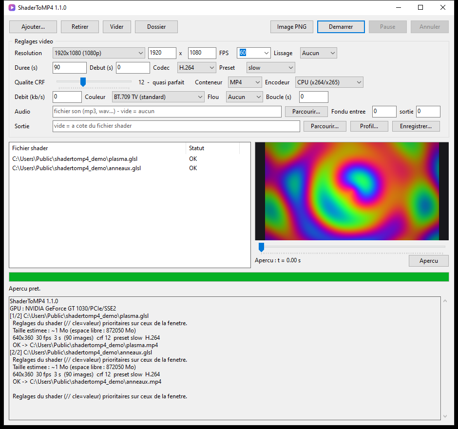

# ShaderToMP4

Convertit un shader [Shadertoy](https://www.shadertoy.com) (onglet *Image*) en vidéo, image par image, avec un temps exact (`iTime = image / fps`) : pas de saccades, pas de capture d'écran. Windows uniquement, un seul `.exe` (OpenGL 3.3 + `ffmpeg.exe`).



## Démarrage rapide

1. Lance `bin\ShaderToMP4.exe` (ou `ShaderToMP4.exe` si tu l'as copié ailleurs). Si `ffmpeg.exe` est absent, le programme propose de le télécharger (environ 80 Mo, depuis gyan.dev, vérifié par SHA-256) et de l'installer à côté de lui. Tu peux aussi le poser à la main dans le même dossier.
2. Glisse un ou plusieurs fichiers shader (`.txt` ou `.glsl`) dans la fenêtre, ou clique sur **Ajouter...**
3. Règle la vidéo dans le panneau **Réglages vidéo**, puis clique sur **Démarrer**.
4. La vidéo est créée à côté du shader (ou dans le dossier choisi dans **Sortie**). Double-clic sur un fichier terminé pour la lire, **Dossier** pour l'ouvrir dans l'explorateur.

Glisser des fichiers directement sur `ShaderToMP4.exe` les ajoute et lance le rendu tout de suite.

## Les boutons

| Bouton | Rôle |
|---|---|
| **Démarrer** | Rend tous les fichiers de la liste qui ne sont pas déjà terminés |
| **Pause** / **Reprendre** | Suspend le rendu (le temps de pause n'est pas compté dans la vitesse) |
| **Annuler** | Arrête le rendu. Les parties déjà terminées sont conservées (voir *Reprise*) |
| **Image PNG** | Rend une seule image, au temps « Début », du fichier sélectionné, et l'ouvre |
| **Aperçu** et curseur | Affiche dans la fenêtre une image du shader à un instant choisi (de « Début » à « Début + Durée »), sans lancer ffmpeg |
| **Dossier** | Ouvre l'explorateur sur la vidéo du fichier sélectionné |
| **Profil... / Enregistrer...** | Charge ou enregistre l'ensemble des réglages dans un fichier `.ini` |

## Les réglages

Tous les réglages se font dans la fenêtre, sont enregistrés dans `config.ini` à côté du `.exe` (à chaque rendu et à la fermeture), et peuvent être imposés **par shader** avec un commentaire :

```glsl
// fps=30
// duration=20
// width=3840
// height=2160
void mainImage(out vec4 fragColor, in vec2 fragCoord) { ... }
```

Les commentaires du shader sont prioritaires sur la fenêtre (le journal le signale).

| Réglage (fenêtre) | Clé | Valeurs |
|---|---|---|
| Résolution | `width`, `height` | 16 à 16384 (arrondi au nombre pair) |
| FPS | `fps` | 1 à 240 |
| Durée, Début | `duration`, `start` | secondes (`90`) ou `mm:ss` dans la fenêtre |
| Codec | `codec` | `h264`, `h265` |
| Preset | `preset` | `ultrafast` ... `veryslow` |
| Qualité CRF | `crf` | 0 (sans perte), 12 (quasi parfait), 18 (très bon) |
| Débit | `bitrate` | kb/s ; 0 = qualité constante (CRF) |
| Conteneur | `container` | `mp4`, `mov`, `mkv` |
| Encodeur | `encoder` | `cpu`, `auto`, `nvenc`, `amf`, `qsv` (repli sur le CPU si indisponible) |
| Lissage | `ss` | 1 à 4 : rendu à N× la taille puis réduction (supersampling) |
| Couleur | `color` | `bt709`, `bt709full` (pleine plage), `srgb`, `bt601` |
| Flou | `blur`, `shutter` | 1, 4, 8, 16 sous-images par image ; obturateur (0,5 = 180°) |
| Boucle (s) | `loop` | période du shader : la durée devient un multiple entier, la dernière image précède exactement la première |
| Audio | `audio` | fichier son, calé sur le temps « Début », complété par du silence s'il est plus court |
| Fondu entrée / sortie | `fadein`, `fadeout` | secondes, image et son |
| Sortie | `outdir` | dossier de sortie (vide = à côté du shader) |
| (config.ini seulement) | `chunk` | rendu par parties de N secondes (30 par défaut, 0 = jamais) |
| (config.ini seulement) | `pbo` | profondeur de la file de lecture GPU (2 à 8, 3 par défaut) |
| (config.ini seulement) | `gpu` | `auto`, `high`, `low` : GPU préféré de Windows (PC à deux cartes) |

## Reprise après interruption

Les vidéos plus longues que `chunk` secondes sont rendues par parties, dans un dossier `<nom>.parts` à côté de la vidéo. Si le rendu est annulé, plante ou échoue, les parties terminées restent : relance le même rendu **avec les mêmes réglages** et il reprend où il s'était arrêté, puis assemble les parties (copie des flux, sans réencodage). Si le shader ou un réglage a changé, les anciennes parties sont jetées.

## Limites

- Seul l'onglet *Image* est supporté : `iChannel0-3` (textures, buffers, multipasse), `iMouse` (fixe à 0) et le son Shadertoy ne le sont pas. Un shader qui les utilise s'affiche avec un avertissement et un rendu noir pour ces entrées.
- Un GPU compatible OpenGL 3.3 est nécessaire.
- Le choix du GPU (`gpu=high|low`) et les encodeurs AMD et Intel n'ont pas été testés sur du matériel réel.

## Auto-test

`scripts\test.bat` rend les shaders du dossier `tests` en 64×64 (à t = 1 s) et les compare à leurs images de référence `.ref` (écart moyen toléré : 2/255). Le rapport est dans `tests\report.txt` et le code de sortie vaut 0 si tout passe. Les références dépendent du GPU et du pilote : après un changement volontaire du rendu ou de matériel, régénère-les avec `scripts\test.bat --update`.

## Organisation du projet

```
bin/        ShaderToMP4.exe (résultat de la compilation), ffmpeg.exe, config.ini : le dossier à utiliser
src/        code source : main.cpp, core/ (moteur de rendu, sans interface), gui/ (fenêtre)
res/        icône (app.ico) et informations de version (app.rc)
scripts/    build.bat (compiler), test.bat (auto-test)
tests/      shaders de référence et leurs images .ref
docs/       capture d'écran, LISEZMOI.txt (résumé)
build/      fichiers objets (générés)
```

## Compiler

Avec les Build Tools de Visual Studio (le chemin de `vcvars64.bat` est écrit dans `scripts\build.bat`, à adapter si besoin) :

```
.\scripts\build.bat
```

Cela compile `res\app.rc` (icône, informations de version) puis tous les fichiers de `src` vers `bin\ShaderToMP4.exe`. Avec MinGW-w64 (non testé) :

```
g++ -std=c++17 -O2 -municode -mwindows -static -I src -o bin/ShaderToMP4.exe src/main.cpp src/core/*.cpp src/gui/*.cpp -lopengl32 -lgdi32 -luser32 -lcomctl32 -lcomdlg32 -lshell32 -ladvapi32 -lwininet
```

Le numéro de version est dans `src\version.h` (affiché dans le titre de la fenêtre, le journal et les propriétés de l'exe).

## Ligne de commande

| Commande | Effet |
|---|---|
| `ShaderToMP4.exe a.glsl b.glsl` | Ajoute les fichiers et lance le rendu |
| `ShaderToMP4.exe --selftest [--update] [--quiet]` | Auto-test (voir plus haut) |
| `ShaderToMP4.exe --get-ffmpeg [--quiet]` | Télécharge et installe `ffmpeg.exe` sans ouvrir la fenêtre |

## Licence

ShaderToMP4 est distribué sous licence [GPL-3.0](LICENSE). `ffmpeg.exe` est un programme séparé, non inclus dans ce dépôt : il est téléchargé à la demande depuis [gyan.dev](https://www.gyan.dev/ffmpeg/builds/) et reste soumis à sa propre licence.
