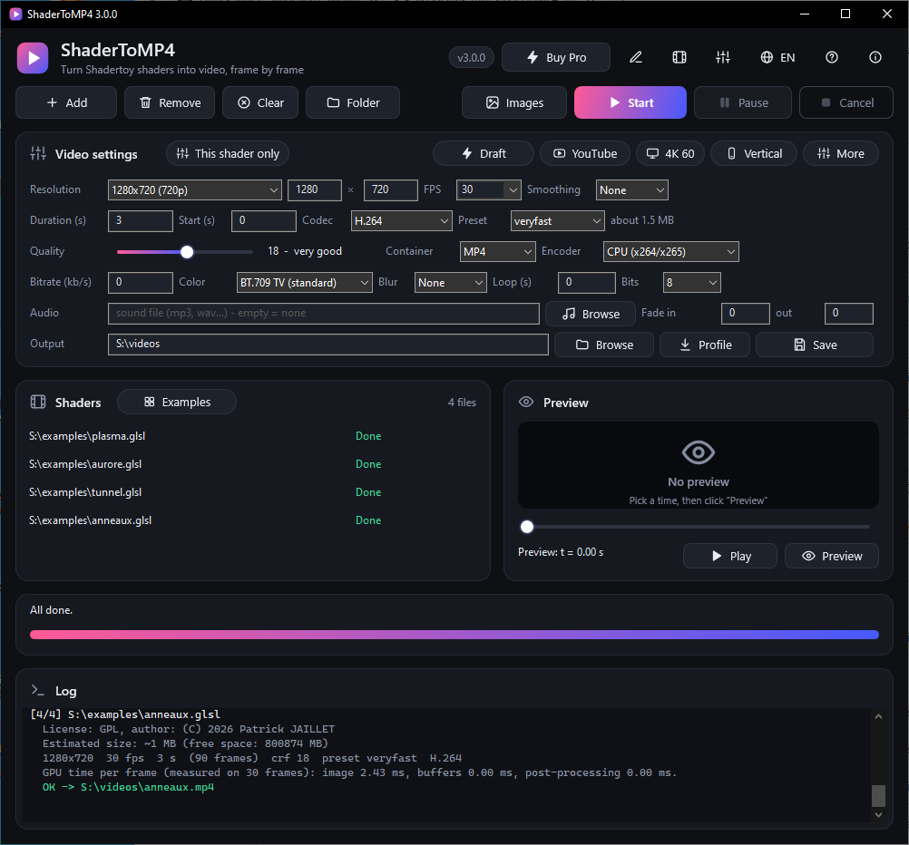
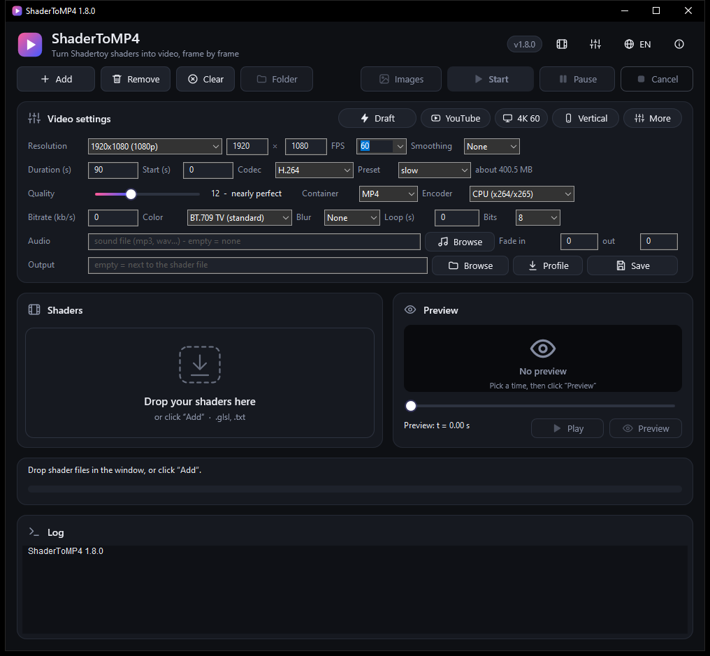
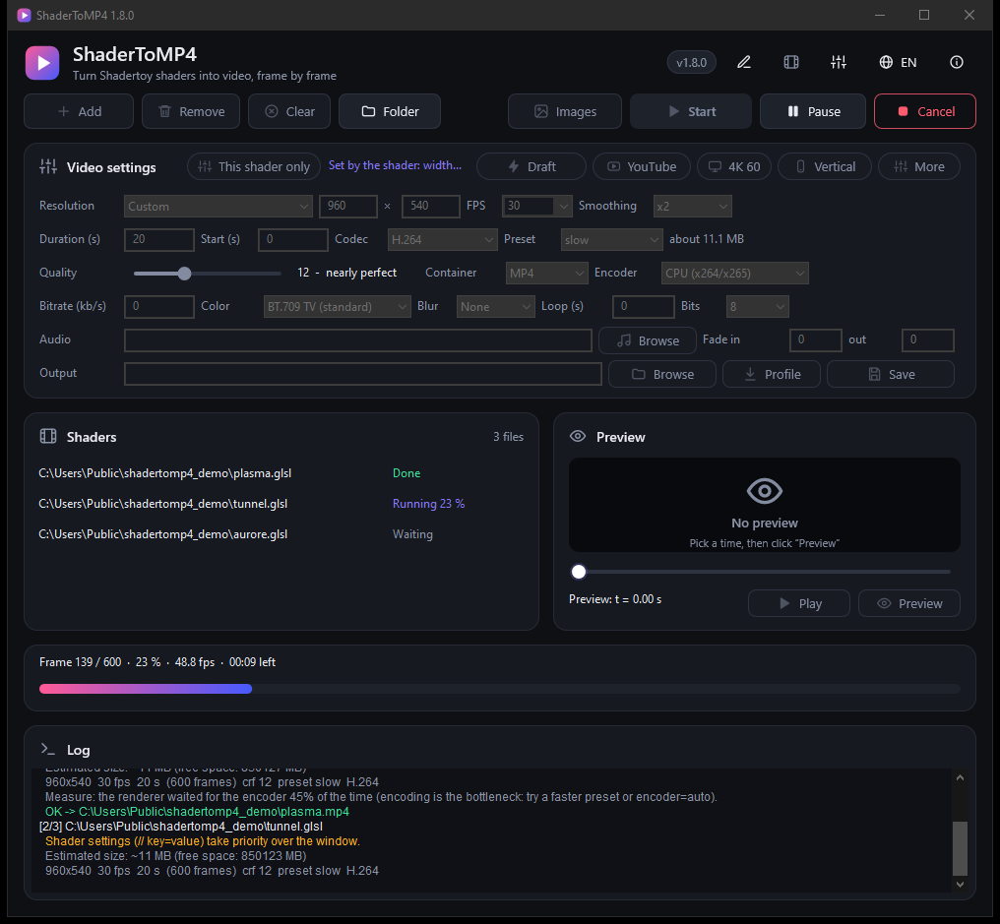
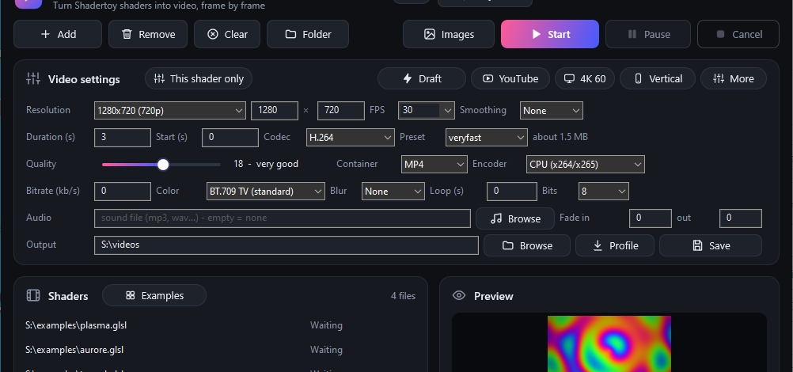
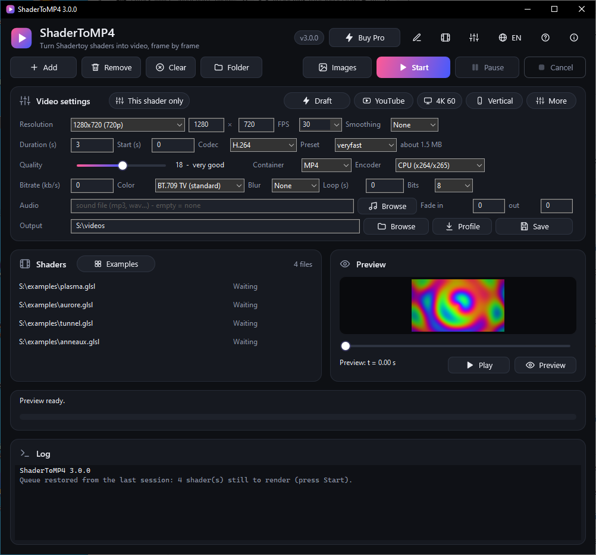
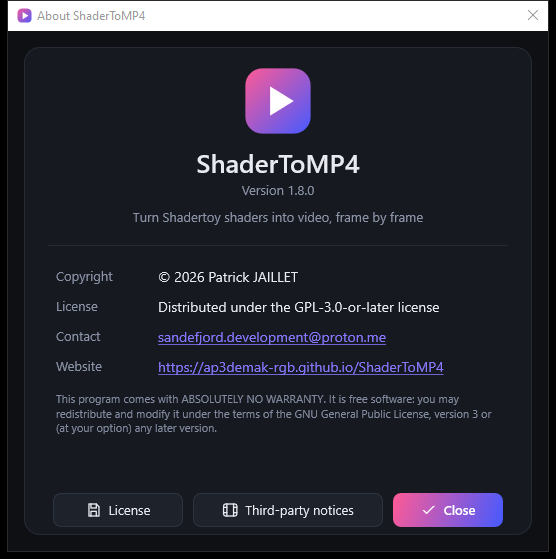
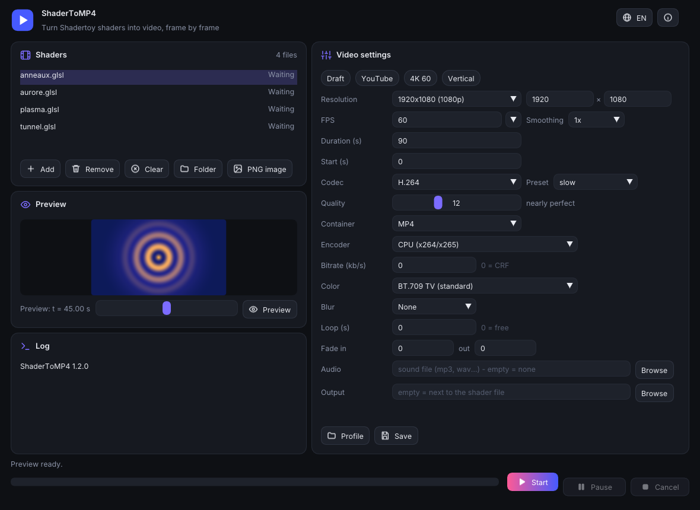
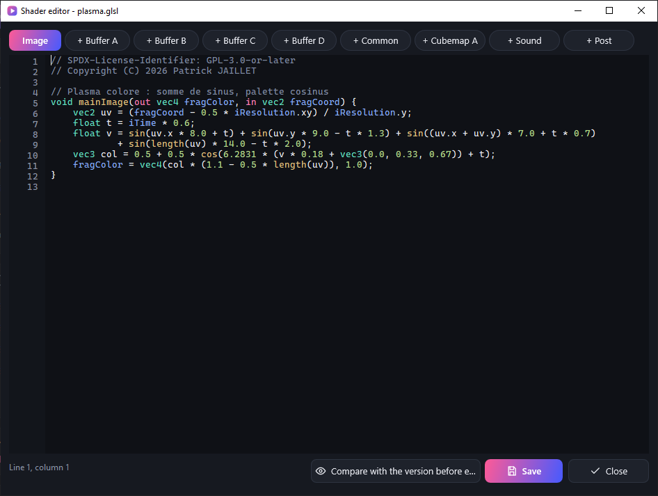
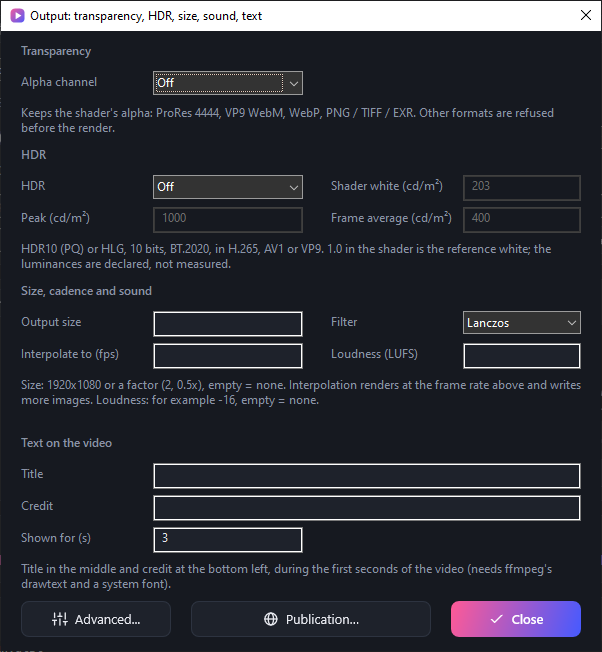

<!-- SPDX-License-Identifier: GPL-3.0-or-later - Copyright (C) 2026 Patrick JAILLET -->

<p align="center">
  
</p>

<p align="center"><b>English</b> · <a href="README.fr.md">Français</a></p>

<p align="center">
  <a href="https://github.com/ap3demak-rgb/ShaderToMP4/releases/latest"></a>
  &nbsp;
  <a href="https://ap3demak-rgb.github.io/ShaderToMP4"></a>
</p>

<p align="center">
  
  
  
  
  
  <a href="LICENSE"></a>
</p>

<p align="center">
  
</p>

**ShaderToMP4** converts a [Shadertoy](https://www.shadertoy.com) shader (*Image* tab, with its Buffer A–D, Common, Cubemap A and Sound passes) into a video, **frame by frame**, with exact timing (`iTime = frame / fps`). No screen capture, so no stutter and no loss, whatever the power of your graphics card: a shader that runs at 5 frames per second in real time still gives a perfectly smooth video.

One portable program for **Windows, Linux and macOS**, **no installer**, with a modern dark interface in English and French.

---

## Why ShaderToMP4?

| | |
|---|---|
| **Exact timing** | Each frame is rendered at time `n / fps`, then piped straight to ffmpeg: no intermediate file. |
| **Maximum quality** | Up to 16384 pixels wide, ×4 supersampling, motion blur (×4, ×8, ×16), correct BT.709 colour conversion, 10-bit output, lossless x264 / x265 if you want it. |
| **Many formats** | MP4, MOV, MKV, WebM (H.264, H.265, VP9, AV1), ProRes and DNxHR for editing, animated GIF and WebP, PNG / TIFF / EXR image sequences. |
| **Shadertoy features** | Textures, cubemaps, 3D textures, audio and video channels (`iChannel`), multi-pass shaders (Buffer A–D, Common, Cubemap A), Sound pass, offline import of a Shadertoy `.json` export, fixed mouse and date, WebGL 2 style GLSL, and a compatibility report before each render. |
| **Fast** | Rendering and encoding run in parallel, asynchronous GPU read-back, optional hardware encoding (NVENC, AMF, QuickSync, VAAPI, VideoToolbox). |
| **Reliable** | Long renders are made in parts: if anything fails, you resume exactly where you stopped. |
| **Practical** | Built-in preview, presets (YouTube, 4K, vertical 9:16), audio with fades, perfect loop, queue of several shaders, pause and cancel. |
| **Portable** | Nothing to install, on any system. Settings, languages and `ffmpeg` stay in the application folder. |

## The interface

<p align="center">
  
</p>

<table>
  <tr>
    <td width="50%"></td>
    <td width="50%"></td>
  </tr>
  <tr>
    <td align="center"><sub><b>Drop your shaders</b> in the drop zone, or click “Add”.</sub></td>
    <td align="center"><sub><b>Render in progress</b>: speed, time left, pause and cancel. Progress also shows in the taskbar.</sub></td>
  </tr>
</table>

<p align="center">
  <br>
  <sub>All video settings in one place, with <b>one-click presets</b> (Draft, YouTube, 4K 60, Vertical) and a tooltip on every field.</sub>
</p>

<p align="center">
  <br>
  <sub>The queue with the status of each shader, and a <b>preview</b> at the time of your choice, without starting ffmpeg.</sub>
</p>

<p align="center">
  <br>
  <sub>The “About” window (<code>F1</code>): version, copyright, license, contact and website. The globe button switches the language instantly.</sub>
</p>

### On Linux and macOS

Windows keeps its native Direct2D interface. Linux and macOS use a second interface with the same look (dark cards, gradient accent, the same SVG icons), built on GLFW and Dear ImGui and drawn with OpenGL; both interfaces share the same rendering engine, settings and translations.

<p align="center">
  <br>
  <sub>The Linux / macOS interface (screenshot produced by the continuous integration on Linux).</sub>
</p>

## Examples

The [`examples`](examples) folder contains four shaders ready to convert: plasma, rings (“anneaux”), tunnel and aurora (“aurore”).

<p align="center">
  
</p>

## Quick start

1. **Download** the portable archive for your system from the [Releases](https://github.com/ap3demak-rgb/ShaderToMP4/releases/latest) page and unpack it anywhere (or [build the project](#building)).

   | System | Archive | Run |
   |---|---|---|
   | Windows 10 / 11, 64-bit | `ShaderToMP4-<version>-win64.zip` | `ShaderToMP4.exe` |
   | Linux x86-64 | `ShaderToMP4-<version>-linux-x86_64.tar.gz` | `./ShaderToMP4` |
   | Linux ARM64 | `ShaderToMP4-<version>-linux-aarch64.tar.gz` | `./ShaderToMP4` |
   | macOS 10.13+, Apple Silicon and Intel | `ShaderToMP4-<version>-macos-universal.zip` | `ShaderToMP4.app` |

2. If `ffmpeg` is missing, the program offers to download it (Windows: about 80 MB from [gyan.dev](https://www.gyan.dev/ffmpeg/builds/); Linux: a static build from [BtbN](https://github.com/BtbN/FFmpeg-Builds); SHA-256 checked) and installs it next to itself. On macOS, install it with Homebrew (`brew install ffmpeg`) or place the `ffmpeg` binary next to the `.app`: no source publishes a verifiable SHA-256 for macOS builds, so there is no automatic download there.
3. **Drop** one or more shader files (`.glsl` or `.txt`) in the window, or click **Add**.
4. Adjust the video (or pick a preset), then click **Start**.
5. The video is created next to the shader, or in the folder chosen in **Output**.

> Files passed on the command line (or dropped on the executable on Windows) are added and rendered right away.

**Requirements**: a graphics card (or driver) supporting OpenGL 3.3, and
- **Windows**: Windows 10 (version 1703 or newer) or Windows 11.
- **Linux**: a desktop with X11 or Wayland (XWayland), glibc 2.35 or newer, the OpenGL driver of your graphics card (Mesa works), and `curl` and `tar` with `xz` for the automatic ffmpeg download. On hybrid-GPU laptops, set `gpu=high` in `config.ini` (or `--gpu=high` with `--render`) to use the discrete GPU, `gpu=low` for the integrated one (the program sets the PRIME variables of Mesa and of the NVIDIA driver before opening OpenGL; restart it after changing; `--diagnostic` shows which GPU is used).
- **macOS**: 10.13 or newer. The archive is signed ad hoc, not notarized: on first launch, right-click `ShaderToMP4.app` and choose *Open* (or run `xattr -dr com.apple.quarantine ShaderToMP4.app`). Settings are written in the folder that contains the `.app`, so keep it in a folder you can write to (not `/Applications`).

## Features

<details>
<summary><b>Buttons and keyboard shortcuts</b></summary>

| Button | Shortcut | Role |
|---|---|---|
| **Add** | `Ctrl+O` | Add shaders to the queue |
| **Start** | `F5` | Render every file of the list that is not already finished |
| **Pause** / **Resume** | `F6` | Suspend the render (paused time is not counted in the speed) |
| **Cancel** | `Esc` | Stop the render; finished parts are kept |
| **Images** | | Menu: a PNG image at the “Start” time, a cover thumbnail (middle of the range) or a contact sheet (3×2 to 6×5); the file is opened |
| **Edit** (pencil icon in the header; the **Edit** button under the list on Linux and macOS) | `Ctrl+E` | Open the editor of the selected shader and its passes (see “Editor and passes”) |
| **This shader only** | | The fields of the settings card apply to the selected shader alone (see “Queue order, settings of one shader, dropped media”) |
| **Preview** and slider | `Ctrl+P` | Show a frame of the shader at a chosen time, without ffmpeg |
| **Play** / **Stop** | | Play the shader in real time at preview size (up to 640 px), loop over the range, jump with the slider; the preview reloads by itself when the shader or one of its pass files changes on disk |
| **Remove** | `Del` (in the list) | Remove the selected shaders |
| **Folder** | | Open the folder of the selected shader's video |
| **Profile / Save** | | Load or save all settings in an `.ini` file |
| **Parameters** (sliders icon) | | Shader parameters and post-processing (effects, color LUT); on Linux and macOS these are at the bottom of the settings card |
| **About** | `F1` | Version, copyright, license, contact, website |
| **EN / FR** | | Switch the interface language |

`Tab` moves from one setting to the next. All text of the interface has a contrast of at least 4.5:1 against its background (WCAG AA), checked automatically for both interfaces.

**Queue kept between sessions**: the shaders that are not rendered yet (waiting, failed, cancelled or interrupted) are noted in `queue.txt` next to the program and put back in the list the next time you open it without files (the log says so; press Start). Finished shaders are forgotten, and so is a file that no longer exists.

</details>

<details>
<summary><b>Queue order, settings of one shader, dropped media</b></summary>

**Queue order.** Right-click a shader (on Windows also `Alt+Up` / `Alt+Down`): *Move to the top of the queue*, *Move up*, *Move down*, *Render only the selection* (the other shaders are left as they are), *Edit the shader…*, *Mark as pending* (a finished or failed shader is rendered again at the next Start), *Remove*. The order is kept in `queue.txt`. **Batches**: *Batch ▸ Put in batch 1 to 4* numbers the selected shaders (`[2]` shows in front of their name, kept in `jobs/batches.txt`), and *Render batch N* renders only that group, finished shaders included.

**Settings for one shader.** The settings card normally applies to every shader. The **This shader only** button (next to the title of the card) makes the fields apply to the selected shader alone: they are kept in the `jobs/` folder next to the program (one small `.ini` per shader), the shader file is not touched and the other shaders keep the general settings. This covers the settings card **and** the Output window (transparency, HDR, size, text, file name, parts, variants...), except the end-of-batch action. Press the button again to go back to the general settings (the shader's own settings are deleted). The right-click entry *Write the settings into the shader* turns them into `// key=value` comments at the top of the shader file (after a confirmation on Windows): it is the only way the program ever modifies a shader, and only when you ask. Priority: general settings, then the shader's own settings, then the `// key=value` comments of the shader.

**Settings imposed by the shader.** When the selected shader imposes a setting with a `// key=value` comment, the field shows the shader's value, greyed out, instead of the window's value (which is kept for the other shaders); the size estimate follows what the shader will do.

**Dropping media.** Drop an image, a sound or a video on the window: a menu asks for the channel, and the line `// iChannel0=tex/wood.png` (`audio:file.wav` for a sound, `video:clip.mp4` for a video; a path relative to the shader when the file is next to it) is written in the comments of the selected shader. For a sound the menu also offers the soundtrack (`// audio=…`). Shader files dropped on the window are still added to the list.

**Preview.** While the shader plays, the time label also shows the frame number and the real frame rate of the preview (`t = 1.23 s · #37 · 58 fps`); the Images menu has *PNG image at the preview time*.

</details>

<details>
<summary><b>Editor and passes</b></summary>

Open it with the pencil icon in the header (Windows), the **Edit** button under the list (Linux and macOS), `Ctrl+E` or the right-click menu of the list.

- **One tab per file of the shader**: Image (the shader itself), Buffer A–D, Common, Cubemap A, Sound and Post. A tab marked `+` does not exist yet: one click creates the file next to the shader (`name.bufferA.glsl`…) with a minimal code that compiles, and opens it.
- **Windows**: GLSL colouring (comments, `// key=value` directives, keywords, types, functions, Shadertoy uniforms, numbers, `#` lines), line numbers, undo. **Linux and macOS**: the same tabs, line numbers and colours (the text field is drawn transparent and the same text is drawn again over it, coloured; the editor uses the font built into Dear ImGui, so only ASCII characters are drawn).
- **`Ctrl+S`** writes the file in its own folder (never elsewhere; it is written aside then renamed, so never half-written; line endings and byte order mark are kept) and reloads the preview. The compiler errors come back in the log as `file:line: message` and are marked in the editor: red underlined line, dot in the margin, message under the editor. When the live preview is playing it reloads by itself.
- Closing asks whether to save the modified tabs. A render started meanwhile uses what is on disk.

<p align="center"></p>

</details>

<details>
<summary><b>All settings</b> (window, <code>config.ini</code> or shader comments)</summary>

Settings are saved in `config.ini` next to the `.exe`, and can be forced **per shader** with a comment (it takes priority over the window; the log says so, and the window shows “Set by the shader: …” in the settings card when such a shader is selected):

```glsl
// fps=30
// duration=20
// width=3840
// height=2160
void mainImage(out vec4 fragColor, in vec2 fragCoord) { ... }
```

| Setting (window) | Key | Values |
|---|---|---|
| Resolution | `width`, `height` | 16 to 16384 (rounded to an even number) |
| FPS | `fps` | 1 to 240 |
| Duration, Start | `duration`, `start` | seconds (`90`) or `mm:ss` in the window |
| Codec | `codec` | `h264`, `h265`, `vp9`, `av1`, `prores_*`, `dnxhr_*` (see “Output formats”) |
| Preset | `preset` | `ultrafast` ... `veryslow` |
| Quality (CRF) | `crf` | 0 (lossless), 12 (nearly perfect), 18 (very good) |
| Bitrate | `bitrate` | kb/s; 0 = constant quality (CRF) |
| Container | `container` | `mp4`, `mov`, `mkv`, `webm`, `gif`, `webp`, `png`, `tiff`, `exr` (WebM: VP9/AV1 only; MOV: not VP9/AV1; MP4: not ProRes/DNxHR) |
| Bits | `depth` | 8 or 10 bits per channel (10: H.265, AV1, VP9, ProRes, PNG/TIFF) |
| Encoder | `encoder` | `cpu`, `auto`, `nvenc`, `amf`, `qsv` (falls back to the CPU if unavailable) |
| Smoothing | `ss` | 1 to 4: render at N× the size, then downscale (supersampling) |
| Color | `color` | `bt709`, `bt709full` (full range), `srgb`, `bt601` |
| Blur | `blur`, `shutter` | 1, 4, 8, 16 sub-frames per frame; shutter (0.5 = 180°) |
| Loop (s) | `loop` | shader period: the duration becomes a whole multiple, the last frame comes exactly before the first |
| Audio | `audio` | sound file, aligned with the “Start” time, padded with silence if shorter |
| Fade in / out | `fadein`, `fadeout` | seconds, picture and sound |
| Output | `outdir` | output folder (empty = next to the shader) |
| (shader comments) | `iChannel0`…`iChannel3`, `bufferA`…`bufferD` (`.scale`, `.size`), `mouse`, `key`, `date` | textures, simulated mouse, keyboard and date (see “Shadertoy compatibility”) |
| (shader comments, `--variant=`) | `variant` | extra renderings of the same shader, one line per variant: `// variant=720p:width=1280\|height=720\|crf=23`. The base render comes first, then each variant with its own settings; its name is added to the file name (`shader_720p.mp4`) unless the variant sets `name` |
| (config.ini only) | `name`, `exists` | output file name template and what to do when it exists (see “Output formats”) |
| (config.ini only) | `gpu` | graphics card on a two-GPU PC, Linux only: `default`, `high` (the discrete one) or `low` (the integrated one). Windows already asks for the powerful GPU; macOS chooses by itself |
| (config.ini only) | `endaction` | after a successful batch: `none` (default), `folder` (show the last file in the file manager) or `sleep` (the computer sleeps after 15 s; closing the program cancels it). At the end of a batch the taskbar / Dock button always flashes |
| (config.ini only) | `chunk` | render in parts of N seconds (30 by default, 0 = never) |
| (config.ini only) | `metadata` | 1 = write title (shader name) and comment (size, frame rate, version) in the file, 0 = none (1 by default) |
| (shader comments, config.ini) | `alpha` | `1` keeps the shader's alpha channel (ProRes 4444, VP9 WebM, WebP, PNG / TIFF / EXR); see “Output” |
| (shader comments, config.ini) | `hdr`, `hdrpeak`, `hdrfall`, `hdrwhite` | `pq` (HDR10) or `hlg`; declared MaxCLL and MaxFALL in cd/m² (1000, 400), shader white in cd/m² (203) |
| (shader comments, config.ini) | `scale`, `scalefilter` | output size (`1920x1080`, `2`, `0.5x`) and its filter (`lanczos`, `bicubic`, `bilinear`, `area`, `neighbor`) |
| (shader comments, config.ini) | `interp`, `loudnorm` | output frame rate by interpolation; sound normalization in LUFS (`-16`) |
| (shader comments, config.ini) | `title`, `credit`, `titledur` | text drawn on the first seconds of the video (title in the middle, credit at the bottom left) |
| (shader comments, config.ini) | `post`, `lut` | post-processing effects (`post=bloom:0.4,grain,vignette`) and color LUT (`lut=grade.cube`); see “Creating” |
| (shader comments, `--param=`) | `key name=…`, `param` | animated parameters: `// key speed=0:1.0 ; 4:3.0`, `--param=speed=2.5`; see “Creating” |
| (shader comments, config.ini) | `vr`, `vripd` | `mainVR` shader as a 360° video: `auto` (default), `off`, `mono`, `stereo` (top / bottom), `sbs` (side by side), `anaglyph` (red-cyan), `fulldome` (180° fisheye square); distance between the eyes of the stereo render (see “Shadertoy compatibility”) |
| (shader comments, config.ini) | `warmup` | frames simulated before the first one (0 to 3600, 0 by default): the buffers (Buffer A–D, Cubemap A) are warmed up, and `iFrame` starts at N (frame 0 has `iFrame` = N, `iTime` is unchanged). Useful for feedback effects that need time to settle; `iTime` of the warm-up frames is `start − N/fps`, so it can be negative |
| (shader comments, config.ini, `--loopmode=`) | `loopmode`, `loopfade` | seamless loop without touching the shader: `crossfade` (the first `loopfade` seconds, 1 by default, blend with the shader one duration later, so the last frame joins the first) or `pingpong` (the time goes up then comes back); `none` by default; see “Output” |
| (shader comments, config.ini, `--timemap=`) | `timemap`, `speed`, `audiofollow` | time curve `video:shader` in seconds, e.g. `0:0;4:1;8:5` (smooth between points, no spaces in a shader comment), and constant speed (0.25 = four times slower, negative = backwards); `audiofollow=1` lets the sound follow a constant speed |
| (shader comments, config.ini, `--samples=`) | `samples` | still image (`--png`): average of N independent samples of the same instant (1 to 100000, `iFrame` differs for each); see “Output” |
| (shader comments, config.ini, `--precheck=`) | `precheck` | `1`: a quick quality check (flashes, invalid values) before every video render, written in the log and next to the video; warns, never blocks; `0` by default |
| (shader comments, config.ini, `--target=`) | `target` | publication target: `youtube-1080p`, `youtube-shorts`, `instagram-reels`, `tiktok`, `square-social`, `x-twitter`, `discord-8mb`, `discord-25mb`, or one of your own in `presets/targets.ini`; sets size, cadence, codec, container and weight; the settings written in the shader win; see “Output” |
| (shader comments, config.ini, `--targetsize=`) | `targetsize` | file weight to reach (`8MB`, `25MB`, `800KB`): the bitrate is computed and corrected until the file fits; h264, h265, vp9, av1 |
| (shader comments, config.ini, `--crop=`) | `crop` | crop after the render, centred: `9:16`, `1:1`, or `W:H:X:Y`; the shader is rendered in full |
| config.ini, `--mastercache=` / `--cachemax=` | `mastercache`, `cachemax` | `1`: a lossless master kept in `cache/` from which every format is derived without rendering again; the cache stays under `cachemax` GB (10 by default) |
| (shader comments, config.ini, `--embed=`) | `embed` | `1`: the shader, its passes and the settings are written into the video tag so that `--reproduce` can render it again; `0` by default |
| (shader comments, config.ini, `--animpreview=`) | `animpreview` | `off` (default), `gif` or `webp`: an animated 3 s, 480 px preview next to the video |
| (shader comments, config.ini, `--autocredit=`) | `autocredit` | `1`: title, author and license read in the header of the shader are written on the first seconds of the video and in the file metadata |
| (shader comments, config.ini, `--stillformat=`) | `stillformat` | `png` (default) or `tiff` for still images (`--png`, posters, cubemap faces) |
| (shader comments, config.ini, `--tile=`) | `tile` | still image (`--png`): side of the tiles in pixels (64 to 16384); `0` (default) = automatic: tiles of 2048 × 512 as soon as the image exceeds 8192 pixels or the GPU limit; see “Output” |
| (shader comments, config.ini, `--printdpi=`) | `printdpi` | PNG still image: resolution written in the file, in dots per inch (0 = none; `--dpi=` is the window scale option) |
| (config.ini only) | `pbo` | depth of the GPU read-back queue (2 to 8, 3 by default) |
| (shader comments, config.ini, `--report=`) | `report` | `json` or `text`: a render report is written next to each video (see “Output”); `off` by default |

</details>

<details>
<summary><b>Output formats, 10-bit, file names and presets</b></summary>

| Format | `codec` | `container` | Notes |
|---|---|---|---|
| H.264, H.265 | `h264`, `h265` | `mp4`, `mov`, `mkv` | hardware encoders: NVENC, AMF, QuickSync, VAAPI, VideoToolbox |
| VP9, AV1 | `vp9`, `av1` | `webm`, `mp4`, `mkv` | VP9 on the CPU (libvpx-vp9); AV1 with SVT-AV1 (libaom as a fallback), and tried first on NVENC / AMF / QuickSync / VAAPI when an encoder is chosen (falls back to the CPU); WebM sound is Opus |
| ProRes | `prores_proxy`, `prores_lt`, `prores_422`, `prores_hq`, `prores_4444` | `mov`, `mkv` | editing format: 10-bit 4:2:2 (4:4:4 for 4444), very large files, CRF and bitrate ignored |
| DNxHR | `dnxhr_sq`, `dnxhr_hq`, `dnxhr_hqx`, `dnxhr_444` | `mov`, `mkv` | editing format, at least 256×120 |
| Animated GIF | (ignored) | `gif` | palette optimised on the whole animation, no sound; 15 to 25 frames/s is suggested and a size limit protects the memory |
| Animated WebP | (ignored) | `webp` | quality from the CRF slider, no sound |
| Image sequence | (ignored) | `png`, `tiff`, `exr` | folder `<name>_frames/` with `<name>_000000.png`…; full range RGB, no YUV conversion; 16-bit PNG / TIFF with 10 bits; EXR in half float |

- **Bits** (`depth`, 8 or 10): at 10 the shader is rendered in 16 bits per channel and encoded as H.265 Main10, AV1, VP9 profile 2, ProRes / DNxHR (always 10-bit) or 16-bit PNG / TIFF, which removes the banding of smooth gradients. Hardware encoders are 8-bit only: the CPU is used instead (the log says so).
- A codec or container that the installed ffmpeg cannot produce is marked “not in this ffmpeg” in the lists; install a full build of ffmpeg (the automatic download is one). A combination that cannot exist (WebM with H.264, MOV with VP9, MP4 with ProRes) is refused with an explanation before rendering starts.
- **Estimated size**: shown under the settings (rough, it depends on the shader), with a warning when the destination drive is too small.
- **File name** (config.ini or shader comment): `name` is a template, by default `{shader}`; `{w}`, `{h}`, `{fps}`, `{date}` and `{codec}` are replaced (`// name={shader}_{w}x{h}`). `exists` decides what happens when the result already exists: `overwrite` (default), `number` (`name-2`, `name-3`…) or `skip`.
- **Presets**: the chips (Draft, YouTube, 4K 60, Vertical) and the “More” menu (X 720p30, light GIF, ProRes for editing, WebM VP9) change size, frame rate, codec, container and quality only. Your own presets are `.ini` files in a `presets` folder next to the program: they appear in the “More” menu (same format as a profile saved with “Save”).

</details>

<details>
<summary><b>Shadertoy compatibility</b> (channels, passes, sound, mouse, date)</summary>

The **Image** tab and the **Buffer A–D**, **Common**, **Cubemap A** and **Sound** passes are rendered, and `mainVR` (VR shaders) gives a 360° video. What works:

| Feature | Status |
|---|---|
| `mainImage`, `iResolution`, `iTime`, `iTimeDelta`, `iFrame`, `iFrameRate`, `iSampleRate` (44100) | supported, exact per frame |
| `iChannel0` to `iChannel3` as 2D textures | supported: `// iChannel0=image.png` (path relative to the shader; PNG, JPG, HDR, EXR… anything ffmpeg decodes), `noise` or `grid` (generated, identical on every run) |
| texture options | `// iChannel0.filter=nearest\|linear\|mipmap` (mipmap by default), `.wrap=clamp\|repeat` (repeat by default), `.vflip=0\|1` (1 by default, like Shadertoy) |
| `iChannelResolution`, `iChannelTime` | supported: the resolution of each channel (256×3 for the keyboard, 512×2 for audio); the time is the render time `iTime` for audio and video channels, 0 for the others |
| `iMouse` | simulated and deterministic. Fixed: `// mouse=0.5,0.5` (fractions of the size, origin at the bottom left), `// mouse=0.5,0.5,down` for a pressed button. Animated, with keyframes (time in seconds, `t:x,y[,down]`, separated by `;`): `// mouse=0:0.2,0.2 ; 5:0.8,0.6,down ; 8:0.8,0.6`. The position is interpolated linearly between two keys and stays constant before the first and after the last. `iMouse.zw` follows Shadertoy: the position of the last click, `z` > 0 while the button is down, `w` > 0 only on the frame where the click starts; the button is pressed from a `down` key until the next key without `down`. Without a setting, 0 |
| `iDate` | real date by default; `// date=2026-03-14T15:09:26` fixes the starting date for a reproducible render. The date advances with the render time (day, month and year roll over at midnight); `+rate=R` sets the seconds of date per second of video: `// date=2026-03-14T15:09:26+rate=60` runs one minute per second, `+rate=0` freezes it (the default is 1) |
| Buffer A–D, Common | supported as files next to the shader: `name.bufferA.glsl` … `name.bufferD.glsl` and `name.common.glsl` (add only `name.glsl` to the list). Each pass reads its inputs through its own `// iChannel0=bufferA` comments (`bufferA` to `bufferD`, `image`-type channels, `noise`, `grid`). Order: A, B, C, D, then Image; a buffer read after its pass in the same frame gives the current frame, read before (or by itself) it gives the previous one, as on Shadertoy. Buffers are 32-bit float, start black, are rendered once per frame (not blurred by motion blur), default to linear filtering and clamping. A buffer can have its own size, set in the main shader (or `config.ini`): `// bufferA.scale=0.5` (fraction of the render size, supersampling included) or `// bufferA.size=512x512` (pixels, `512` alone for a square); the pass sees it in `iResolution`, and the passes that read it (and the image) in `iChannelResolution`. Reading a smaller or larger buffer is bilinear unless `.filter=nearest` is set |
| History of the buffers | a render that starts later (resuming parts, preview at a given time) replays the earlier frames first, without encoding them; the log says so. The preview replays at most 600 frames |
| GLSL written for WebGL 2 | accepted: `#version` and `#extension` lines are ignored, `precision` statements, `texture2D`, `texture2DLod` and `texelFetch`, `textureLod`, `dFdx`… work (the program compiles in GLSL 3.30 core). A compile error names the pass (`[Buffer A]`) and keeps the line numbers of its file |
| Compile errors | shown as `file:line: message` (like a compiler, the file being the shader or the pass); **double-click** the line in the log to open the file at that line (Notepad++, Sublime Text or VS Code when installed, otherwise the default application) |
| Compatibility report | before each render the log lists what is ignored or fixed (and, for a VR shader, the 360° mode and the size it expects): `mainSound` written in the main file, cubemaps or 3D textures read without a channel, `iMouse` or `iDate` read without a fixed value, a keyboard channel without keys, `iChannelTime` read without an audio or video channel, a channel that is set but never read by its code, and a buffer or Cubemap A pass that neither the image nor any pass that is read ever reads |
| Sound pass | file `name.sound.glsl` with `vec2 mainSound(int samp, float time)`, rendered by the GPU (512×512 stereo samples per block, 44.1 kHz, Common available) into a temporary WAV file that becomes the audio track of the video, from the `start` time on; the `audio` setting, if set, replaces it. Video outputs only (GIF, WebP and sequences have no sound); the temporary file is deleted at the end |
| Cubemap A | file `name.cubemapA.glsl` with `mainCubemap(out vec4 fragColor, in vec2 fragCoord, in vec3 rayOri, in vec3 rayDir)`, rendered on the six faces (512×512) every frame; read it with `// iChannel0=cubeA` |
| Shadertoy import | drop, add or `--render` the `.json` file exported from the shader page (Export button): passes, Common and `iChannel` comments are written to the `shadertoy/` folder next to the program, then rendered. Offline, no account and no API key. Shadertoy's own media (textures, cubemaps, volumes) are replaced by generated stand-ins (noted in the log); the Sound pass is imported and rendered as `name.sound.glsl`; the webcam is not supported; a `mainVR` pass is rendered as 360° (see “mainVR”); a keyboard input becomes the simulated keyboard channel (set the keys with `// key=`). The shader keeps its author's license |
| cubemap, 3D texture, audio, video channels | supported: `// iChannel0=cube:sky` (generated sky), `cube:name_%d.png` (six square faces 0 to 5 = +X −X +Y −Y +Z −Z) or `cube:cross.png` (4×3 cross); `volume:noise` (generated) or `volume:image.png@N` (N slices side by side) or `volume:file.bin` (Shadertoy's 3D volume format: 20-byte header, then 8-bit or 32-bit float values, 1 to 4 channels, up to 1024 per side; one channel gives red only, floats are kept in full precision; the Shadertoy volume files themselves are not shipped, take your own `.bin`); `audio` (the soundtrack of the `audio` setting) or `audio:file.mp3` gives Shadertoy's 512×2 texture (row 0 spectrum, row 1 waveform, computed at the exact time of each frame, without the web analyser's smoothing between frames); `video:file.mp4` plays a video (looped, decoded by ffmpeg at the render frame rate, reduced to 1280×720 at most, `.vflip` as for images). The shader's own `samplerCube` / `sampler3D` declarations are matched automatically |
| `mainVR` (VR shaders) | rendered as a **360° equirectangular video**. A shader that has `mainVR` and no `mainImage` is detected automatically; otherwise set `// vr=mono` or `// vr=stereo` (`vr=off` ignores `mainVR`). The ray origin and direction are given for every pixel as `mainVR(out vec4 fragColor, in vec2 fragCoord, in vec3 fragRayOri, in vec3 fragRayDir)`; forward is the centre of the image (−Z), up is +Y. **Mono**: width = 2 × height (e.g. 4096×2048 or 8192×4096), `fragRayOri` is the origin. **Stereo**: top / bottom, left eye on top, width = height (e.g. 4096×4096), `iResolution` is the size of one eye and the origin moves on a circle of diameter `vripd` (0.064 by default, in shader units), as in omnidirectional stereo. The log warns when the size does not fit. In an MP4 or MOV file the “spherical video” metadata (equirectangular, top-bottom for stereo) is added after the render so that YouTube and VR players play it as 360° (`metadata=0` leaves it out; other containers cannot carry it). Only the Image pass is VR: buffers and Cubemap A are normal passes, and the head position and orientation of a headset are not simulated |
| keyboard channel | simulated and deterministic: `// iChannel0=keyboard` gives Shadertoy's 256×3 texture (row 0 key down, row 1 key pressed during this frame, row 2 toggle; read it with `texelFetch(iChannel0, ivec2(keyCode, row), 0).x`), and the keys are pressed at the instants given by `// key=code:start-end` (key code as in JavaScript, or a letter `a`–`z`, or `space`, `enter`, `left`, `up`, `right`, `down`, `shift`, `ctrl`, `alt`, `esc`, `tab`, `backspace`; times in seconds of `iTime`). Several keys on one line with `;`, or several `// key=` lines: `// key=space:2-4.5 ; left:1-3`. The real keyboard is never read |
| webcam channel | not supported (the render is not interactive) |
| `// iChannel` lines are not needed when the shader never reads the channel | a channel that is read without a texture stays black and the log says so |

</details>

<details>
<summary><b>Creating: animated parameters and post-processing</b></summary>

**Parameters.** A comment declares an adjustable `uniform` that is added to every pass of the shader (image, buffers, Cubemap A, post): `// uniform type name = default [min..max]`.

```glsl
// uniform float speed = 1.0 [0..5]
// uniform int   count = 3 [1..10]
// uniform bool  glow = true
// uniform vec2  center = 0.5, 0.5 [0..1]
// uniform color tint = #ff8800        (a vec3 in the shader)
// uniform float kick = audio.bass     (follows the sound, see below)
void mainImage(out vec4 fragColor, in vec2 fragCoord) { ... speed ... }
```

Types: `float`, `int`, `bool`, `vec2`, `vec3`, `vec4`, `color`. Without a range the slider goes from 0 to twice the default (at least 1). A name that is already used (a Shadertoy variable such as `iTime`, a GLSL word, a uniform written in the shader, a duplicate) stops the render with a clear message, and so does an invalid declaration or value.

- **Panel.** Windows: the sliders button in the header opens “Parameters and post-processing”; Linux and macOS: the “Shader parameters” section at the bottom of the settings card. One slider, checkbox or color picker per parameter of the selected shader. The values are saved per shader in the `params/` folder next to the program (nothing is written elsewhere) and used at once by the live preview and by every render. “Reset parameters” goes back to the values written in the shader. The time slider of the preview shows a thin mark at every keyframe time of the selected shader.
- **Keyframes.** `// key name=0:1.0 ; 4:3.0 ; 8:1.0` (time in seconds of `iTime`, then the value; `x,y` for a vector, `#rrggbb` for a color). The value is interpolated between two keys and stays constant before the first and after the last. A word in front chooses the interpolation: `smooth`, `linear` (default) or `constant` (a step at each key): `// key tint=smooth 0:1,0,0 ; 2:0,0,1`. A single value without a time (`// key glow=false`) fixes the parameter. A parameter with keyframes is animated: its slider is inactive. The same syntax works on the command line: `--param=speed=2.5` or `--param="speed=smooth 0:1 ; 4:3"`. Order of priority: declaration, then the values saved by the panel, then `--param`, then the `// key` lines of the shader.
- **Linked to the sound.** `// uniform float kick = audio.bass` (also `audio.level`, `audio.mid`, `audio.treble`) takes its value from the file of the `audio` setting at the exact time of every frame, with the same analysis as the `audio` channel: `level` is the loudness over the last 23 ms (1 = a full-scale sine), `bass` the peak of 0–250 Hz, `mid` of 250 Hz–2 kHz, `treble` of 2–10 kHz, all in 0..1. With `[min..max]` the value is scaled to that range (`// uniform float kick = audio.bass [1..3]`). Only `float` and `int` can follow the sound. Without an audio file the parameter keeps its default and the log says so.

**Post-processing.** Applied to the rendered image **in floating point, before the conversion to 8 or 10 bits**, so it works with supersampling, motion blur and 10-bit output, and values above 1 (bright lights) are still there for the bloom. Order: the `name.post.glsl` pass, then the effects, then the LUT, then the fade.

- **`name.post.glsl`** next to the shader: a `mainImage` that receives the rendered image in `iChannel0` and has the same inputs as an image shader (`iTime`, `iFrame`, `iMouse`, parameters, `// iChannel1=...`, Common, buffers). Errors are reported as `file:line`.
- **Effects**, in the window (checkbox + slider) or `// post=bloom:0.4,grain,vignette` (name, then the amount after a colon; without it, the default). They are always applied in this order:

  | Effect | Amount (default) | What it does |
  |---|---|---|
  | `sharpen` | 0 to 4 (0.5) | unsharp mask |
  | `chroma` | 0 to 0.2 (0.01) | chromatic aberration, growing toward the edges |
  | `bloom` | 0 to 4 (0.35) | glow of the bright parts (blurred at three scales) |
  | `contrast` | −1 to 2 (0.15) | contrast around 0.5 |
  | `saturation` | −1 to 2 (0.25) | −1 gives grey |
  | `hue` | −0.5 to 0.5 (0.05) | hue rotation, in turns (1 = 360°) |
  | `vignette` | 0 to 2 (0.4) | darker corners |
  | `grain` | 0 to 1 (0.06) | film grain, different on each frame, the same on every render |

- **Color LUT.** `// lut=grade.cube` (path relative to the shader) or the “Color LUT” field: a `.cube` file, 1D (`LUT_1D_SIZE` 2 to 256) or 3D (`LUT_3D_SIZE` 2 to 65), with `DOMAIN_MIN` / `DOMAIN_MAX`. The 3D table is read with **tetrahedral interpolation**. The file is checked when it is read: wrong size, wrong number of lines, unknown keyword or invalid number stop the render with the file name and the line.

The window shows the effects in the live preview (restarted a moment after a change); `// post=` and `// lut=` written in a shader take priority over the window. The settings `post` and `lut` can also be written in `config.ini`. Not done: effects in the Windows main window itself (they are in the “Parameters” window), several `.post.glsl` passes, and per-pass sizes for the post chain (it works at the render size).

</details>

<details>
<summary><b>Output: transparency, HDR, size, sound, text, montage, contact sheets</b></summary>

All of these are written as `// key=value` comments in the shader, in `config.ini` or on the command line (`--key=value`), and set in the **Output** window (the film icon in the header on Windows; a section at the bottom of the settings card on Linux and macOS). Values are checked when you close the window (Windows) or press Start, with the same rules as the command line.

<p align="center"></p>

**Transparency** (`alpha=1`). The shader's `fragColor.a` is kept (straight, not premultiplied alpha; most Shadertoy shaders write garbage or 0 there, so it is off by default). Possible with **ProRes 4444** (MOV, MKV), **VP9** (WebM, MKV; 8-bit alpha), **WebP** and **PNG / TIFF / EXR** sequences; every other combination (H.264, H.265, AV1, GIF, ProRes 422...) is refused before the render with a message. Supersampling, motion blur and the post-processing keep the alpha (the blur accumulates premultiplied colors, so edges stay exact); fades act on the alpha, the live preview and the preview image show the transparency over a gray checkerboard. The size estimate counts the alpha channel. Not possible with HDR or frame interpolation.

**HDR** (`hdr=pq` for HDR10, `hdr=hlg` for HLG). The picture is rendered in floating point and encoded in **BT.2020** with the PQ or HLG transfer, 10 bits (set automatically), with the matching color tags. The shader values are read as sRGB: **1.0 is the reference white**, `hdrwhite` cd/m² (203 by default, BT.2408), and values above 1.0 become highlights (a bright light written `vec3(4.0)` is 4× the white). For HDR10 the stream declares its luminances: `hdrpeak` (MaxCLL and mastering display, 1000 cd/m² by default) and `hdrfall` (MaxFALL, 400); they are declared, not measured on your frames. Codecs: **H.265** (x265, with the HDR10 SEI), **AV1** (SVT-AV1 with the static metadata when this ffmpeg accepts it, otherwise the color tags only; the log says so) and **VP9** (color tags only), in MP4, MKV or WebM. Hardware encoders are 8-bit here: the CPU encoder is used and the log says so. There is no tone mapping to SDR: the preview and single images (`--png`) stay in SDR.

**Size, cadence and sound.**
- `scale=1920x1080` or `scale=2` / `scale=0.5x` (factor): render at the window size, write at another one; `scalefilter=lanczos` (default), `bicubic`, `bilinear`, `area` or `neighbor` (nearest neighbour, for pixel art). Dimensions are rounded to even numbers.
- `interp=60`: render at `fps` (say 30) and let ffmpeg's `minterpolate` write 60 images per second. Native rendering is always better (a shader can render the extra frames exactly); this is for shaders that are too slow. It works in 8 bits, not with alpha, and across the parts of a long render the first image of each part has no previous image to interpolate from.
- `loudnorm=-16`: EBU R128 normalization to that loudness (LUFS), in one pass, for the `audio` file and for the sound pass. A short sound gives a less exact result (the filter measures over about 3 seconds).

**Text on the video** (`title=My title`, `credit=Shader by Name`, `titledur=3`). The title is drawn in the middle and the credit at the bottom left for the first `titledur` seconds, fading in and out, with ffmpeg's `drawtext` filter and a font of the system (Segoe UI on Windows, DejaVu or Liberation or Noto on Linux, Helvetica or Arial on macOS); the render stops with a message if this ffmpeg has no `drawtext` or no font is found. Chunked renders keep the right timing. When you import a Shadertoy `.json`, the log gives the line to add to credit the author.

**Montage** (`name.montage`). A text file chains several shaders in one video:

```
# comment
set codec=h265              (settings of the final video, like config.ini)
duration=6                  (default length of a clip, seconds)
transition=crossfade 1.0    (default transition: cut | fade | crossfade | wipe, then its length)
intro.glsl 5
plasma.glsl 8 crossfade 1.5
"my tunnel.glsl" 6 cut
```

A clip line is a path (relative to the `.montage`; in quotes if it has spaces), an optional duration, then the transition that leads *into* this clip from the previous one (ignored for the first): `cut`, `fade` (through black), `crossfade` or `wipe`, with its length. Add the file to the list or on the command line like a shader. Each clip is rendered like a shader, **in parts that can resume** (a clip that is already rendered with the same settings is reused after an interruption), into a `name.clips` folder next to the video, as ProRes HQ (or lossless H.264 if this ffmpeg has no ProRes); then ffmpeg joins them with the transitions (`xfade`, `acrossfade`) and writes the final video with your codec. Size, frame rate, `scale`, `interp`, `title`, `credit`, fades and `loudnorm` are applied to the montage as a whole, not to each clip; the `audio` setting is one soundtrack over the whole montage, otherwise the sound of each clip (a Sound pass) is joined with silence for the clips that have none. Limits: video containers only, no alpha, no HDR, no preview or single image of a montage, and a `// audio=` comment or `// duration=` comment inside a clip is replaced by the montage.

**Advanced page.** The **Advanced…** button of the Output window (Linux and macOS: the end of its section) opens the settings that used to exist only in `config.ini`: file name template (`name`), what to do when the file exists (`exists`: overwrite, number, skip), container metadata (`metadata`), the variants (`variants`: `720p:width=1280|height=720 ; 360p:width=640|height=360`), the end-of-batch action (`endaction`: nothing, show the folder, sleep after 15 s), the length of the resumable parts (`chunk`), the depth of the GPU read-back queue (`pbo`) and the motion-blur shutter (`shutter`).

**Render report** (`report=json` or `report=text`, or `--report=json` on the command line). After each render (successful, failed or cancelled) a file `name.report.json` (or `.report.txt`, in your language) is written next to the video with the shader, the output file, the status and the error, the size and the number of frames, the video duration, the total render time, the frames per second of the render loop, the **bottleneck** (the renderer waited for the encoder more than 30 % of the time: the encoder; otherwise the GPU, with the percentage), the file size, the codec / container / encoder, and the warnings the log showed. Montages and single images have no report.

**Quality control, comparison and estimate.** *Quality check* (**Images ▸ Check the shader**, `--check[=flash,nan,flicker,alias,portability]`, or `precheck=1` before every video render): small frames are rendered over the whole duration (at the video cadence, 4000 frames at most, without ffmpeg) and the report gives the moment of the first problem: flashes (changes of relative luminance of 10 % or more over a quarter of the screen, more than three flashes per second) and saturated red flashes, following the principles of the public photosensitivity guidelines (Harding type; a simplified indicator, not a certification), and regular stripe patterns (at least five light / dark pairs on a quarter of the lines, for a second or more); invalid values (NaN, infinities) with the lines of the shader that can produce them (divisions, `normalize`, `pow`, `sqrt`, `log`, `acos`) and a map of the invalid pixels shown in the preview and written as `name.check.png`; completely black or white frames and burnt pixels (more than a quarter of the image above 1.0); flicker (frames with no link to the next one) and isolated bad frames; aliasing of fine details (against a render at three times the size; a shader that depends on the pixel size shows it too); precision at large times (the clock is a 32-bit float: the picture must still move at iTime = 10 000 s and 100 000 s) and half precision (`mediump`: the clock would stutter after 512 / fps seconds, and a simulation that rounds `iTime` and `iResolution` to half precision and compares the picture with the exact one), by simulation only, no other GPU is tried. The report is written next to the video (`name.check.json` and `.check.txt`); a warning never blocks a render. With `--check` nothing is rendered and the exit code is `6` when there is a warning. *Comparison*: `--compare a.glsl b.glsl [--compare-video=sbs|curtain|diff] [--tolerance=N]` renders both at the same 12 moments and gives the mean and maximum difference (0 to 255), the PSNR, an amplified difference image `a_diff.png` of the worst moment and, on request, a comparison video (side by side, sweeping curtain, amplified difference); exit code `7` when the maximum difference is above the tolerance (1 by default). In the editor, **Compare with the version before editing** renders the Image tab as it was when opened or last saved against the current text, and a curtain that you drag in the preview shows both (the other passes are read from disk). *Reference frames*: `--golden=record` keeps 5 small frames in `golden/<name>/` (next to the output folder or the shader), `--golden=verify` checks that a modification did not change them (mean difference of 1 / 255 by default, `--tolerance`; exit code `7`); the images depend on the GPU and the driver, so record and verify on the same machine. *Time estimate*: **Images ▸ Estimate the render time** (every file not done yet, with the total of the queue) or `--dry-run` renders about a second of real video at three moments, encoder included, and extrapolates with a low and a high bound (variants multiply it); when a shader needs more than twenty times the duration of the video, or more than two seconds per frame, the program says so and suggests lowering the supersampling, the motion blur sub-frames or the size, with the time each would give. It never changes your settings.

**Publication, weight and traceability** (the **Publication…** button of the Output window, or the keys of the table). *Publication target*: `target=tiktok` (or `--target=`) applies the picture size, cadence, codec, container and maximum weight of a platform, then warns when the video is longer than the platform accepts or when the shader (its own `// width=` and so on) overrides the target; the limits are data kept by hand in the program, not read from any service (they change: check them), and `presets/targets.ini` adds or replaces targets (one `[id]` section with `label`, `width`, `height`, `fps`, `codec`, `container`, `maxduration` in seconds and `maxsize` in MB). *Target size*: `targetsize=8MB` computes the video bitrate from the duration, the sound and the container (4 % margin), encodes in two passes with the software encoders (h264, h265, vp9, av1), measures the file and starts again with a corrected bitrate, four attempts at most; refused with a message when the duration makes the bitrate lower than 20 kb/s or for codecs without a bitrate (ProRes, DNxHR). *Crop*: `crop=9:16` keeps the centre of the picture, so one render gives the vertical version too. *Master cache*: with `mastercache=1` the shader is rendered once into a lossless master (FFV1, in `cache/` next to the program, named by a fingerprint of the shader, its passes and the settings that change the picture); MP4, WebM, GIF, a vertical or square version, a new target size are then derived from it by ffmpeg without using the GPU again, and the log says when a master is reused; `cachemax` limits the folder (the least recently used masters go first) and `--cache-purge` or the **Empty the master cache** button empties it. *Source in the video*: `embed=1` stores the shader, its passes and the settings in the `shadertomp4` tag of the file (every container; not for sequences, GIF and WebP), and `--reproduce video` extracts them into `<video>_source/` and renders them again into `<video>_reproduced/`. *Credit and license*: the header of a shader imported from Shadertoy (or comments such as `// License: CC BY-NC-SA 3.0`) gives the author and the license, written in the metadata and, with `autocredit=1`, on the first seconds; a license that forbids commercial use (NC) triggers a warning, and a shader without a license is reported as under the Shadertoy default (CC BY-NC-SA 3.0); this is information read from comments, never legal advice. *Integrity*: `--verify video` decodes the whole video, gives the duration, cadence, number of frames and SHA-256, and compares them with `name.report.json` when `report=json` was used (exit code `7` on a difference); the Images menu offers the same check for the videos of the selected shaders. *Animated preview*: `animpreview=gif|webp` cuts 3 s from the middle of the finished video (no new GPU render). *HTML page*: **Images ▸ Export as an HTML page** or `--render --export-html shader.glsl` writes one `.html` file (WebGL 2, no network) with the Image shader, its Buffer A-D and Common passes and the images, noise and grid of its channels; refused with a message: volumes, cubemaps, sound, video, microphone, keyboard, `// uniform` parameters, post-processing, `mainVR`. The page takes `#t=1&w=640&h=360&paused=1` in its address to show one moment; it was compared with the render of the program (mean difference below one level of 255 on the test shader). Not covered: the HTML page depends on the browser and the GPU it runs on, and the weight of a video is exact only to the margin of the encoder.

**Posters, projections and cost map.** *Poster by tiles*: a still image (`--png`, **Images** button) larger than 8192 pixels on a side, or than the GPU allows, is computed in tiles (2048 × 512 by default, `tile=` to choose): each tile is rendered with the whole `iResolution` and a shifted `fragCoord`, so the result is identical to a single render (checked bit for bit), read back, reduced from the supersampling (`ss`) by blocks, and written as PNG bands in a `name.tiles` folder that are kept if you stop (the next run resumes after the last finished band) and stacked at the end by ffmpeg. 16 bits per channel with `depth=10`, `samples=N` for noisy shaders, `printdpi=300` for print. Limits: 65536 pixels per side, and ffmpeg needs memory for the whole image when it assembles it (about 3 bytes per pixel and a few times that while encoding); Buffer / Cubemap passes work (their buffers are computed once at the full size, and every tile reads them) as long as the full image fits in 8192 × 8192 pixels and in the GPU, otherwise the render is refused with the size; post-processing is refused (it reads the neighbours of each pixel). `stillformat=tiff` writes a TIFF (8 or 16 bits, deflate compression, also by tiles) instead of a PNG; every PNG still image is tagged as sRGB (a colour-space declaration: the pixels do not change; no embedded ICC profile). *GPU cost map*: **Images ▸ GPU cost map** or `--heatmap[=16x9]` splits the image into tiles, redraws each one several times measuring the GPU time, and writes `name_heat.png` (the image tinted from blue, cheap, to red, expensive), which also replaces the image of the preview, with the figures in the log: whole frame time, cheapest and dearest tile, and the share of the hottest one. After every render the log and the report (`gpu_ms`) also give the average GPU time per frame of the image, the buffers (and each pass: Buffer A to D, Cubemap A, in the report) and the post-processing, measured on about twenty frames; the status bar shows the running averages while the render goes on. *VR projections* (shaders with `mainVR`): `vr=stereo` (eyes top / bottom), `vr=sbs` (eyes side by side, width = 4 × height, left eye on the left), `vr=anaglyph` (one 2:1 image, left eye in red, right eye in green and blue), with `vripd` for the distance between the eyes and the spherical metadata of the stereo modes; `vr=fulldome` renders a square 180° fisheye (zenith at the centre, the front at the bottom, the horizon on the circle, black outside); `--cubefaces[=size]` (or **Images ▸ Cubemap faces**) writes the six faces `name_px.png`, `_nx`, `_py`, `_ny`, `_pz`, `_nz`, upright when seen from the inside (for game engines and domes); an equirectangular still image is `--png` with `vr=mono`. A plain `mainImage` shader with `vr=fulldome` is rendered as a domemaster: the square image as it is, black outside the circle (no projection).

**Loops and time** (the “Time and loop” section of the Output window, “Advanced” page). Nothing here modifies the shader: it is a function of time, so the program evaluates it where it wants. *Crossfade loop* (`loopmode=crossfade`): the first `loopfade` seconds of the video blend with the shader one duration later, so the last frame joins the first and the end of the video leads straight into its start; the Buffer / Cubemap passes cannot be replayed at another time, so such shaders are refused. *Ping-pong* (`loopmode=pingpong`): the time goes up for half the duration then comes back (Image-only shaders). *Time curve* (`timemap=0:0;4:1;8:5`): which shader second is shown at each video second, smooth between points; flat parts freeze the image, falling parts play backwards, and each frame is computed at its exact time, so a slow motion is sharp even at a quarter of the speed (no interpolation) and the motion blur follows the speed; `speed=0.25` is the constant case. With Buffer / Cubemap passes the state only exists in the direction of the time, so when the time goes back (ping-pong, falling curve) the passes are replayed from the start of the range for each frame, up to 400000 simulation steps in all (the log gives the figure; longer videos are refused); the crossfade loop is refused with passes. The sound is not changed by the curve (a message says so), except that `audiofollow=1` makes it follow a constant positive `speed` (ffmpeg `atempo`: the pitch is kept; the sound pass and the audio file both follow); a curve, ping-pong or a negative speed cannot be followed. In the Output window, the **Time and loop** page (third page, from the Advanced page) draws the curve as you type it: the shader time against the video time, with the real time as a dotted diagonal. *Finding the period*: the **Find the loop** button (or `--find-loop[=seconds]`, no render) compares the image with itself at three moments and searches the smallest delay at which the shader repeats; the result is written in the log and in the **Loop** field (the duration then becomes a whole number of periods). *Seam check*: after each render with a loop setting, the last frame is compared with the first on small decoded images; the log (and the report) say whether the seam is as smooth as the motion between two neighbouring frames. *Smart thumbnail* (Images menu, or `--png=best`): 24 frames are scored (colour variety, contrast, detail, exposure) and the three best, at distinct moments, are opened together so that you can choose, and written as `name_thumb.png`, `name_thumb2.png`, `name_thumb3.png`. *Averaged still image* (`--png --samples=N`): N samples of the same instant with a different `iFrame` are averaged in floating point, for path-traced shaders that are noisy; cancelling keeps the samples already computed.

**Contact sheet and cover thumbnail** (the **Images** button: PNG image, cover thumbnail, or a 3×2, 4×3, 5×4 or 6×5 sheet; or on the command line). `--sheet=4x3` writes `name_sheet.png`, a grid of 4 × 3 thumbnails taken at the middle of 12 equal intervals of the rendered range (at most 100 tiles, 1920 pixels wide in all); `--thumb` writes `name_thumb.png`, one image from the middle of the range, or `--thumb=2.5` at second 2.5, 1280 pixels wide at most. Both work with buffers (the history is replayed) and with the post-processing.

</details>

<details>
<summary><b>Features by version</b></summary>

Taken from [CHANGELOG.md](CHANGELOG.md), which has the details; the list is checked against it by `scripts/check-repo.ps1`.

| Version | Main additions |
|---|---|
| Unreleased | Quality check (flashes, NaN, flicker, aliasing, precision), shader comparison and reference frames, render time estimate with alert; seamless loops (crossfade, ping-pong), time curve and real slow motion, loop period search, seam check, smart thumbnail, averaged still image; posters by tiles up to 65536 pixels, GPU cost map and GPU time per pass, side-by-side / anaglyph / fulldome VR, cubemap faces |
| 1.9.0 | Transparency, HDR10 / HLG, output size, interpolation, loudness, title and credit, montage, contact sheets; animated parameters and post-processing; Output window; editor with passes; settings of one shader, batches, queue order, dropped media; render report; advanced watch folder and benchmark comparison; EGL headless rendering; Dutch, Japanese and Chinese |
| 1.8.0 | Animated `iMouse` and `iDate`, simulated keyboard, buffers with their own size, `mainVR` 360° videos, Shadertoy volume files, `warmup` |
| 1.7.0 | Sound pass (`mainSound`) |
| 1.6.1 | German, Spanish, Italian and Portuguese fully translated |
| 1.6.0 | Cubemaps, 3D textures, audio and video channels, Cubemap A pass, offline import of a Shadertoy JSON export |
| 1.5.1 | Accessible names for fields, lists and sliders; refreshed screenshots |
| 1.5.0 | Variants, real-time preview, macOS Dock progress, GPU choice on Linux, `--dpi=` |
| 1.4.0 | VP9, AV1, ProRes, DNxHR, GIF, WebP, image sequences, 10-bit output, size estimate, presets, textures and Buffer A–D passes, full command line, queue file, watch folder, diagnostic and benchmark, four more languages |
| 1.3.0 | Linux (x86-64, ARM64) and macOS versions with a GLFW + Dear ImGui interface, platform layer, portable archives for the three systems |
| 1.2.0 | GPL-3.0-or-later license, English / French interface and documentation, About window, official website, repository checks |
| Before 1.2.0 | First public version, dark Direct2D interface |

</details>

<details>
<summary><b>Resuming after an interruption</b></summary>

Videos longer than `chunk` seconds are rendered in parts, in a `<name>.parts` folder next to the video. If the render is cancelled, crashes or fails, the finished parts stay: run the same render **with the same settings** and it resumes where it stopped, then assembles the parts (stream copy, no re-encoding). If the shader or a setting changed, the old parts are discarded.

</details>

<details>
<summary><b>Command line</b></summary>

| Command | Effect |
|---|---|
| `ShaderToMP4 a.glsl b.glsl` | Add the files and start rendering |
| `ShaderToMP4 --render [options] a.glsl b.glsl` | Render without a window, same on Windows, Linux and macOS (see below) |
| `ShaderToMP4 --diagnostic` | Print system, graphics card, OpenGL, ffmpeg and the encoders found (no path, no personal data): paste it in a bug report |
| `ShaderToMP4 --benchmark [--seconds=N] [--quick] [--json] [--compare=previous.json --max-drop=N]` | Measure frames per second at 720p, 1080p and 4K with the CPU encoder, and with the hardware one when available. With `--compare` (a previous `--json` output) each case is compared with the same case before; exit code `5` when one is slower by more than N % (15 by default). The Linux continuous integration keeps the previous result in a cache and fails above 50 % |
| `ShaderToMP4 --selftest [--update] [--quiet]` | Self-test (see below) |
| `ShaderToMP4 --get-ffmpeg [--quiet]` | Download and install `ffmpeg` without opening the window (Windows and Linux) |
| `ShaderToMP4 --version` | Print version, copyright and license |
| `ShaderToMP4 --help` | Print the options |

**Rendering without a window** (`--render`): the options are the keys of the settings table written `--key=value` (`--width=1280 --height=720 --fps=30 --duration=10 --codec=h265 --container=mp4 --crf=18 --outdir=out`), applied after `config.ini` and after `--profile=file.ini`; the `// key=value` comments of a shader still take priority, as in the window. `--png` renders a single image at the start time. `--thumb[=seconds]` writes a cover thumbnail and `--sheet=4x3` a contact sheet (see “Output”); `--png=best` writes the three richest frames, `--samples=N` averages N samples of a still image, and `--find-loop[=seconds]` searches the period of the shader without rendering (see “Output”). `--verify video...` re-reads finished videos (duration, cadence, frames, SHA-256, compared with the render report; exit code `7` on a difference), `--reproduce video` renders again the source embedded with `embed=1`, `--export-html shader.glsl` writes a standalone HTML page, and `--cache-purge` empties the master cache (see “Output”). `--param=name=value` (repeatable) sets a parameter declared in the shader with `// uniform`, or gives it keyframes: `--param="speed=smooth 0:1 ; 4:3"` (see “Creating”). `--watch=folder` keeps the program running and renders every `.glsl` / `.txt` that appears in the folder (once its size stops changing; pass files such as `name.bufferA.glsl` are not shaders of their own; stop with `Ctrl+C`, or use `--watch-count=N` to stop after N renders). Watching is never on by default. It also looks in the sub-folders (not in `done/` and `failed/`): a `profile.ini` in the watched folder or in a sub-folder sets the settings of the shaders there (after `config.ini` and `--profile`, before the `--key=value` options); `--watch-move` moves every rendered shader, with its pass files, to `done/` (or `failed/` after an error) of its own folder; `--log=file` also appends everything that is displayed, with a time stamp, to a file; `--report=json|text` writes a render report next to each video. `--progress=json` prints one JSON object per line on the standard output: `start`, `progress` (`frame`, `frames`, `percent`, `fps`, `eta`), `log`, `done` (with the `output` file), `error`, then `end` (`ok`, `failed`); `--progress=text` prints a line every 10 %. Exit codes: `0` everything rendered, `1` a render failed, `2` invalid command line, `3` no OpenGL 3.3, `4` ffmpeg not found. On Linux without any display server (a render farm, a container, continuous integration) `--render`, `--selftest`, `--diagnostic` and `--benchmark` create their OpenGL context through **EGL** (Mesa's `libEGL`, loaded only when no display is found; install your distribution's Mesa EGL package, for example `libegl1` and `libegl-mesa0`). On Windows the program is a window application: use `start /wait` in `cmd`, or `Start-Process -Wait -NoNewWindow` in PowerShell, to wait for it and read the exit code.

```
ShaderToMP4 --render --progress=json --container=webm --codec=vp9 --width=1280 --height=720 --outdir=out shader.glsl
```

</details>

<details>
<summary><b>Languages</b></summary>

All interface texts come from `lang/en.json` and `lang/fr.json`, embedded in the executable, and from the other files of the `lang` folder shipped next to it: German (`de`), Spanish (`es`), Italian (`it`), Portuguese (`pt`), Dutch (`nl`), Japanese (`ja`) and Simplified Chinese (`zh`). These seven translations are recent and have not been reviewed by native speakers: corrections are welcome. The language follows the system by default (when a file exists for it), can be switched with the globe button, and is remembered in `window.ini`. Japanese and Chinese need a font with those characters: Windows has one (the system falls back to it by itself); on Linux and macOS the program loads a system CJK font when one is installed (Noto Sans CJK, WenQuanYi, Droid Sans Fallback, PingFang or Hiragino...) and shows empty boxes otherwise. To add or fix a language without rebuilding, put a `lang/<code>.json` file next to the executable (keys missing from it fall back to English); the globe button then cycles through every available language.

</details>

## FAQ

**Which Shadertoy shaders are supported?**
Most of them. The *Image* tab alone is enough: paste the code in a `.glsl` file (the `mainImage` function is enough). Buffer A–D, Common, Cubemap A and Sound tabs go in files next to it (`name.bufferA.glsl`, `name.common.glsl`, `name.cubemapA.glsl`, `name.sound.glsl`), or are written for you when you import the `.json` file exported from the shader page. Not supported: the webcam channel (`mainVR` shaders are rendered as 360° videos, see “Shadertoy compatibility”; the keyboard is simulated with `// key=`, the microphone reads the sound file of the `audio` setting).

**What about textures, buffers, sound or the mouse?**
Textures, cubemaps, 3D textures, audio and video channels (`iChannel0` to `iChannel3`), buffers (multipass) and the Sound pass are supported. The mouse is simulated, fixed (`// mouse=0.5,0.5[,down]`) or animated by keyframes (`// mouse=0:0.2,0.2 ; 5:0.8,0.6,down`), otherwise 0, and `iDate` can be fixed with `// date=`. An input that is read without being set up (a channel without a texture, an unset `iMouse`) is listed in the compatibility report and stays black or 0. See “Shadertoy compatibility” above.

**Why not a simple screen capture?**
A capture depends on your PC's speed: if the shader is heavy, the video stutters. Here each frame is rendered at its exact time, as slowly as needed.

**My render is slow. What can I do?**
Try hardware encoding (`Encoder: Auto`), a faster preset, or the *Draft* preset to test. The log tells you whether the GPU or the encoder is the bottleneck.

**Where is `ffmpeg`?**
On Windows and Linux it is downloaded on request next to the program. You can also place it there yourself, or keep it in your `PATH` (on macOS the Homebrew folders are searched too).

**Which hardware encoders are supported?**

| System | Encoders (`Encoder` setting) |
|---|---|
| Windows | NVENC (NVIDIA), AMF (AMD), QuickSync (Intel) |
| Linux | NVENC, VAAPI (AMD / Intel), QuickSync |
| macOS | VideoToolbox |

`Auto` tries them in that order with a 0.2 s test encode and falls back to the CPU when none works.

**Does it install anything or write elsewhere on my PC?**
No. The program is portable: settings (`config.ini`, `window.ini`), languages and `ffmpeg` live in its own folder. The program itself does not write to the registry, to your user profile or to any system folder (graphics drivers may keep their own caches).

## Building

### Windows

With the Visual Studio Build Tools (the path of `vcvars64.bat` is written in `scripts\build.bat`; adjust it if needed):

```
.\scripts\build.bat
```

This compiles the resources (manifest, icon, SVG icons, language files, version information) then every file of `src` into `bin\ShaderToMP4.exe`, statically linked (no runtime to install), and copies the license files and `lang/` next to it. CMake works too (`cmake -S . -B build-cmake` then `cmake --build build-cmake --config Release`), and `scripts\package-windows.ps1` makes the portable zip.

### Linux and macOS

You need CMake 3.20+, a C++17 compiler, and on Linux the X11 / Wayland development packages (on Debian and Ubuntu: `sudo apt install cmake ninja-build xorg-dev libgl1-mesa-dev libxkbcommon-dev libwayland-dev wayland-protocols`).

```
./scripts/build.sh          # configures, downloads GLFW, Dear ImGui and NanoSVG (pinned versions) and builds bin/ShaderToMP4
./scripts/test.sh           # self-test
./scripts/package-linux.sh x86_64      # or aarch64: dist/ShaderToMP4-<version>-linux-<arch>.tar.gz
./scripts/package-macos.sh             # dist/ShaderToMP4-<version>-macos-universal.zip (build with -DCMAKE_OSX_ARCHITECTURES="arm64;x86_64")
```

The first configuration needs an internet connection to fetch the three libraries.

<details>
<summary>MinGW-w64 (untested)</summary>

Direct2D's SVG rendering needs recent MinGW headers.

```
g++ -std=c++17 -O2 -finput-charset=UTF-8 -municode -mwindows -static -I src -o bin/ShaderToMP4.exe src/main.cpp src/core/*.cpp src/gui/*.cpp -lopengl32 -lgdi32 -luser32 -lcomctl32 -lcomdlg32 -lshell32 -ladvapi32 -lwininet -ld2d1 -ld3d11 -ldxgi -ldwrite -lshlwapi -luxtheme -ldwmapi -lole32
```

</details>

### Project layout

```
src/        source code: core/ (rendering engine, no UI), platform/ (the only code that calls the operating system: windows/, posix/),
            gui/ (Windows interface, Direct2D), ui_imgui/ (Linux and macOS interface, GLFW + Dear ImGui), main.cpp, main_posix.cpp
assets/     fonts embedded in the Linux / macOS interface (Inter)
cmake/      resource embedding for CMake builds
lang/       interface texts: en, fr, de, es, it, pt, nl, ja, zh (.json)
res/        manifest (DPI, theme), icon, version information, SVG icons (icons/)
scripts/    build.bat / build.sh (build), test.bat / test.sh (self-test), package-*.{ps1,sh} (portable archives), check-repo.ps1 (repository check)
tests/      reference shaders and their .ref images
examples/   example shaders
docs/       banner, screenshots, website
bin/        working folder: the executable (generated), ffmpeg, config.ini
```

### Self-test and repository check

`scripts\test.bat` (`./scripts/test.sh` on Linux and macOS) renders the shaders of the `tests` folder at 64×64 (at t = 1 s) and compares them with their `.ref` reference images (mean difference tolerated: 2/255). The report is in `tests\report.txt` and the exit code is 0 when everything passes. References depend on the GPU and driver: after an intended rendering change or on new hardware, regenerate them with `scripts\test.bat --update`.

`scripts\check-repo.ps1` checks the repository before each commit: license headers, matching language files, no hard-coded interface text, bilingual documentation, portability rules.

### Publishing a version

1. Set the new number in `src/app_info.h` (`APP_VER_MAJOR`, `APP_VER_MINOR`, `APP_VER_PATCH`, `APP_VER_STR`).
2. In `CHANGELOG.md` and `CHANGELOG.fr.md`, rename the “Unreleased” section to the version (`## 1.4.0 — date`).
3. Commit, then `git tag v1.4.0 && git push --tags`. The continuous integration builds the four archives, writes `SHA256SUMS.txt` and publishes the release with the changelog section; it refuses a tag that differs from `APP_VER_STR` or a changelog without a section for that version.

### Known limits

- The Windows interface adapts to the screen DPI, including when a window is moved between two monitors of different scales (checked on a real two-monitor PC by switching the second one to 150 % and 200 %: the main window and the editor are laid out again at the new scale and kept inside the screen; a window that had to be shrunk to fit does not grow back when moved to a bigger screen). Screen readers: checked with NVDA 2026.2 (its speech log read while tabbing through the main window and the Output window: every field, list, slider and button is announced with its name and role, the slider with its value; icon-only buttons are named by their tooltip) and with a UI Automation client; the names are given to both UI Automation and MSAA, which NVDA reads. Narrator uses UI Automation and was started with the program running, but its speech cannot be recorded, so only the names it reads were checked. In the editor, `Ctrl+Tab` / `Ctrl+Shift+Tab` / `Ctrl+1` to `Ctrl+9` switch tabs without the mouse (`Tab` inserts a tab in the text).
- AMD and Intel hardware encoders (AMF, QuickSync, VAAPI), and hardware AV1, have not been tested on real hardware.
- macOS: the program is built and packaged by the continuous integration, but the hosted macOS machines have no GPU, so the window has not been run on a real Mac. Please report any problem.
- Linux and macOS: the file dialogs are built into the program (no system dialog), and the render progress is shown in the macOS Dock (written from the documentation of the system and compiled by the continuous integration, but never run on a real Mac); on Linux there is no progress on the taskbar button (the launchers' API needs D-Bus, a library the program does not ship), the window only asks for attention at the end of a batch.
- Linux and macOS: the editor, the Output section, the settings of one shader, the dropped-media menu and the headless rendering through EGL are compiled by the continuous integration (the ImGui code was also syntax-checked against the real sources) but their windows have not been seen on screen, and the EGL path has only run in the continuous integration. The same goes for the hardware encoders in 10 bits and for the comparison of frame interpolation with native rendering, which have only been checked on synthetic output.

## Project information

- **Copyright** © 2026 Patrick JAILLET
- **License**: distributed under the GPL-3.0-or-later license, see [LICENSE](LICENSE) and [COPYING](COPYING). Third-party components: [THIRD_PARTY_NOTICES.md](THIRD_PARTY_NOTICES.md). `ffmpeg` is a separate program, not included in this repository: it is downloaded on request from [gyan.dev](https://www.gyan.dev/ffmpeg/builds/) (Windows) or [BtbN](https://github.com/BtbN/FFmpeg-Builds) (Linux) and remains under its own license.
- **Contact**: [sandefjord.development@proton.me](mailto:sandefjord.development@proton.me)
- **Website**: <https://ap3demak-rgb.github.io/ShaderToMP4>
